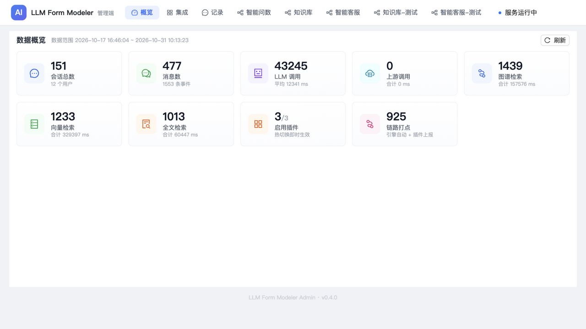
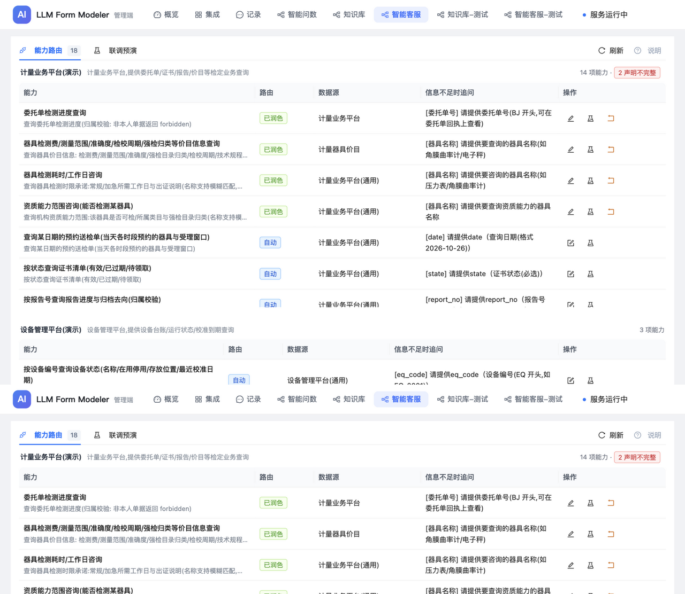
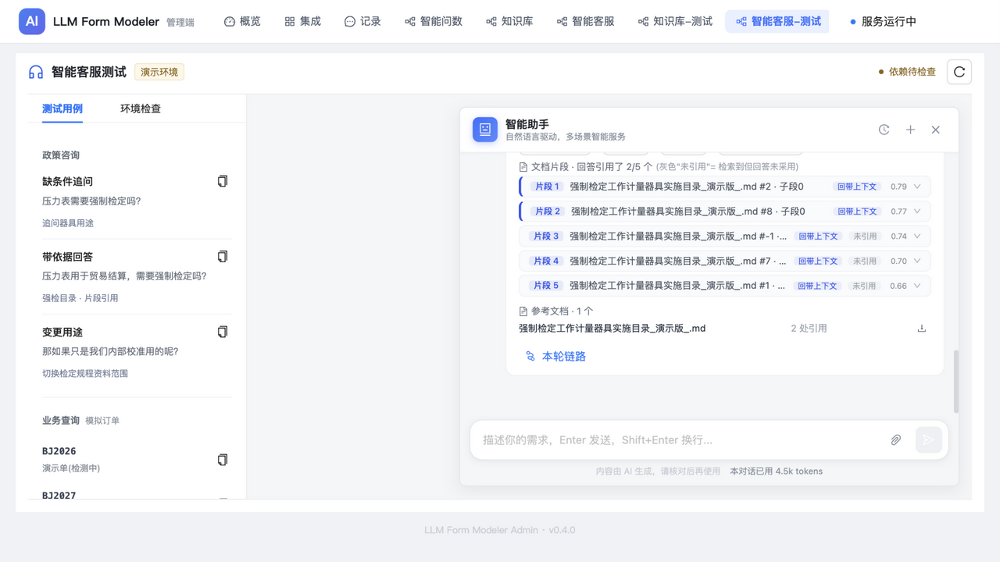
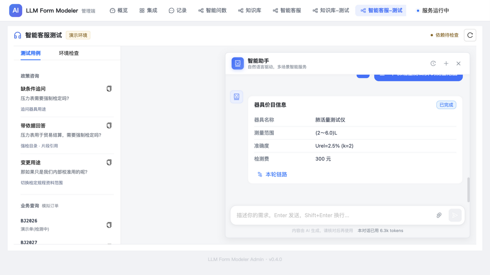
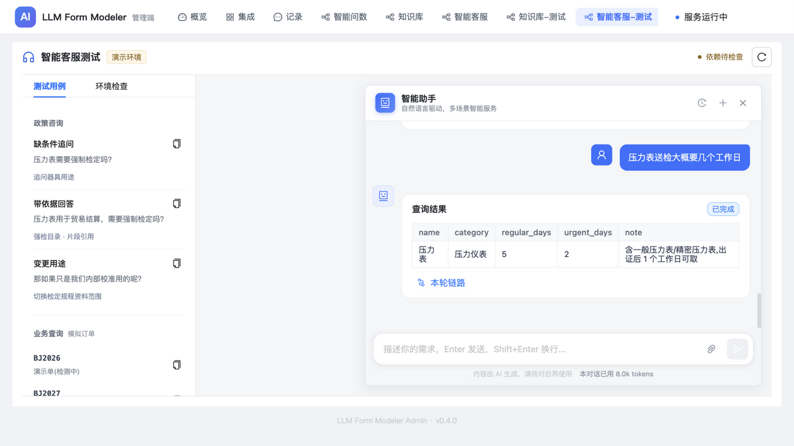
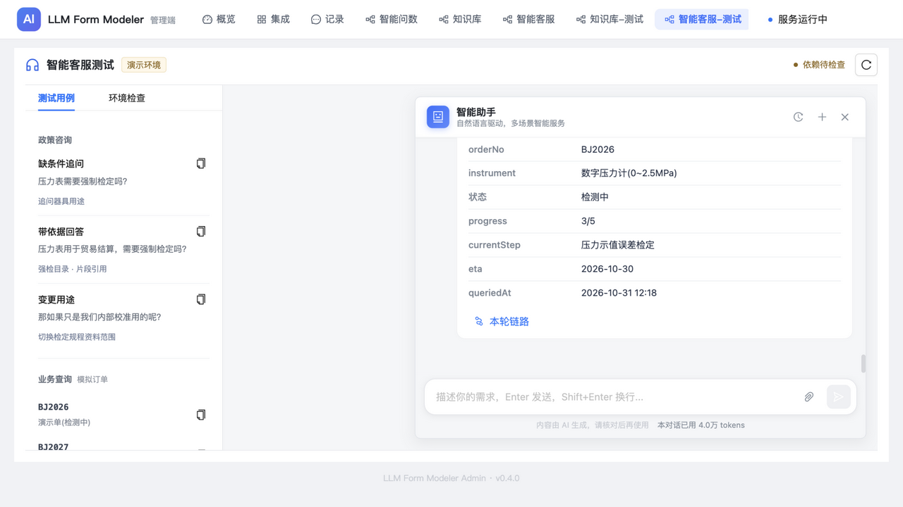
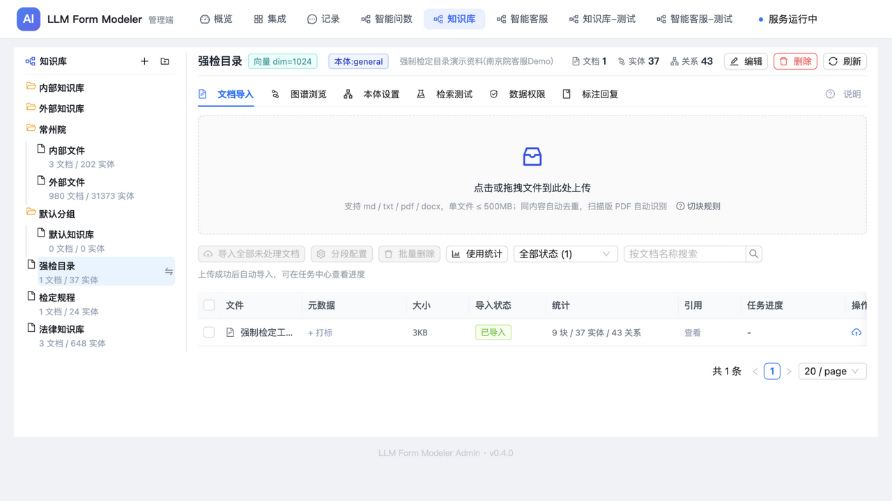

# LLM Form Modeler

**LLM 驱动的多插件智能助手引擎** — 通过 LangGraph StateGraph 编排意图识别、工具执行与追问恢复，支持自然语言驱动多种业务能力（表单配置、请假申请、知识图谱检索问答等），Engine 层零领域知识。

> 📖 **新入手必读**：[doc/README.md](doc/README.md) —— 全项目文档总目录（书的目录指南）。
> `AGENTS.md` —— AI agent / 开发者操作手册入口（规约/测试/发布/部署索引）。
> `doc/插件开发与嵌入指南.md` —— 系统全景 / 从零写一个插件（请假为例）/
> manifest 声明逐项 / 交互模式 / 嵌入契约协议（含完整消息往返举例）/ 增量修改协议 / FAQ。
> 进阶：`backend/src/domains/ARCHITECTURE.md` —— pack 全部钩子（工具/HTTP API/后台任务/
> 依赖门控/管理页）+ SDK 存储设施（图/向量/文档解析 + 命名空间隔离契约）。

## 界面一览

> 以下截图来自 99.22 演示环境线上实测（2026-10-31），更多见
> [doc/test-evidence/](doc/test-evidence/) 归档报告。

**管理端概览** —— 会话/调用/检索大盘，插件启停热切换：



**智能客服 · 能力路由** —— MCP 工具声明自动接入 + 人工润色，18 项能力按服务分组：



**知识问答 · 强检判定** —— 缺条件先追问，结论带知识库片段引用与引用实体：



**业务查询 · 器具价目** —— "查一下肺活量测试仪的测量范围"直达 MCP 业务平台，结构化结果卡：



**业务查询 · 检测时限 / 委托单进度** —— 检测工作日承诺与进度三态（正常/拒权/查无）：





**知识库管理** —— 库树/文档导入/图谱浏览/检索测试/数据权限，任务中心断点续跑：



## 技术栈

| 层 | 技术 |
|----|------|
| 前端 | Vue 3 + TypeScript + Vite + Ant Design Vue + Pinia + AntV G6（图谱可视化） |
| 后端 | Python 3.12 + FastAPI + LangGraph StateGraph |
| LLM | OpenAI 兼容接口（Qwen3 / GPT / 任意兼容模型；embedding 同协议） |
| 存储 | PostgreSQL（对话/审计/任务/checkpoint + 向量 pgvector，必填）+ Neo4j（图谱，可选） |
| 上游 | AssetClient 抽象（HTTP 适配；地址请求级解析：宿主 services 表按请求下发） |

---

## 一、核心架构：三层六边形

```
┌─────────────────────────────────────────────────────────────────────┐
│                         前端 (Vue 3)                                │
│                                                                     │
│   独立模式 (三栏布局)          嵌入模式 (IM 聊天窗 + SDK)            │
│   StandaloneLayout             EmbeddedLayout + embed.js            │
└───────────────────────────────┬─────────────────────────────────────┘
                                │ HTTP / SSE
                                ▼
┌─────────────────────────────────────────────────────────────────────┐
│            Python 后端 (FastAPI;dev :18080 / 容器内 nginx 反代)      │
│                                                                     │
│  ┌──────────────────────────────────────────────────────────────┐   │
│  │  API 层 (api/)                                               │   │
│  │  /api/config/chat  /api/conversations  /health             │   │
│  └──────────────────────────┬───────────────────────────────────┘   │
│                              │                                       │
│  ┌──────────────────────────▼───────────────────────────────────┐   │
│  │  ★ Engine 层 (engine/) — 零领域知识                          │   │
│  │                                                              │   │
│  │  ┌────────────────────────────────────────────────────────┐  │   │
│  │  │  LangGraph StateGraph                                  │  │   │
│  │  │                                                        │  │   │
│  │  │  classify_intent ──→ route_by_tool ──→ execute_tool    │  │   │
│  │  │        │                                  │            │  │   │
│  │  │        │                            interrupt?         │  │   │
│  │  │        │                           ↙        ↘          │  │   │
│  │  │        │                     挂起追问    正常完成       │  │   │
│  │  │        │                        │           │          │  │   │
│  │  │        │                   Command(resume)  │          │  │   │
│  │  │        │                        │           ▼          │  │   │
│  │  │        │                        └──→ execute_tool      │  │   │
│  │  │        │                             (重跑工具)         │  │   │
│  │  │        │                                  │            │  │   │
│  │  │        │                                  ▼            │  │   │
│  │  │        └──────────────────────→ handle_result ──→ END  │  │   │
│  │  │                                                        │  │   │
│  │  │  Checkpoint: PostgresSaver (thread_id = conv_id)     │  │   │
│  │  └────────────────────────────────────────────────────────┘  │   │
│  │                                                              │   │
│  │  辅助模块:                                                   │   │
│  │  ├── stream.py      graph.stream → SSE 桥接 (实时 chunk)    │   │
│  │  ├── conversation.py 多轮对话管理 (append-only 事件流)      │   │
│  │  ├── compression.py  上下文压缩 (70% 阈值 + 熔断器)         │   │
│  │  ├── prompt_loader.py Jinja2 模板加载 (缓存 + 覆写/追加)    │   │
│  │  ├── log_config.py   日志配置 (loguru: 控制台 + 轮转文件)   │   │
│  │  └── logging_filter.py 日志脱敏过滤器                       │   │
│  └──────────────────────────┬───────────────────────────────────┘   │
│                              │                                       │
│  ┌──────────────────────────▼───────────────────────────────────┐   │
│  │  ★ SDK 层 (sdk/) — 协议定义 + 通用存储设施                   │   │
│  │                                                              │   │
│  │  ├── tool.py        Tool / CompositeTool / ToolResult        │   │
│  │  │                  ToolContext / AskSpec / AskQuestion       │   │
│  │  ├── registry.py    ToolRegistry (自动发现 + 注册)           │   │
│  │  ├── pack_router.py PackRouter 协议 (一级/二级路由)          │   │
│  │  ├── pack_api.py    插件 HTTP API 鉴权/身份辅助              │   │
│  │  ├── asset_client.py AssetClient ABC (submit/query)          │   │
│  │  ├── sanitize.py    Unicode 隐写清洗                         │   │
│  │  ├── llm_compat.py  LLM 响应形状归一(自插件上提 SDK)         │   │
│  │  ├── observability.py 观测常量+log_pack_call 通用打点        │   │
│  │  │                                                            │   │
│  │  ├── scope_registry.py  ★ 存储命名空间隔离(前缀登记+scope签发)│   │
│  │  ├── graph_store.py     ★ Neo4j 图存储(GraphStore Protocol)  │   │
│  │  ├── vector_store.py    ★ 向量存储工厂(VectorStore Protocol)│   │
│  │  └── doc_parser.py      ★ md/txt/pdf/docx 解析+切块          │   │
│  └──────────────────────────┬───────────────────────────────────┘   │
│                              │                                       │
│  ┌──────────────────────────▼───────────────────────────────────┐   │
│  │  ★ Domain Packs (domains/) — 领域知识全部在此                │   │
│  │                                                              │   │
│  │  ┌─────────────────────┐                                    │   │
│  │  │ njmind_form         │                                    │   │
│  │  │                     │                                    │   │
│  │  │ tools/              │                                    │   │
│  │  │  create_form (6步)  │                                    │   │
│  │  │  modify_form (3步)  │                                    │   │
│  │  │  get_form (1步)     │                                    │   │
│  │  │  clone_form (3步)   │                                    │   │
│  │  │  image_form (3步)   │                                    │   │
│  │  │  chat (兜底)        │                                    │   │
│  │  │                     │                                    │   │
│  │  │ prompts/            │                                    │   │
│  │  │  chat.j2  parse.j2  │                                    │   │
│  │  │  generate.j2  ...   │                                    │   │
│  │  │                     │                                    │   │
│  │  │ config.yaml         │                                    │   │
│  │  └─────────────────────┘                                    │   │
│  │                                                              │   │
│  │  ┌──────────────────────────────┐                            │   │
│  │  │ 新插件只需:                   │                            │   │
│  │  │ 1. 创建 domains/xxx/ 目录     │                            │   │
│  │  │ 2. 实现 pack.py              │                            │   │
│  │  │ 3. 定义 Tool 子类             │                            │   │
│  │  │ → 自动发现, 零配置上线        │                            │   │
│  │  └──────────────────────────────┘                            │   │
│  └──────────────────────────────────────────────────────────────┘   │
│                              │                                       │
│  ┌──────────────────────────▼───────────────────────────────────┐   │
│  │  Adapters (adapters/)                                        │   │
│  │  HttpAssetClient — HTTP 上游适配（地址:宿主 services 表          │   │
│  │  按请求下发;详见 resolve_base 请求级解析）                    │   │
│  └──────────────────────────────────────────────────────────────┘   │
└─────────────────────────────────────────────────────────────────────┘
         │                    │
         ▼                    ▼
┌────────────────┐   ┌─────────────────────┐
│ 上游业务 API   │   │ LLM 推理服务         │
│ (地址请求级解析:│   │ (OpenAI 兼容接口)    │
│  宿主services表│   │ glm / Qwen / ...     │
│  按请求下发)   │   └─────────────────────┘
│  提交/查询数据)│
└────────────────┘
```

### 架构试金石

```bash
# Engine 层不能包含任何领域知识(领域标识/插件名零出现)
grep -rE "formCode|leaveType|请假|kb_id|chatbi|njmind" backend/src/engine/
# → 必须返回空
# SDK 层零领域知识(存储设施不认识 LLM/本体/知识库)
grep -rn "kg_" backend/src/sdk/graph_store.py backend/src/sdk/vector_store.py
# → 仅注释命中(存量数据兼容说明)
```

---

## 二、LangGraph StateGraph 核心流程

### 2.1 图结构

```python
START → classify_intent (LLM 选工具, 从 registry 动态生成 prompt)
  │
  ├─ route_by_tool ──→ execute_tool (执行工具, 支持 interrupt)
  │                         │
  │                    ToolResult.ask?
  │                    ├─ 是 → interrupt() 挂起 → SSE needsClarification
  │                    │       前端发 answers → Command(resume=answers)
  │                    │       → execute_tool 重跑 (带 clarify_answers)
  │                    └─ 否 → handle_result → END
  │
  └─ route_after_result ──→ rerun (追问恢复后重跑) / done (结束)
```

### 2.2 路由范围与意图确认

- 请求声明 `packs` 时,插件选择、工具选择、兜底与最终执行均受该范围约束；
  声明的插件全部不可用时返回错误,不扩大到全局插件。
- 工具归属在插件装配时登记。插件路由只能返回本插件工具；执行与断点恢复
  再次校验归属,不以模型输出或用户确认替代范围校验。
- 工具兜底只采用插件明确声明的 `domain.fallback_tool`,不取全局首个工具。
  无匹配直接说明当前范围无法处理；合法候选低置信度才请求确认,展示处理方向。
  确认仅对当前轮有效,且只接受明确同意。
- 知识库插件直接进入 `kb_search`,问题理解由知识检索管线负责；向量检索不变。
- 首次回答、追问恢复和继续生成统一消费结果信封,数据制品与引用卡一致保留。

### 2.3 追问恢复机制 (LangGraph 原生 interrupt)

```
用户: "帮我创建一个请假申请表"
  │
  ▼
classify_intent → 选中 create_form
  │
  ▼
execute_tool → CreateFormTool.execute()
  │
  ├─ _step_parse_fields: LLM 提取字段 → 部分字段不明确
  │  → 关键信息缺失 → 设置 _need_clarify 标记
  │
  ├─ ToolResult(ask=AskSpec(...))
  │
  └─ interrupt({questions, summary}) → 图挂起
     │
     ▼
  SSE → 前端渲染追问卡片
     │
     用户回答: {请假类型: "年假/事假/病假", 日期范围: "开始-结束"}
     │
     ▼
  Command(resume=answers) → 图从断点恢复
     │
     ├─ interrupt() 返回 answers
     ├─ 注入 tool_state["clarify_answers"]
     ├─ 清除 _need_clarify / _clarify_spec 标记
     └─ 重跑 execute_tool
           │
           ├─ _step_parse_fields: LLM 提取 → 字段完整 ✓
           ├─ _step_fetch_templates: 获取字段模板 ✓
           ├─ _step_generate: LLM 生成完整配置 ✓
           ├─ _step_validate: 上游 API 校验 ✓
           └─ ToolResult(artifact=form_config) → handle_result → END
```

### 2.4 GraphState 定义

```python
class GraphState(TypedDict, total=False):
    # 输入
    user_input: str
    conversation_history: list[dict]
    compressed_history: str
    conversation_id: str
    forward_headers: dict          # 嵌入模式透传的请求头
    context_artifact: dict | None  # 上下文制品 (pack 判断画布状态 + modify 增量基线)

    # 意图识别 (两级路由产出)
    tool_name: str                 # 选中的工具名 (pack 二级路由决定)
    intent_reason: str             # 路由理由 (含 pack 信息, 可观测)

    # 工具执行
    tool_state: dict               # 工具内部 state (透传, Engine 不读)
    tool_result: dict | None       # 工具执行结果

    # 追问 (LangGraph interrupt)
    pending_questions: list[dict]
    clarify_answers: dict          # resume 值

    # SSE 事件收集
    sse_events: list[dict]
```

---

## 三、插件系统

### 3.1 自动发现机制

```
domains/
├── njmind_form/          ← 表单配置插件
│   ├── pack.py           ← create_registry() 注册工具
│   ├── models.py         ← ParsedField 等数据模型
│   ├── tools/
│   │   ├── create_form.py   (CompositeTool, 6步管线)
│   │   ├── modify_form.py   (CompositeTool, 3步管线)
│   │   ├── get_form.py      (Tool, 查询已有表单)
│   │   ├── clone_form.py    (Tool, 复制表单)
│   │   ├── image_form.py    (Tool, 图片识别→表单)
│   │   └── chat.py          (Tool, 兜底闲聊)
│   └── prompts/
│       ├── chat.j2
│       ├── parse.j2
│       ├── generate.j2
│       └── ...
│
├── leave_application/    ← 请假申请插件(演示域)
│
├── knowledge_graph/      ← 知识图谱插件(全能力形态示例)
│   ├── pack.py           ← 四钩子齐备: create_registry + create_api_router
│   │                        + register_tasks + unload
│   ├── config.yaml       ← manifest: 依赖声明(neo4j/pg_vector)+管理页+设置页
│   ├── settings.schema.yaml ← 声明式设置页 schema(管理端自动渲染)
│   ├── api.py            ← 插件自有 HTTP API(挂 /api/packs/knowledge_graph)
│   ├── tasks.py          ← 后台任务: 导入流水线(断点续跑/熔断/进度心跳)
│   ├── store.py          ← 领域元数据(kg_ 三表, PG)
│   ├── stores.py         ← SDK 存储适配层(前缀登记+工厂单例)
│   ├── retrieval.py      ← 混合检索问答(图谱+向量+全文兜底三路)
│   ├── probes.py         ← 领域专属探针(neo4j;pg_vector 探针平台内置,实现下沉 SDK)
│   └── tools/kb_search.py
│
├── chatbi/               ← 智能问数插件(NL2SQL+图表,全能力形态)
│   ├── tools/            ← ask_data(8步管线) / switch_chart
│   ├── api.py / tasks.py / config.yaml / settings.schema.yaml
│   └── schema_graph / semantic / retrieval / memory / feedback / hybrid …
│
├── njmind_bpm/           ← 流程/审批流配置插件(generate_process)
├── njmind_list/          ← 列表页配置插件(generate_list)
│
└── (新插件只需创建目录 + pack.py + tools/ → 自动发现, 零配置上线)
```

**pack.py 可选钩子**（全部由平台在装配/卸载期调用）:

| 钩子 | 必须 | 作用 |
|------|------|------|
| `create_registry()` | ✓ | 返回本插件 ToolRegistry |
| `create_api_router()` | 可选 | 插件自有 HTTP API,挂 `/api/packs/{name}` 前缀,启停随插件热挂卸 |
| `register_tasks(mgr, app_state)` | 可选 | 注册后台任务 handler(任务中心可见/可取消) |
| `unload()` | 可选 | 释放连接/注销前缀等清理 |

manifest（config.yaml）还可声明: `dependencies`(基础设施依赖+探针,未配置 fail-closed 不可启用)、`admin.settings`(声明式设置页)、`admin.page`(自定义管理页组件)。

### 3.2 Tool 协议

```python
class Tool(ABC):
    name: str                    # 工具名 (LLM 选择时看到)
    description: str             # 工具说明
    when: str                    # "何时用" 描述

    # 语义自检 (Engine 在 execute 前调用, 失败则跳过 execute 回流给 LLM)
    def validate_input(self, state: dict) -> str | None

    def execute(self, state: dict, ctx: ToolContext) -> ToolResult

    # 钩子方法 (Engine 通过钩子操作制品, 不直接读内部结构)
    def format_result(self, artifact: dict) -> dict     # SSE 前端字段
    def summarize_artifact(self, artifact: dict) -> str # 压缩器状态补偿
    def title_for(self, artifact: dict) -> str          # 对话列表标题

class CompositeTool(Tool):
    steps: list[str] = []        # 管线步骤名
    pipeline_steps: list[dict]   # 前端展示用

    def run_pipeline(self, state, ctx):
        for step in self.steps:
            if state.get("_need_clarify"): break
            getattr(self, f"_step_{step}")(state, ctx)
```

### 3.3 ToolResult 三态

```python
class ToolResult:
    artifact: dict | None        # 制品 (config/data)
    artifact_type: str           # "config" | "data"
    reply: str | None            # 闲聊回复
    ask: AskSpec | None          # 追问 (非空 → interrupt)
    summary: str                 # 摘要 (进对话历史)
    error_for_llm: str | None    # 错误 (回流给 LLM)
    extra: dict                  # 扩展数据
```

### 3.4 动态能力上报

ChatTool（兜底工具）通过 `ctx.registry` 动态查询所有已注册工具的能力描述，生成系统 prompt：

```python
def _build_capabilities(self, ctx):
    caps = []
    for tool in ctx.registry.all():
        if tool.name != self.name:
            caps.append(f"- {tool.name}: {tool.when}")
    return "\n".join(caps)
```

**新增插件后，ChatTool 的能力描述自动更新，无需修改 Engine 或 ChatTool 代码。**

---

### 3.5 通用后台任务框架（任务中心）

插件经 `register_tasks(mgr)` 注册 handler 后即可 `mgr.submit(...)` 提交后台任务:

- **queue_key 串行**:同 key 任务 FIFO 串行（如 `queue_key=kb_id` → 同库导入不并发写图）
- **生命周期**:pending → running → succeeded/failed/cancelled;协作式取消（handler 周期检查 `cancelled`）
- **可观测**:进度/消息推送（`handle.set_progress/log`）、请求级结构化日志（对齐 call_logs 粒度）、SSE 事件流（`GET /api/tasks/{id}/events`）、管理端任务中心实时视图（结构化日志分组/逐块进度条/活点心跳）
- **持久化**:任务与日志落 PG,重启后可查历史

---

## 四、当前插件能力

### 4.1 njmind_form — 表单配置

| 工具 | 类型 | 管线 | 说明 |
|------|------|------|------|
| create_form | CompositeTool | 6步 | 自然语言 → 完整表单配置 |
| modify_form | CompositeTool | 3步·两相式 | 自然语言修改已有配置（增量指令集为主，全量重生成兜底） |
| get_form | Tool | - | 根据 formCode 查询已有表单 |
| clone_form | Tool | - | 复制已有表单并修改标识 |
| image_form | Tool | - | 图片识别 → 表单配置 (多模态) |
| chat | Tool | - | 兜底闲聊 + 动态能力描述 |

**CREATE 管线 (6步)：**
```
fetch_guide → list_assets → parse_fields(LLM) → fetch_templates → generate(LLM) → validate
```

**MODIFY 管线 (3步，modify 步两相式)：**
```
fetch_guide → modify → validate（差分校验）
                ├─ 增量主路径（默认，~4s）：
                │    build_catalog(字段目录~1KB) → plan_ops(LLM 只输出指令集)
                │    → apply_ops(纯代码确定性合并) → postprocess
                │    锚点失败带清单重试≤2次
                └─ 全量兜底（升格后本会话锁定）：LLM 吃/吐完整配置（~33s）
                     触发：LLM 主动 full_rewrite / 指令重试超限 / 输出不可解析
```
前端进度条四节点（获取指南/规划指令/应用修改/校验结果）由
`pipeline_steps` 声明动态下发，未提及字段经 `restore_untouched`
从基线逐字节还原（改 A 不动 B）。

### 4.2 leave_application — 请假申请 (示例插件)

> 注：此插件已注册并随 pack 自动发现加载（作为多 pack 一级路由的演示域——"帮我查请假审批"会路由到它）。

| 工具 | 类型 | 管线 | 说明 |
|------|------|------|------|
| submit_leave | CompositeTool | 3步 | 提交请假申请 (支持追问) |
| query_status | Tool | - | 查询审批状态 |

**SUBMIT 管线 (3步)：**
```
parse_info(LLM) → validate_rules(API) → submit(API)
```

**关键设计：信息不足时通过 `ToolResult.ask` + `AskSpec` 声明式追问，不填默认值。**

### 4.3 knowledge_graph — 知识图谱 + 向量检索（全能力插件）

自然语言驱动的知识库：上传文档 → LLM 抽取实体/关系入 Neo4j、切块向量化入 PG(pgvector) →
对话里"查一下知识库里""张伟向谁汇报"直接命中（`kb_search` 工具），答案带三元组证据
与原文引用。

| 组成 | 说明 |
|------|------|
| 导入流水线（后台任务） | 解析→切块→批内并行 LLM 抽取→本体约束→图+向量双写;**断点续跑**（块级 checkpoint,done = 已入图）、连续失败熔断、进度心跳（批次 N/M + 已抽取 X/Y 块,日志带文档级 total/done）;收尾生成**摘要块**（D14:LLM 概括首尾节选 200 字,seq=-1 入索引——"劳动法主要讲什么"式抽象问法零召回兜底,重导幂等,失败降级不阻断） |
| 实体消歧（别名合并） | 同一人物跨块不同写法（张小凡/鬼厉）不再裂成多节点:抽取词表播种既有实体+别名,收尾按"别名指认+类型一致"合并碎片（机制详见 `ARCHITECTURE.md`「长文档导入」;大库名录先类型分桶+编辑距离预筛,仅可疑对送 LLM）。零猜测:正文没指认的永不并。诛仙实测 563 实体收敛至 397 |
| 长文档导入 | 全局 LLM 限速（RPM/TPM 双令牌桶 + 429 全局退避）;`extraction_model` 设置可单独给导入换更快的模型（对话/检索链路不受影响）;失败自动续跑（非欠费/鉴权/永久性校验错误,5 分钟退避,**预算跨续跑链封顶**,重启不再卡 retry_scheduled 中间态）;滑窗 ETA 预估 |
| 混合检索问答 | 意图解析→图谱子图 + 向量双路召回→LLM 组织答案（带证据链）;**父子回带**（Dify 对标:向量子段命中后回带所属整章前后各 ~2000 字上下文窗口,句读对齐,单块 5000 字/总预算 24000 字护栏;父块缺失/定位失败降级子段原文不静默丢内容;检索测试页与对话引用面板均标注回带明细）;**奇偶重排**（D15:融合/rerank 后按 score 降序,前半高分占头部偶数位、后半反向占奇数位——lost-in-middle 缓解,纯顺序变换默认开,编号权威源自动对齐）;**图谱零命中（别名/错别字/部分匹配）时全文兜底**（kg_chunks tsvector+GIN,2-gram 分词,`fulltext_fallback_enabled` 默认开）,兜底命中标 `source='fulltext'`;embedding 未配置时自动降级纯图谱。**升级注意**:首次启动建全文索引对存量 kg_chunks 全表重写（一次性,迁移已放开 600s 超时）,期间 kg_chunks 短暂锁表;存量文档的全文索引按旧文本计算——**重点 PDF 建议重导入**以吃到 NFKC 归一化+全文索引完整收益 |
| 块命中统计（D29） | 回答中被引用的块（`[片段:N]` 解析,子块归父块）`hit_count`+1,管理端块明细"N 次引用"列——"哪些知识真被用"的治理数据;统计失败静默不拖垮检索 |
| 检索可观测 | 三路库调用入 `call_logs`（graph/vector/fulltext 类型）:逐词种子命中、子图召回量+三元组明细+截断水位、向量逐条相似度分数、全文兜底命中明细——会话链路与调用日志页均可查 |
| 插件 HTTP API | `/api/packs/knowledge_graph/*`:知识库树 CRUD/文档上传/导入/图谱查询/增量展开/检索问答/检索测试/建库向导（分段配置+实时预览,预览与导入同一条切块代码路径）/块编辑（改文本仅重嵌该块向量）/分段重配;`GET /dependency-status` 返回 Neo4j/向量库探针结果（设置页重检用） |
| 检索数据权限（嵌入模式） | 每库可配置允许检索的**用户/角色**（管理端「数据权限」页签或 `PUT /kbs/{id}/acl`）;不配置=全开放。生效条件:宿主传入用户身份（`X-User-Id`）或角色（chat 走 `pack_params.knowledge_graph.user_roles` 透传,REST `/search` 走 body `roles`）才过滤,未传不过滤;显式指定无权库=403/诚实拒绝,跨库自动过滤。管理端各页不受限。 |
| 管理页 | 管理端动态 Tab,左右分栏:左侧库树（文件夹/子库层级,建/移/删）+ 右侧详情四子页——文档导入 / G6 图谱浏览（单击详情/双击展开邻居/悬停高亮一阶邻域）/ 本体设置（模板起步/LLM 归纳/类型审核）/ 检索测试（意图/种子命中/子图水位/向量分数可视化） |
| 依赖门控 | manifest 声明 neo4j/pg_vector 依赖与探针;未配置 → 插件中心"依赖未配置"不可启用,补配后热加载 |

**SDK 存储下沉**：图/向量/文档解析能力已下沉 `sdk/`（`graph_store` / `vector_store` /
`doc_parser` / `scope_registry`）,带命名空间隔离契约（前缀登记 fail-fast + scope_id
服务端签发）。ChatBI 已照此接入（`chatbi` 前缀）,后续插件（RAG、记忆库…）三行代码
接入全套隔离存储设施,
详见 `backend/src/domains/ARCHITECTURE.md`「SDK 存储设施」。

### 4.4 chatbi — 智能问数（NL2SQL + 图表，全能力插件）

自然语言查业务库：数据源管理 → 语义层/图谱检索（向量+关键词 RRF 混合）→ SQL
生成/自愈/三层校验 → 执行 → 图表卡（数据来源折叠区含表 schema 卡/JOIN 路径/执行
SQL,与引用编号构成可信度双件套）。移植自独立 chat-bi 平台，领域能力全量保留
（语义层版本/记忆/反馈闭环/Skills/多轮/澄清）。

| 组成 | 说明 |
|------|------|
| 主工具 | `ask_data`（8 步管线）/ `switch_chart`（换图表类型） |
| 插件 HTTP API | `/api/packs/chatbi/*`：数据源 CRUD/扫描/语义层版本/图谱浏览/记忆/指标/健康面板;`POST /datasources/{id}/rebuild-index`（强制重建向量索引,异步任务）;`POST /feedback`（对话卡点赞/点踩 → 表/关系置信度微调,开关默认关） |
| 后台任务 | scan_datasource / refresh_semantics / memory.consolidate / rebuild_index |
| 管理页 | 管理端动态 Tab：数据源管理/语义层/图谱浏览 |
| 依赖门控 | pg_vector 可选（未配置降级全表清单,对标原系统 SEC-005） |

### 4.5 njmind_bpm / njmind_list — 流程与列表配置

BPM 审批流配置（`generate_process`）与列表页配置（`generate_list`）两个插件,
上游走 njmind-modeler Java 侧纯计算端点（parse/render 零持久化,落库走 designer
原保存流程）。

---

## 五、SSE 实时进度

```
后端 (graph.stream)                    前端
┌──────────────┐
│ classify_    │──stage("正在理解您的意图...")──→  🔄 正在理解...
│ intent       │                                      │
└──────┬───────┘                                      ▼
       ▼                                        ┌──────────┐
┌──────────────┐                                 │ 进度条   │
│ execute_tool │──pipeline_definition──→         │ 动画     │
│              │  [{step: "解析字段"}, ...]       │          │
│  _step_      │──stage("解析中...")──→          │ ✓ 解析   │
│  parse_fields│                                  │ ○ 生成   │
│              │──stage("生成中...")──→          │ ○ 校验   │
│  _step_      │                                  └──────────┘
│  generate    │──stage("校验中...")──→
│              │
│  _step_      │──stage("校验通过 ✓")──→
│  validate    │
│              │──result({artifactType, data})──→  📋 数据卡片
│  submit      │                                    或
│              │──done()──→                       📝 配置 JSON
└──────────────┘
```

**实现要点：**
- `graph.stream()` 是同步 API，在线程池中执行
- 每个 chunk 通过 `loop.call_soon_threadsafe()` 实时推 SSE（不等全部完成）
- interrupt 时检查 `graph.get_state()` 获取中断数据
- 传输保障：后端 15s `: ping` 心跳；响应头 `Cache-Control: no-cache, no-transform`
  （no-transform 禁止中间代理压缩——rsbuild 等 dev server 的 gzip 中间件会把
  event-stream 攒到流结束才吐，表现为前端一直无响应）；前端 60s 空闲看门狗断流报错

---

## 六、嵌入主系统

### 方式 A：SDK 嵌入（推荐）

```html
<!-- 部署后入口 = HOST_PORT(默认 19090);本地 dev 为 vite :13080 -->
<script src="http://你的部署:19090/ai-modeler/embed.js"></script>
<script>
  const assistant = new LLMFormModeler({
    baseUrl: 'http://你的部署:19090',
    userId: 'zhangsan',
    position: 'bottom-right',
    onConfigGenerated: (config) => { /* ... */ },
    onConfigApply: (config) => { /* 写入主系统设计器 */ },
  })
</script>
```

### 方式 B：iframe 嵌入

```html
<iframe
  src="http://你的部署:19090/ai-modeler/?embed=true"
  style="width: 400px; height: 600px; border: none;"
></iframe>
```

### 生产形态：嵌入契约协议（mind-designer 已接入）

designer（field-edit 页右下角悬浮球）走**信封协议**：
`READY / INIT / GET_CONTEXT / APPLY / AUTH_UPDATE / GET_AUTH / CLOSE / RESIZE`，
带 requestId 关联与 capabilities 能力协商，配置读写走宿主前端、渲染画布不落库。
完整协议规范见 **`doc/嵌入模式总体设计.md`**。下方 SDK / iframe 为独立演示形态。

### 请求头透传

嵌入模式下，主系统的请求头会自动透传到后端（用于上游 API 鉴权等）：

```
主系统 → 前端 (iframe/SDK) → 后端 → AssetClient → 上游 API
         (X-User-Id, X-Tenant-Id, Authorization 等全部透传)
```

---

## 七、快速开始

### 环境要求

- Python 3.12+
- Node.js 20+

### 配置

编辑 `.env`（完整示例见 `.env.example`）：

```env
# ── LLM 推理服务 (必填;OpenAI 兼容接口) ──
LLM_BASE_URL=https://dashscope.aliyuncs.com/compatible-mode/v1
LLM_API_KEY=sk-xxxx
LLM_MODEL=qwen-max
LLM_MAX_TOKENS=4096

# ── Docker 部署(compose 变量;本地裸机开发不需要)──
HOST_PORT=19090                # 应用入口 http://IP:19090/ai-modeler/
NEO4J_PASSWORD=change-me       # compose 内 Neo4j 密码(必填)
APP_MEM_LIMIT=8g               # 应用容器内存护栏

# ── 知识图谱插件（可选；不配则插件中心显示"依赖未配置"不可启用）──
NEO4J_URI=bolt://localhost:7687
NEO4J_USER=neo4j
NEO4J_PASSWORD=your-password
# ── 向量存储（pgvector 单后端;Milvus 已下线移除）──
# VECTOR_BACKEND=pg        # 默认且唯一。向量存 PostgreSQL(pgvector 扩展 + HNSW 余弦索引),
#                          # 走 DATABASE_URL 同库,建表时自动 CREATE EXTENSION vector
#                          # (目标 PG 需装 pgvector;无权限时报错并提示找 DBA 授权)。
#                          # 存量 .env 带 VECTOR_BACKEND=milvus 会在启动时 fail-fast 提示改 pg。
LLM_EMBED_MODEL=bge-m3              # 默认本地 ONNX(EMBEDDING_BACKEND=local,零 API 费用)
EMBEDDING_BACKEND=local              # local(默认)/api(云端 OpenAI 兼容 /v1/embeddings)

# ── 管理端口令（可选加固；不配=开放访问，公网部署必须配置）──
# ADMIN_TOKEN=

# ── 检索增强（可选；默认全关，管理端插件设置里也有开关）──
# RERANK_BASE_URL=              # 外置 rerank API(Cohere/Jina 协议 POST {base}/rerank)
# RERANK_MODEL=                 # rerank 模型名(两变量都配才生效)
# RERANK_API_KEY=
# RERANK_TIMEOUT=3              # 秒;超时降级原召回序不阻断
# EMBED_QUERY_PREFIX=0          # 1=查询向量加检索前缀(仅 bge-*-zh-v1.5 系模型需要;bge-m3 官方明确无需,勿开)
# EMBED_CACHE_MAX=4096          # 嵌入缓存 LRU 上限(默认开,TTL 24h,重复文本零出站)
# LLM_CACHE_ENABLED=0           # 1=chat 结果进程内缓存 24h(全同参数命中;对话场景慎开)
```

健康检查：根路径 `GET /health`（运维/K8s 探针）与 `GET /api/health`
（嵌入代理链别名，宿主探测 AI 服务是否部署用）双端点。

#### 上游地址请求级解析（重要）

上游地址**只来自宿主 services 表**：designer 握手后经 chat 请求下发
（如 `http://192.168.99.28:7114/codeBack`，经 designer 代理到网关），
按 pack 在 manifest 里声明的服务名（如 `njmind-modeler`）解析。
未下发的服务调用时抛 `ServiceUnresolvableError`（fail-closed，报错信息
指引排查方向）。

工具侧还有一层 `preflight` 前置校验（SDK 钩子，业务工具自己声明执行前提——
如 njmind_form 校验上游地址可解析），缺地址在进管线前就拦截，错误直达用户，
不烧 LLM/上游调用。

同一请求内所有上游调用（含缓存 key）绑定同一 base，不同环境不串缓存。
每轮请求实际采用的地址记录在会话链路的 `request_context` 打点中（管理端可查）。

### 启动

```bash
# 后端
cd backend
source venv/bin/activate
uvicorn src.main:app --reload --host 0.0.0.0 --port 18080

# 前端
cd frontend
npm install && npm run dev
```

### 访问（本地开发;生产为单容器 http://IP:HOST_PORT/ai-modeler/）

| 地址 | 说明 |
|------|------|
| http://localhost:13080/ai-modeler/ | 独立模式（三栏布局,vite dev server） |
| http://localhost:13080/ai-modeler/?embed=true | 嵌入模式（宿主 iframe） |
| http://localhost:13080/ai-modeler/embed-demo.html | 嵌入演示页（模拟主系统） |
| http://localhost:13080/ai-modeler/embed.js | 嵌入 SDK |
| http://localhost:18080/docs | API 文档（Swagger） |
| http://localhost:18080/health | 健康检查 |

---

## 八、API 一览

| 方法 | 路径 | 说明 |
|------|------|------|
| POST | `/api/config/chat` | **统一对话入口** (SSE 流式, 走 LangGraph) |
| GET | `/api/conversations` | 对话列表（按 userId；`?contextKey=x&latest=true` 恢复绑定会话） |
| GET | `/api/conversations/:id` | 对话详情（含消息历史） |
| POST | `/api/conversations` | 创建对话（可带 contextKey 绑定宿主实体） |
| DELETE | `/api/conversations/:id` | 删除对话 |
| POST | `/api/auth/token` | **统一认证**：口令换 24h token（白名单，无需 token） |
| GET | `/api/meta/packs` | pack manifest 声明（前端渲染 actions/展示字段/示例） |
| GET | `/health` `/api/health` | 健康检查（嵌入探测走 /api/health 同链路，`Cache-Control: no-store`） |
| GET/DELETE | `/api/admin/conversations` | **管理端**：全量会话分页/详情/删除（需 `X-Admin-Token`） |
| GET | `/api/admin/call-logs` | **管理端**：LLM/上游调用审计日志分页查询 |
| GET/POST | `/api/admin/packs`、`/api/admin/packs/:name/enable\|disable` | **管理端**：插件清单与启停（热生效） |
| GET/PUT | `/api/admin/packs/:name/settings` | **管理端**：插件设置读写（声明式设置页） |
| POST | `/api/admin/packs/:name/recheck` | **管理端**：依赖重新检测（补配后热加载，无需重启） |
| GET/PUT | `/api/admin/settings/display`、GET `/api/settings/display` | 平台显示设置（链路思考/检索结果显示开关;管理端写,对话页只读共读） |
| GET | `/api/admin/conversations/:id/trace` | **管理端**：会话链路追踪（事件流+调用日志统一时间线） |
| GET | `/api/admin/stats` | **管理端**：概览统计 |
| GET | `/api/tasks`、`/api/tasks/:id`、`/api/tasks/:id/logs` | **任务中心**：任务列表/详情/结构化日志 |
| POST | `/api/tasks/:id/cancel` | **任务中心**：取消运行中任务 |
| GET | `/api/tasks/:id/events` | **任务中心**：任务 SSE 实时事件流 |
| * | `/api/packs/{name}/*` | **插件自有 API**（如 `/api/packs/knowledge_graph/search`）,启停随插件热挂卸 |

**ChatRequest 格式：**

```json
{
  "message": "用户消息",
  "conversation_id": "conv_xxx",
  "answers": {"leaveType": "年假", "startDate": "2026-07-22"},
  "image_base64": "data:image/png;base64,..."
}
```

- `answers` 非空时走 `Command(resume=answers)` 追问恢复路径
- `image_base64` 非空时传入 `tool_state` 供 ImageFormTool 使用
- 请求头自动透传到上游（嵌入模式）

---

## 九、管理端（Admin Console）

运维/客服视角的独立页面：**`/ai-modeler/admin.html`**（与主聊天应用平行的 vite 多页入口，不经嵌入 SDK）。

### 访问与鉴权

- **默认(未配置 `ADMIN_TOKEN`):开放访问**——打开页面直接用,无口令(仅限内网;启动日志会打醒目警告)
- 配置 `ADMIN_TOKEN` 后:所有页面(index/admin/embed-demo)先经 `auth.html` 门禁页输入口令
  换取 24h token(`POST /api/auth/token`),之后全部 API 请求带 `Authorization: Bearer` 头;
  签名密钥随进程重启随机轮换——重启/重新部署后旧 token 全部失效,需重新登录;
  管理端兼容旧 `X-Admin-Token` 头(Bearer 优先)
- ⚠ 开放模式下,凡能访问本服务的客户端都可查看全部会话(含完整 prompt)/删除会话/切换插件——公网部署必须配置口令
- 普通会话接口上 `X-User-Id: admin` 的跨用户查看能力与管理端同模式(开放即放行,口令模式须带口令)

### 功能

| Tab | 能力 |
|-----|------|
| 概览 | 会话/用户/消息/事件计数、LLM 与上游调用量、平均耗时、插件启用数 |
| 会话 | 跨用户全量会话（分页/按用户/按标题/**按插件多选**过滤,含「其他」）、**链路追踪**（见下）、删除 |
| 调用日志 | `call_logs` 审计流水（LLM/上游/**图谱/向量/全文检索**），按会话/类型过滤，检索类型带召回量/匹配度列，抽屉查看请求/响应全文 |
| 任务中心 | 后台任务列表（状态/进度/耗时）、SSE 实时刷新、**结构化日志抽屉**（按事件阶段分组、逐块进度条、指标徽章、运行中活点心跳） |
| 插件 | 全部已发现 pack 的启停开关、依赖状态（探针实测）、声明式设置抽屉、**插件自定义管理页**（动态 Tab,如知识图谱的文档导入/图谱浏览/本体设置） |

### 会话链路追踪

会话列表点"查看"进入链路视图（`GET /api/admin/conversations/{id}/trace`）：全量事件流
与 LLM/上游调用日志按时间合并成统一时间线，**按轮分组**（每轮 = 一条用户消息到
下一条之前的全部活动），每轮聚合墙钟耗时 / LLM 次数与耗时 / 上游次数与耗时。

时间线覆盖的环节：

| 环节 | 来源 |
|------|------|
| 意图路由决策（选领域/选工具/是否兜底） | 引擎自动 trace 打点 + LLM 调用明细 |
| LLM 调用（**完整 prompt 与响应**、token 用量、耗时、环节标签 stage） | `call_logs`（按 conv_id 关联；`LLM_LOG_FULL=0` 可退回摘要模式） |
| 上游 API 调用（请求/响应全文、状态码、耗时） | `call_logs`（会话归属经线程上下文自动绑定，插件零改动） |
| **图谱/向量/全文检索**（种子词与逐词命中、子图召回量与三元组明细、向量逐条相似度分数、全文兜底命中明细;ChatBI 检索同入观测） | `call_logs`（call_type=graph/vector/fulltext,常量收敛 `sdk/observability.py`；检索摘要行直接可读，明细展开可查） |
| 工具执行（工具名、耗时、ok/ask/error 结论） | 引擎自动 trace 打点 |
| 插件内部业务步骤 | pack 调 `ctx.trace()` 写入（见插件指南 §2.2） |
| 后台任务（导入流水线批次/块级明细） | 任务日志（请求级结构化，任务中心抽屉查看） |
| 历史压缩（压缩点/轨迹/压缩 LLM 调用） | compacted/compact_trace 事件 + call_logs |
| 快照 / 追问现场 | checkpoint / ask 事件 |


### 插件热启停

- 部署契约是**单实例、单 Uvicorn worker**；当前不支持多副本或多 worker 热切换
- 开关**热生效**：禁用的插件立即从工具注册表、`/api/meta/packs`、宿主插件列表中消失，无需重启服务（实现见 `src/services/pack_manager.py`——重新 `nodes.configure` 注入 + 替换 `app.state` 引用，graph 拓扑不变不重建）
- 状态持久化在 `PACK_STATE_PATH`（默认 `data/pack_state.json`，随部署卷持久化），重启后保持
- `PACKS_ENABLED` env 是**部署上限**：配置后无论状态文件内容如何，名单外的插件一律不启用、不装配、管理面不显示；名单内由管理端自由启停（热切换）。未配置 = 不设限（基础集合取 状态文件 > 全部发现，管理端切换过就以状态文件为准）
- 所有插件默认都是可选的，包含 ChatBI；单个插件加载或健康异常不会阻断其它插件。插件可用 `runtime_contract` 声明自身必须完整具备的工具/API/任务，缺件时整包隔离而非留下半个插件；只有部署方显式设置 `PACKS_CRITICAL=pack_a,pack_b` 时，名单内且当前启用的插件才采用整次装配 fail-fast
- 保护：不允许禁用最后一个启用的插件（引擎会无工具可用）

### 鉴权边界（重要）

- `ADMIN_TOKEN` 未配置 → 开放模式（无口令直接访问,启动日志有醒目警告）；配置后校验失败 → 401
- 普通会话接口上 `X-User-Id: admin` 的跨用户查看能力，同样要求携带合法管理口令——只报 admin 用户名没有口令时，"admin" 就是一个普通用户，只能看自己的会话

---


## 十、目录结构

```
llm-to-modler/
├── backend/
│   └── src/
│       ├── main.py                # FastAPI 入口, 构建 Graph
│       │
│       ├── engine/                # ★ Engine 层 (零领域知识)
│       │   ├── graph.py           # StateGraph 构建 + compile
│       │   ├── graph_state.py     # GraphState TypedDict
│       │   ├── nodes.py           # 节点函数 (classify/execute/handle)
│       │   ├── stream.py           # graph.stream → SSE 桥接
│       │   ├── sse.py             # SSE 事件格式 + StreamManager(线程安全)
│       │   ├── conversation.py    # 多轮对话管理
│       │   ├── compression.py     # 上下文压缩 + build_compressed_history
│       │   ├── prompt_loader.py   # Jinja2 模板加载
│       │   ├── state_keys.py      # 跨模块状态键常量 (engine ↔ pack ↔ 前端)
│       │   ├── log_config.py      # 日志配置 (loguru: 控制台 + logs/app.log 轮转)
│       │   └── logging_filter.py  # 日志脱敏
│       │
│       ├── sdk/                   # ★ SDK 层 (协议定义 + 通用存储设施)
│       │   ├── tool.py            # Tool/CompositeTool/ToolResult(含 formatted 显式通道)
│       │   ├── prompt_loader.py   # PromptLoader(自 engine 下沉)
│       │   ├── call_context.py    # 请求级 conv_id thread-local(自 services 下沉)
│       │   ├── asset_client.py    # AssetClient(通用)/ConfigAssetClient(配置类) 两层
│       │   ├── pack_api.py        # 插件门面(admin鉴权/配置读取器/任务异常 PermanentTaskError,依赖倒置)
│       │   ├── registry.py        # ToolRegistry (自动发现)
│       │   ├── pack_router.py     # PackRouter 协议 (一级/二级路由)
│       │   ├── sanitize.py        # Unicode 隐写清洗
│       │   ├── llm_compat.py      # LLMCompat/chat_text 响应形状归一(自 chatbi 下沉)
│       │   ├── observability.py   # call_type 观测常量 + log_pack_call 通用打点
│       │   ├── catalog.py         # 目录名词确定性匹配原语(中文名→code)
│       │   ├── env_config.py      # SDK 强类型 env 配置解析
│       │   ├── scope_registry.py  # ★ 存储命名空间隔离(前缀登记+scope签发)
│       │   ├── graph_store.py     # ★ Neo4j 图存储(GraphStore Protocol)
│       │   ├── vector_store.py    # ★ 向量存储工厂(pgvector 单后端;probe_pg_vector/backend_display_name)
│       │   ├── pg_vector_store.py # ★ pgvector 实现(HNSW 余弦,连接自愈)
│       │   ├── relational_store.py # ★ pack 关系型存储通道(PG,pack 独立 schema)
│       │   └── doc_parser.py      # ★ md/txt/pdf/docx 解析+切块
│       │
│       ├── domains/               # ★ Domain Packs (领域知识全部在此)
│       │   ├── njmind_form/       # 表单配置插件
│       │   │   ├── pack.py
│       │   │   ├── router.py      # NjmindFormRouter (领域路由规则)
│       │   │   ├── keys.py        # pack 私有 JSON 键常量
│       │   │   ├── config.yaml    # 领域描述/动作/欢迎语
│       │   │   ├── models.py      # ParsedField 等数据模型
│       │   │   ├── tools/         # create/modify/get/clone/image/chat
│       │   │   └── prompts/       # Jinja2 模板
│       │   │
│       │   ├── leave_application/ # 请假申请插件 (演示域)
│       │   │
│       │   ├── knowledge_graph/   # ★ 知识图谱插件 (全能力形态)
│       │   │   ├── pack.py        # 四钩子: registry/api_router/tasks/unload
│       │   │   ├── config.yaml    # manifest(依赖声明/管理页/设置页)
│       │   │   ├── settings.schema.yaml  # 声明式设置页
│       │   │   ├── api.py         # 插件 HTTP API(/api/packs/knowledge_graph)
│       │   │   ├── tasks.py       # 导入流水线(断点续跑/熔断/心跳)
│       │   │   ├── store.py       # 领域元数据(kg_ 三表)
│       │   │   ├── stores.py      # SDK 存储适配层
│       │   │   ├── retrieval.py   # 混合检索问答
│       │   │   ├── probes.py      # 领域专属探针(neo4j;pg_vector 探针下沉 SDK)
│       │   │   ├── tools/kb_search.py
│       │   │   └── prompts/
│       │   │
│       │   ├── chatbi/            # ★ 智能问数插件 (NL2SQL+图表, 全能力形态)
│       │   │   ├── tools/         # ask_data(8步) / switch_chart
│       │   │   ├── api.py / tasks.py / settings.schema.yaml
│       │   │   └── schema_graph / semantic / retrieval / hybrid
│       │   │       / memory / feedback / indexing / graph_infer …
│       │   │
│       │   ├── njmind_bpm/        # 流程/审批流配置插件
│       │   └── njmind_list/       # 列表页配置插件
│       │
│       ├── adapters/              # 适配器
│       │   └── http_asset_client.py  # HTTP 上游实现
│       │
│       ├── api/                   # 路由层
│       │   ├── config.py          # /api/config/chat
│       │   ├── conversations.py   # /api/conversations
│       │   ├── admin.py           # 管理端(会话/调用日志/插件/设置/统计)
│       │   ├── tasks.py           # 任务中心(列表/日志/取消/SSE)
│       │   ├── meta.py            # /api/meta/packs
│       │   ├── settings.py        # 显示设置(用户级只读端点)
│       │   ├── health.py          # /health
│       │   └── auth.py            # 统一认证(token 签发 + AuthMiddleware)
│       │
│       ├── llm/
│       │   ├── client.py          # LLM 客户端 (OpenAI 兼容, 支持多模态)
│       │   ├── local_embeddings.py # 本地 ONNX 向量化(bge-m3, EMBEDDING_BACKEND=local)
│       │   ├── embed_cache.py     # 嵌入缓存(LRU+TTL 24h,重复文本零出站)
│       │   └── rate_limit.py       # 全局限速(RPM/TPM 双桶+EMA 校准)
│       │
│       └── services/
│           ├── db.py                  # PG 存储引擎(psycopg3 连接池+占位符翻译)
│           ├── conversation_store.py  # PG 会话存储(psycopg 连接池)
│           ├── upstream_client.py     # 上游客户端
│           ├── task_manager.py        # ★ 后台任务框架(队列串行/取消/SSE)
│           ├── task_store.py          # ★ 任务+日志 PG 持久化
│           ├── pack_manager.py        # 插件启停热生效
│           ├── pack_api_mount.py      # 插件 HTTP API 挂载/卸载
│           ├── pack_dependency.py     # 依赖门控装配
│           ├── pack_settings.py       # 插件设置(设置页>env>默认)
│           ├── pack_state.py          # 启停状态持久化
│           ├── platform_settings.py   # 平台级 KV 设置(显示设置)
│           └── call_context.py        # 调用上下文(会话归属绑定)
│
├── frontend/
│   ├── src/
│   │   ├── components/
│   │   │   ├── chat/              # 聊天组件 (ChatPanel/ChatInput/KgGraphCard/BiChartCard/TurnTraceModal)
│   │   │   └── json/              # JSON 查看器
│   │   ├── admin/                 # ★ 管理端(独立多页入口)
│   │   │   ├── components/        # 概览/会话/调用日志/任务中心/插件/设置抽屉
│   │   │   └── packPages/         # 插件自定义管理页(注册表动态 Tab)
│   │   │       ├── knowledge_graph/  # 库树+文档导入/G6 图谱浏览/本体设置/检索测试
│   │   │       └── chatbi/        # 数据源管理/语义层/图谱浏览/看板/记忆/Skills
│   │   ├── layouts/               # 独立/嵌入布局
│   │   ├── stores/                # Pinia 状态管理
│   │   ├── services/              # API 调用 + SSE
│   │   └── composables/           # Header 透传等
│   └── public/
│       └── embed-demo.html        # 嵌入演示页
│
├── .env                           # 环境变量
├── README.md                      # 本文档
└── TECH-ROADMAP.md                # 技术路径文档
```

---

## 十一、设计亮点

### 1. Engine 零领域知识

Engine 层不知道"表单"、"请假"等任何业务概念。所有领域知识封装在 `domains/` 下的插件包中。新增业务能力 = 新增一个插件目录。

### 2. LangGraph 原生 interrupt/resume

追问流程不使用自研状态机，而是利用 LangGraph 的 `interrupt()` + `Command(resume=...)` 原生机制。Checkpoint 自动持久化状态，断点恢复零额外代码。

### 3. 动态能力上报

ChatTool 通过 `ctx.registry.all()` 动态查询所有已注册工具的能力描述。新增插件后，ChatTool 的"我能做什么"自动更新，无需修改任何代码。

### 4. 信息不足时的声明式追问

工具信息不足时**必须追问**，不填默认值。通过 `ToolResult.ask` + `AskSpec` 声明式定义追问问题，Engine 统一处理 LangGraph interrupt/resume。

### 5. SSE 实时流式

`graph.stream()` 的每个 chunk 通过 `call_soon_threadsafe` 实时推送到前端，不等全部执行完成。前端实时展示每一步进度动画。

### 6. 请求头全链路透传

嵌入模式下，主系统的 HTTP 请求头（X-User-Id、Authorization 等）通过 `forward_headers` 全链路透传到上游 API，实现零侵入的身份传递。

### 7. 两级路由

一级路由（引擎）按 `config.yaml` 的领域描述选领域包（pack），单包场景零 LLM 调用直通；二级路由（pack）选具体工具，领域规则（如"画布有内容+增量话术=修改类"）写在 pack 的 router 里，不泄漏进引擎。真正的安全防线是路由数据铁律（如"无制品必创建"）+ 各工具 `validate_input` 语义自检，而非声明式标记位。

### 8. 插件即平台公民（全能力插件形态）

插件不只是"几个工具"：manifest 声明依赖（探针实测、fail-closed 装配）、声明式设置页、
自定义管理页（前端注册表动态 Tab）、自有 HTTP API（热挂卸）、后台任务（队列串行/断点
续跑/取消/结构化日志）——知识图谱插件是首个全能力示范，ChatBI（智能问数）已照此形态
复用 SDK 存储设施（前缀登记 + scope 签发隔离契约）。

---

## 十二、Docker 部署

前后端合并为一个一体容器（nginx 伺服静态/反代 + uvicorn 跑 API），
外加 Neo4j（图谱）一个依赖服务；向量存 PostgreSQL（pgvector，与平台
存储同库同容器，Milvus 后端已随服务下线移除）。

```bash
# 1. 准备配置
cp .env.example .env
vim .env   # 填 LLM_API_KEY、NEO4J_PASSWORD、POSTGRES_PASSWORD 等
           # 注意:DATABASE_URL 保持注释(compose 自动拼装,见 .env.example 说明)

# 2. 一键发布（拉码 → 预构建 → 打镜像 → compose 切换 → 健康验证）
./deploy.sh

# 常用管理
./deploy.sh --status   # 服务状态
./deploy.sh --logs     # 跟随日志
./deploy.sh --down     # 停止（数据保留）
./deploy.sh --rollback # 回滚到上一个版本
```

- 应用入口：`http://<主机>:19090/ai-modeler/`（`HOST_PORT` 可改）
- 数据落盘：`./data/postgres`（PG 数据，含向量表）、`./data/app`（上传文件）、`./data/neo4j`
- embedding 模型：首次部署自动下载到 `./data/models/embedding/`（bge-m3，~543MB），
  跨版本复用；`EMBEDDING_BACKEND=local` 启用本地向量化
- 镜像构建：`deploy.sh` 在 docker run 容器内预构建（前端 dist / 后端 .deps / nginx deb），
  `docker build` 只做纯 COPY，规避构建容器 DNS 坑

**存量升级（SQLite → PG 迁移，一次性,手动执行）**：平台已收敛 PG-only,老版本
升级需先手动迁移存量数据——源库落点、宿主执行命令与影响说明见
`backend/scripts/migrate_sqlite_to_pg.py` 脚本头部的 runbook(幂等可重跑,
不随镜像/部署分发)。

**存量升级（Milvus → PG 向量迁移）**：迁移脚本已随 Milvus 下线移除——曾用
Milvus 的部署直接重新导入文档/重扫语义层即可（用户裁决：老数据可重新写入）。
