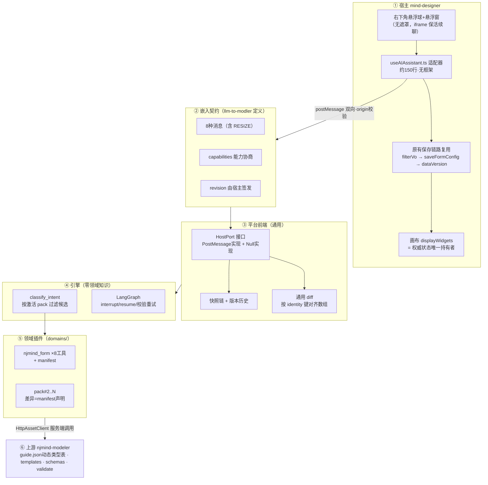
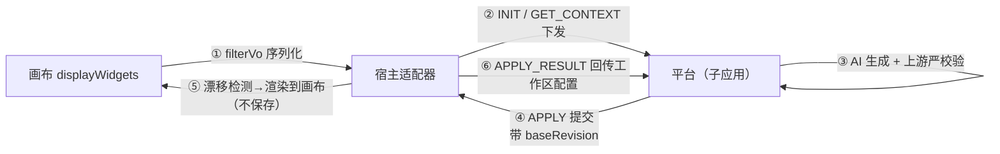
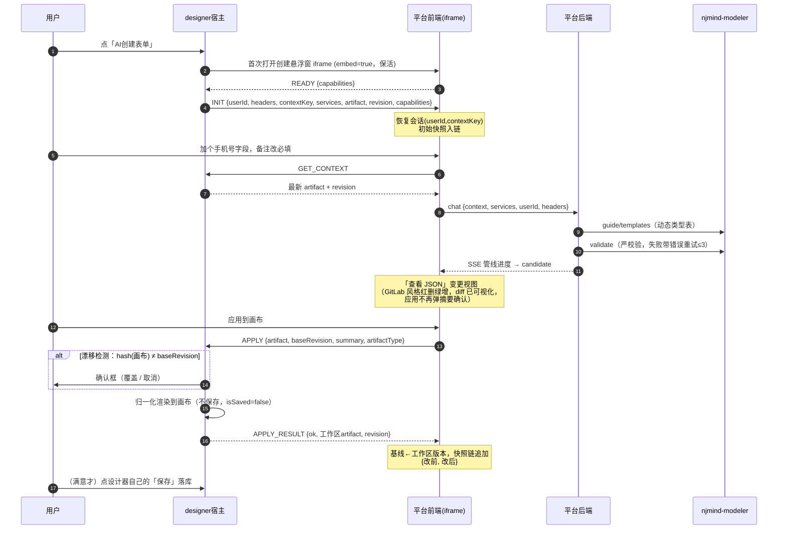
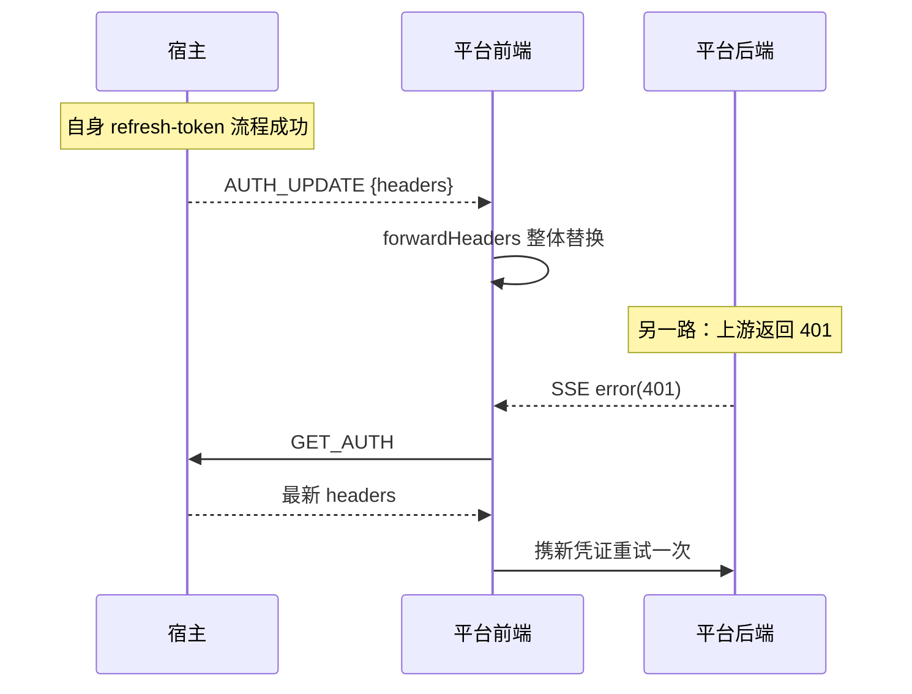
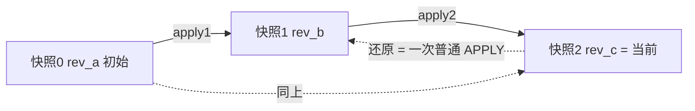
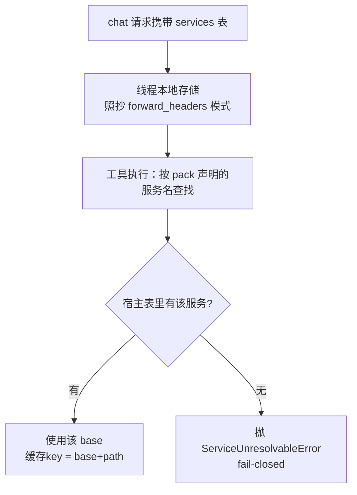
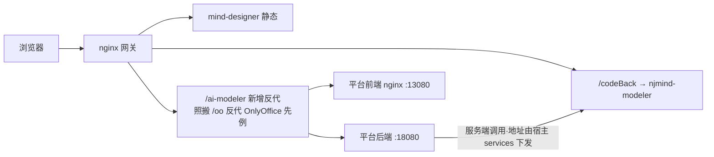
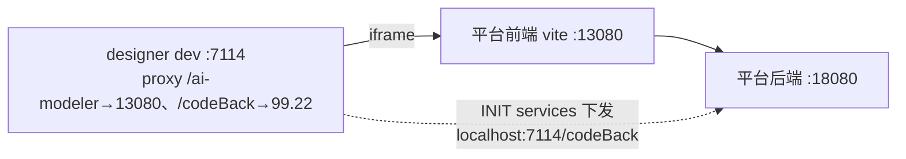
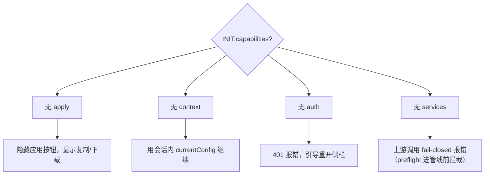
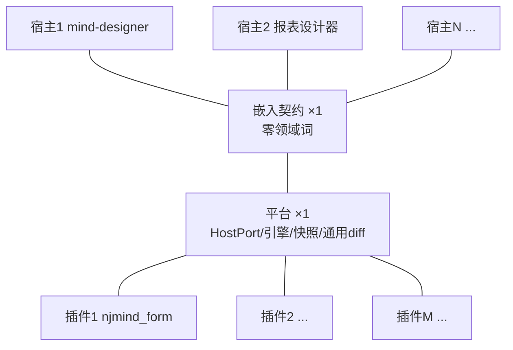

# llm-to-modler 嵌入模式总体设计

> **文档版本**：v1.3（2026-08-18，插件统一「AI 永不落库」：移除 clone 的 persist_artifact）
> **状态**：已实施（P0-P6 全部落地：信封协议/context_key 服务解析/健康探测/
> 悬浮球形态/增量协议/AI 永不落库均在代码中；§7 的类型表动态化已修复，
> §7.5 clone persist 已删除——各节标注「已实施/已修复」处为回写记录）
> **范围**：llm-to-modler 以侧边对话窗形态嵌入 mind-designer（field-edit 页），以及由此确立的「嵌入式 AI 工具平台」钩子协议、插件机制、安全与部署方案
> **关联文档**：`README.md` §六 嵌入主系统、`doc/系统架构与学习指南.md` §十 嵌入模式、`TECH-ROADMAP.md` §5 插件化 / §9.1 身份透传

---

## 目录

0. [白话走读（先读这章）](#0-白话走读先读这章)
1. [背景与目标](#1-背景与目标)
2. [总体架构](#2-总体架构)
3. [关键设计决策](#3-关键设计决策)
4. [嵌入契约（钩子协议）规范](#4-嵌入契约钩子协议规范)
5. [平台前端设计](#5-平台前端设计)
6. [平台后端设计](#6-平台后端设计)
7. [njmind_form pack 改造](#7-njmind_form-pack-改造)
8. [宿主（mind-designer）适配器设计](#8-宿主mind-designer适配器设计)
9. [安全设计](#9-安全设计)
10. [部署方案](#10-部署方案)
11. [降级矩阵](#11-降级矩阵)
12. [扩展性与演进](#12-扩展性与演进)
13. [实施计划](#13-实施计划)
14. [守门不变量与评审清单](#14-守门不变量与评审清单)
15. [附录](#15-附录)

---

## 0. 白话走读（先读这章）

> 本章不出现架构术语，用一次真实使用过程把全文设计串一遍。读完再回头看 §2 之后的规范章节，每个概念都能对号入座。

### 0.1 一次完整的使用过程

小王在设计器里打开「请假申请」表的配置页，想改表单：

1. 他点「AI创建表单」按钮，页面**右下角悬浮球 + 悬浮窗（原方案 NDrawer 侧栏，落地改为悬浮形态——同为非模态、画布可编辑）**——这个悬浮窗就是我们系统的页面，以 iframe 方式嵌在里面。此时还没发生任何事。
2. 我们的页面加载完，跟设计器打个招呼："我准备好了"（即 §4 的 READY 消息）。
3. 设计器回一条初始化消息（INIT），就四样东西：**你是谁**（userId + token）、**改哪个表**（formCode）、**上游服务在哪**（网关地址）、**表单现在长什么样**（画布上完整的配置 JSON + 一个版本号）。
4. 小王打字："加一个手机号字段，备注改成必填"。
5. 我们的后端跑的**还是原来那套**：选工具 → 拉上游的类型说明和模板 → LLM 生成新配置 → 提交上游校验，不过就带着错误重试（最多 3 次）。这段一行代码都不用改。
6. 生成完了，弹出轻量变更摘要：新增了手机号、备注的必填从否变成是。小王点「应用到画布」。
7. 前端把新配置发回给设计器页面（APPLY）。设计器先检查这期间有没有人手动改过画布（漂移检测），没有就把新配置**渲染到画布上**——走的和页面加载是同一条归一化路径，手机号字段立刻出现在表单上。**注意：这一步不保存、不入库**，画布进入「未保存」状态。
8. 小王直接在画布上看效果（也可以点设计器自带的移动端预览）。满意就点设计器**自己的「保存」按钮**落库——保存的校验、乐观锁、提示全部是设计器原有代码；不满意就继续跟 AI 说，或者从版本历史里还原（还原 = 把旧版本再渲染一遍，同样不碰库）。
9. AI 这边同时把这次「改前/改后」两个版本存进历史，作为下一轮修改的基础。

### 0.2 三个大白话原则

- **我们只负责"想"，设计器负责"存"**。我们的后端和 AI 流程都不触发保存——落库只发生在业务人员点设计器自己的「保存」按钮那一刻。
- 传过来的表单配置、formCode，对我们就是一坨 JSON 和一个字符串，我们不懂也不需要懂——所以换成报表、流程场景，这套原样能用（这就是 §12 说的插件化）。
- 每一步都有退路：拿不到最新配置就用自己存的；对方不支持"应用"就退化成复制 JSON（§11 降级矩阵）。

### 0.3 后端流程：只动两头，不动中间

**中间完全不动**（核心资产）：`/api/config/chat` 入口和 SSE 流式、LangGraph 的「选工具 → 生成 → 上游校验 → 失败重试」循环、interrupt/resume 追问、PG 会话库（平台已收敛 PG-only，原 SQLite 路径移除，见 `services/db.py`）。

**入口变 3 处**：

| # | 现在怎么做 | 嵌入后怎么做 | 为什么 |
|---|-----------|------------|--------|
| 1 | 修改时从**自己的会话库**里读上次生成的配置 | 请求体多带一个 `context` 字段（宿主刚下发的最新配置），有就**覆盖**会话里的旧配置再进图 | 侧栏开着的时候画布还能手动改，AI 必须基于最新版改，否则会覆盖人的修改 |
| 2 | 上游地址 env 里写死一个 | 请求体多带一个 `services` 表，按请求切换上游地址 | 生产/开发/多环境的 modeler 地址不同，地址跟着宿主走 |
| 3 | 前端自己填 userId（admin/anonymous） | 只用宿主下发的 userId | 防伪造，会话隔离才真实 |

**出口变 1 处（最重要的心智转变）**：生成的配置**不由我们的后端保存，也不由 APPLY 自动保存**。后端做完「生成 + 校验」就结束；APPLY 只把配置**渲染到宿主画布**（供人工看效果），落库由业务人员点宿主自己的「保存」按钮完成。现状后端本来就只有 clone 一个工具调过 persist 且是半成品（update 分支是 TODO），本轮**把该调用删掉**，让「AI 永不落库」成为插件层统一且真实的不变量——落库只属于人的保存按钮。

**配套小改 4 处**：会话绑定 formCode（收起再开不丢上下文）；checkpointer 显式长连接（平台 PG-only 后为 `PostgresSaver` 进程级长连接，由 main.lifespan 收口释放，重启不丢追问现场，见 `graph.py:184-218`）；透传头前缀补 `enterprise`（现在这个头会被默默丢掉）；新增 `GET /api/meta/packs` 把 pack 声明信息吐给前端。

一句话总结：**后端的"脑子"（生成+校验管线）原封不动，动的是"进来的参数"和"出去的去向"。**

---

## 1. 背景与目标

### 1.1 现状

mind-designer（低代码表单设计器）的 field-edit 页（`src/views/WidgetConfig/WidgetConfig.tsx`）右上角有「AI 创建表单」按钮（`Header.tsx:219-230`），当前行为：

- 打开一个 NModal 弹窗内嵌 iframe（`Header.tsx:276-280`），URL 硬编码 `http://192.168.99.22:4096?formCode=xxx`（`Header.tsx:44-50`），指向 opencode 页面；
- **纯单向展示**：只传 formCode 一个参数，无 token、无 postMessage 通信（mind-designer 全源码 0 处 postMessage）。

> 注：以上为**改造前基线**。改造后 Header.tsx 已切换为右下角悬浮球 + 悬浮窗（`ai.aiHealthy` 健康门控、`ai.showAI` 显隐、`aiExpanded` 展开态，见 `Header.tsx:224-271`），走嵌入契约（READY/INIT/GET_CONTEXT/APPLY/APPLY_RESULT），渲染到画布不落库。

### 1.2 目标

| # | 目标 | 对应章节 |
|---|------|---------|
| G1 | llm-to-modler 以**右下角悬浮球 + 悬浮窗**（非模态弹窗、画布可同时编辑；原方案 NDrawer 侧栏，落地改为悬浮形态）嵌入 field-edit | §4 §8 |
| G2 | 读取当前表单配置（formCode + 配置），AI 修改后**渲染到宿主画布**供人工查看效果，由业务人员点宿主自己的「保存」落库（方案 B + 人工落库） | §4 §8 |
| G3 | 宿主下发 userId + 鉴权头，支持 token 刷新双向同步 | §4 §9 |
| G4 | 应用前强制 diff 预览；快照链支持还原任意历史版本 | §5 |
| G5 | 上游 njmind-modeler 地址由宿主浏览器 origin 推导，请求级解析 | §6 |
| G6 | 全部机制以**平台通用**形态实现：零领域词协议、pack manifest 声明差异，为第 N 个宿主 / 第 M 个插件预留 | §7 §12 |

### 1.3 非目标（本期不做）

- 不做多制品批发（一会话一制品不变量，跨领域复合需求拆会话）；
- 不做宿主反向注册工具进引擎（TECH-ROADMAP 远期项）；
- 不改造 `embed.ts` 浮动按钮 SDK 的既有用法（保留给其他宿主，mind-designer 用自建侧栏适配器）；
- 不动 mind-designer 的保存接口与后端（`/codeBack/formConfig/saveFormConfig` 原样复用）。

---

## 2. 总体架构

### 2.1 六层结构



**一句话读图**：领域知识只允许出现在 ⑤；① 只做物理实现；②③④ 对「表单」一无所知。

### 2.2 数据流总览（方案 B）

配置的读与写都经过宿主前端，子应用永不直连 `/codeBack`：



子应用后端仅保留两类上游调用：**读资产**（guide/templates/schemas）与**校验**（`/api/mcp/forms/validate`，规则比宿主保存校验更严）。`persist_artifact` 直写上游的路径**已移除**：`clone_form.py:79` 注释明确不落库，四个工具（create/modify/get/clone）统一「生成 + 校验 → 输出候选」，AI 全程不落库。

---

## 3. 关键设计决策

| # | 决策 | 理由 | 拒绝的备选 |
|---|------|------|-----------|
| D1 | 配置读取走宿主前端；APPLY 仅**渲染到画布**，落库由业务人员手动保存（方案 B + 人工落库） | 保存的校验/dataVersion/filterVo 全部复用宿主既有代码且落库时机归人；AI 全程碰不到库，「怕改错」从根上消解；子应用不感知 `/codeBack` API | APPLY 确认后自动走保存接口（落库时机交给确认框，风险与心智负担更高）；子应用直调 `getFormConfigByCode/saveFormConfig`（版本冲突、双写路径、鉴权两套） |
| D2 | 非模态形态（画布保持可见可编辑） | 嵌入模式本义。原方案 NDrawer 侧栏，落地改为右下角悬浮球+悬浮窗（iframe 保活续聊）——同为非模态 | 沿用 NModal（遮罩挡画布、与「嵌入」语义冲突） |
| D3 | revision（内容摘要）由宿主签发 | 权威状态在宿主侧；避免两侧哈希算法不一致 | 子应用自算 hash |
| D4 | token 双向刷新（主动推 + 被动取）都做 | 内网长会话 token 过期是必然事件，不能靠用户重开兜底 | 只做单向 |
| D5 | 契约由 llm-to-modler 定义发布，宿主写薄适配器 | 工具只有一家、宿主未来 N 家；所有嵌入类产品的通行解（Intercom/OnlyOffice/webview） | 宿主建「AI 插件框架」（过度设计） |
| D6 | 领域差异收敛于 pack manifest | 兑现「工具平台、表单只是插件」的顶层理念 | 协议加领域字段 / 前端写死字段逻辑 |
| D7 | 字段类型表以 guide.json 为唯一事实源 | 上游 `fieldTypes` 有完整 20 种类型；模板/schemas 本就动态；消灭 config.yaml 陈旧子集与静默 text 回退 bug | 手工补齐 config.yaml 到 20 种（仍是第二份事实源） |
| D8 | 上游地址 = 宿主 origin + `/codeBack`，请求级解析 | 已验证生产链路同源同前缀；内网可信部署下宿主地址直接采用 | 后端 env 写死每环境地址（多租户/多环境失效） |
| D9 | diff 预览 + 快照还原一起做 | 「怕改错」是核心诉求；append-only 会话存储使快照近乎免费 | 只做还原初始版 |
| D10 | 会话绑定 (userId, contextKey) 并支持恢复 | 侧栏收起再开不丢上下文与版本历史 | 每次打开新会话（`EmbeddedLayout.vue:67-71` 现状，翻转此行为） |
| D11 | 插件统一「AI 永不落库」：删除 clone 的 `persist_artifact`，四个工具一律只生成+校验 | 消除 create/modify 不落库而 clone 偷偷落库的不一致；兑现「落库只属于人的保存按钮」；抹掉 update 分支 create 兜底的半成品 TODO | 保留 clone 落库（AI 触碰数据库、行为不一致、业务人员不知情）；接完 persist 让 AI 全量落库（与本轮人工落库决策相悖） |

---

## 4. 嵌入契约（钩子协议）规范

### 4.1 设计原则

1. **两类消息原语**：请求/响应（带 `id` 关联、可等待、可超时、可失败）与通知（单向事件）。APPLY/GET_CONTEXT 必须是请求——「发了就当成功」不被允许。
2. **能力协商**：INIT 声明宿主能力，READY 声明子应用能力，双方按交集工作，缺什么降什么。
3. **revision 宿主签发**：子应用只存储和透传。
4. **双向 origin 校验**：出站 `targetOrigin` 显式白名单；入站 `e.origin` 不在白名单直接丢弃。
5. **领域信息过协议的唯一形态是不透明字符串**（`artifactType` / `contextKey` / 服务名）。

### 4.2 消息信封

```ts
interface BridgeMessage<P = unknown> {
  v: 1                     // 协议版本
  src: 'child' | 'host'    // 发送方
  id?: string              // 请求相关性（仅请求类消息）；响应回填同一 id
  type: string             // 见 4.3 消息清单
  payload: P
}
```

响应消息 type 为请求 type 加 `_RESULT`（如 `GET_CONTEXT` → `GET_CONTEXT_RESULT`）。`id` 使用 `crypto.randomUUID()`。

### 4.3 能力定义

| 能力名 | 含义 | 宿主实现要求 |
|--------|------|-------------|
| `context` | 能提供当前制品 | 响应 GET_CONTEXT |
| `apply`  | 能把制品接入工作区（designer = 渲染到画布；是否/何时落库由宿主与用户决定） | 响应 APPLY |
| `auth`   | 能刷新/补发凭证 | 发 AUTH_UPDATE + 响应 GET_AUTH |
| `services` | 能提供服务地址表 | INIT 带 services |

### 4.4 消息清单总表

| # | 方向 | type | 原语 | 能力门 | 超时 | 缺失降级 |
|---|------|------|------|--------|------|---------|
| 1 | 子→宿 | `READY` | 通知 | — | — | 宿主收不到 READY 不发 INIT，侧栏显示加载失败 |
| 2 | 宿→子 | `INIT` | 指令 | — | 子应用等 3s | 超时切换独立模式（现有降级路） |
| 3 | 子→宿 | `GET_CONTEXT` | 请求 | `context` | 10s | 用会话内 currentConfig 继续 |
| 4 | 子→宿 | `APPLY` | 请求 | `apply` | 30s（含宿主确认框+渲染耗时） | 隐藏「应用」按钮，退化为复制/下载 JSON |
| 5 | 宿→子 | `AUTH_UPDATE` | 通知 | `auth` | — | 401 时提示重开侧栏 |
| 6 | 子→宿 | `GET_AUTH` | 请求 | `auth` | 10s | 同上 |
| 7 | 子→宿 | `CLOSE` | 通知 | — | — | — |
| 8 | 子→宿 | `RESIZE` | 通知 | — | — | `mode: expanded/normal`，全屏查看等场景临时撑大窗口 |

### 4.5 各消息详细规范

#### 4.5.1 READY（子→宿，通知）

子应用挂载完成后发出（现有 `hostPort.ts` 的 READY→INIT onMounted 行为保留）。

```jsonc
{
  "v": 1, "src": "child", "type": "READY",
  "payload": {
    "protocolVersion": 1,
    "capabilities": ["diff", "snapshots"]   // 子应用能力，v1 宿主可忽略
  }
}
```

#### 4.5.2 INIT（宿→子，指令，一次性）

**全协议仅 INIT 与 AUTH_UPDATE 携带 token。**

```jsonc
{
  "v": 1, "src": "host", "type": "INIT",
  "payload": {
    "protocolVersion": 1,
    "userId": "u_1024",
    "headers": {
      "Authorization": "Bearer xxx",
      "tenant-id": "7",
      "enterprise-id": "3"
    },
    "contextKey": "leave_form",
    "services": { "njmind-modeler": "https://gw.example.com/codeBack" },
    "artifact": { "...": "filterVo 之后的当前配置，创建场景可为 null" },
    "revision": "rev_9f2a",
    "capabilities": ["context", "apply", "auth", "services"]
  }
}
```

| 字段 | 类型 | 必填 | 说明 |
|------|------|------|------|
| protocolVersion | number | ✅ | 不一致时双方按各自认识的子集工作并 console.warn |
| userId | string | ✅ | 宿主侧用户标识；mind-designer 取自 `__lims__userStore.userAllInfo.id` |
| headers | Record\<string,string\> | ✅ | 鉴权/租户头。进入 `forwardHeaders` 单例，随所有 API 请求透传 |
| contextKey | string | ❌ | 宿主实体标识，**协议不透明**（designer 放 formCode）；缺省 = 创建场景 |
| services | Record\<string,string\> | ❌ | 服务名 → base 地址；key 是 pack manifest 声明的服务名 |
| artifact | object \| null | ❌ | 初始上下文（filterVo 后结构）；缺省时子应用发 GET_CONTEXT 或空会话起步 |
| revision | string | ❌ | 宿主签发的内容摘要，快照链的初始版本标签 |
| capabilities | string[] | ✅ | 见 4.3 |

#### 4.5.3 GET_CONTEXT（子→宿，请求）

**每次 modify 前必拉**——侧栏无遮罩、画布随时可手动编辑，AI 必须基于最新版修改。

```jsonc
{ "v": 1, "src": "child", "id": "r17", "type": "GET_CONTEXT", "payload": {} }
// 响应：
{ "v": 1, "src": "host", "id": "r17", "type": "GET_CONTEXT_RESULT",
  "payload": { "artifact": { "...": "最新配置" }, "revision": "rev_77c2", "meta": { "savedAt": "..." } } }
```

#### 4.5.4 APPLY（子→宿，请求，唯一回写通道——落到宿主工作区，不承诺落库）

```jsonc
{
  "v": 1, "src": "child", "id": "r18", "type": "APPLY",
  "payload": {
    "artifact": { "...": "修改后的完整配置" },
    "baseRevision": "rev_77c2",
    "summary": "新增「手机号」字段；「备注」改为必填",
    "artifactType": "form-config"
  }
}
```

| 字段 | 类型 | 必填 | 说明 |
|------|------|------|------|
| artifact | object | ✅ | 完整制品（非增量补丁），与 INIT/GET_CONTEXT 收到的结构同构 |
| baseRevision | string \| null | ✅ | AI 基于哪一版修改；宿主据此做漂移检测 |
| summary | string | ❌ | 人类可读变更摘要，宿主确认框直接展示 |
| artifactType | string | ❌ | 来自 pack manifest，协议透传不解释 |

**APPLY_RESULT 成功**——回传宿主**工作区归一化后**的制品与 revision（designer 场景 = 渲染进画布的那份配置；因未落库，不含服务端新分配的 ID——ID 在用户手动保存时才产生）：

```jsonc
{ "v": 1, "src": "host", "id": "r18", "type": "APPLY_RESULT",
  "payload": { "ok": true, "artifact": { "...": "工作区配置" }, "revision": "rev_88d1", "contextKey": "leave_form" } }
```

`contextKey` 为可选回填：**创建场景**（INIT 无 contextKey）宿主在此返回它为该工作区指定的 key，子应用把会话重新绑定。子应用以回传的 `artifact` 作为下轮修改基线（等价于紧跟着做一次 GET_CONTEXT 的结果）。

**APPLY_RESULT 失败**：

```jsonc
{ "v": 1, "src": "host", "id": "r18", "type": "APPLY_RESULT",
  "payload": { "ok": false, "code": "REVISION_CONFLICT", "message": "画布已被手动修改" } }
```

| code | 语义 | 子应用行为 |
|------|------|-----------|
| `REVISION_CONFLICT` | baseRevision ≠ 宿主当前画布（未保存的手动修改会被覆盖）且用户选了取消 | 提示 + 自动 GET_CONTEXT 拉新 → 引导「基于最新重新修改」 |
| `RENDER_FAILED` | 宿主渲染/接入工作区失败（结构不合法等） | 展示 message 原文 |
| `REJECTED_BY_USER` | 宿主确认框被取消 | 静默回到预览态 |
| `UNSUPPORTED` | 宿主不支持该 artifactType | 引导复制 JSON |

> 保存失败不属于本协议范围：落库由业务人员点宿主自己的保存按钮触发，错误自然出现在宿主 UI 里。

#### 4.5.5 AUTH_UPDATE（宿→子，通知）

```jsonc
{ "v": 1, "src": "host", "type": "AUTH_UPDATE",
  "payload": { "userId": "u_1024", "headers": { "...": "最新鉴权头" } } }
```

触发时机：宿主自身 refresh-token 流程成功后（mind-designer 的 401 刷新见 `@mind/shared/src/service/axios.ts:194-202`）。子应用收到后**整体替换** `forwardHeaders`。

#### 4.5.6 GET_AUTH（子→宿，请求）

```jsonc
{ "v": 1, "src": "child", "id": "r19", "type": "GET_AUTH", "payload": {} }
// 响应：
{ "v": 1, "src": "host", "id": "r19", "type": "GET_AUTH_RESULT",
  "payload": { "userId": "u_1024", "headers": { "...": "" } } }
```

触发时机：子应用后端返回 401（SSE error 事件）时主动索取最新凭证并重试一次。

#### 4.5.7 CLOSE（子→宿，通知）

```jsonc
{ "v": 1, "src": "child", "type": "CLOSE", "payload": {} }
```

现有 `closeWindow()` 保留语义。

#### 4.5.8 RESIZE（子→宿，通知）

子应用需要更大的视口时（如全屏查看 JSON 变更视图）请求宿主调整窗口尺寸，
关闭后恢复。fire-and-forget：宿主不认识则静默忽略，子应用弹窗仍占满 iframe
视口，天然向后兼容。**领域无关**——任何插件的全屏查看场景都可复用。

```jsonc
// 子 → 宿
{ "v": 1, "src": "child", "type": "RESIZE", "payload": { "mode": "expanded" } }
// 恢复
{ "v": 1, "src": "child", "type": "RESIZE", "payload": { "mode": "normal" } }
```

宿主侧（useAIAssistant）：`aiExpanded` 状态 + `--expanded` class
（420×640 → min(1100px,…)×min(820px,…)）；CLOSE 时复位。

#### 4.5.9 预留：SAVED（宿→子，通知，可选能力 `saveNotify`）

宿主在业务人员**手动保存成功**后发出：

```jsonc
{ "v": 1, "src": "host", "type": "SAVED", "payload": { "revision": "rev_88d1", "artifact": { "...": "" } } }
```

子应用据此在快照上标记「已落库」并显示保存状态。v1 可不实现——能力未声明即静默降级为不显示保存状态。

### 4.6 完整时序



### 4.7 token 双向刷新时序



### 4.8 演进规则

- 未知 `type` 一律忽略（前向兼容）；
- `capabilities` 只增不改语义；
- `protocolVersion` 不一致时按最大公共子集工作；
- 新钩子 = 新消息 type + 新能力名 + 双方降级路径，三件套缺一不可合入。

---

## 5. 平台前端设计

### 5.1 HostPort 接口

UI 层（ChatPanel / EmbeddedLayout）今后只依赖此接口，不再直接触碰 postMessage：

```ts
export type HostCapability = 'context' | 'apply' | 'auth' | 'services'

export interface HostIdentity {
  userId: string
  headers: Record<string, string>
}

export interface HostContext {
  artifact: unknown | null
  revision: string | null
}

export type ApplyResult =
  | { ok: true; artifact: unknown; revision: string; contextKey?: string }
  | { ok: false; code: 'REVISION_CONFLICT' | 'RENDER_FAILED' | 'REJECTED_BY_USER' | 'UNSUPPORTED'; message: string }

export interface ApplyRequest {
  artifact: unknown
  baseRevision: string | null
  summary?: string
  artifactType?: string
}

export interface HostPort {
  readonly connected: boolean
  readonly capabilities: ReadonlySet<HostCapability>
  /** 握手；无宿主返回 null → 调用方切独立模式布局 */
  init(): Promise<{ userId: string; contextKey?: string; services?: Record<string, string> } | null>
  getContext(): Promise<HostContext | null>
  applyArtifact(req: ApplyRequest): Promise<ApplyResult>
  getIdentity(): Promise<HostIdentity | null>
  onAuthUpdated(cb: (identity: HostIdentity) => void): void
  close(): void
}
```

### 5.2 PostMessageHostPort（升格现有 hostPort.ts）

现有 `hostPort.ts`（旧名 useEmbedBridge）的问题与本实现的对应修复：

| 现状 | 位置 | 修复 |
|------|------|------|
| `targetOrigin: '*'` 出站裸奔 | `hostPort.ts:151` | 显式白名单（INIT 到达后锁定宿主 origin，或部署 env 预配） |
| 入站不校验 `e.origin` | `hostPort.ts:157-159` | 白名单校验，不匹配直接丢弃 |
| APPLY 单向 fire-and-forget | `hostPort.ts:196` `_request` | requestId 关联表 + Promise + 超时 |
| 无能力概念 | 全文件 | capabilities 驱动 UI（无 apply 能力 → 不渲染应用按钮） |

内部结构：

```
PostMessageHostPort
 ├─ pending: Map<id, {resolve, reject, timer}>   // 请求关联表
 ├─ outOrigin: string | null                      // 锁定的目标 origin
 ├─ inOrigins: Set<string>                        // 入站白名单
 └─ listeners: Map<type, callbacks>               // 通知路由
```

### 5.3 NullHostPort（独立模式）

所有方法返回 null / connected=false，`capabilities` 为空集。UI 据此显示复制/下载按钮——**这就是降级的机械实现，不写 if (宿主是谁)**。

### 5.4 快照链与版本历史

> **落地形态注记（12.7 简化）**：下图为设计稿的通用快照接口（before/after/
> 持久化到后端事件流）。实际落地做了简化——**纯前端版本切换**：每次产出带
> config_snapshot 的消息卡片即版本锚点，消息列表上的「回滚到此版本」只切换
> 数据（保留对话、不改后端）；revision 哈希与漂移检测照常实现。未实现：独立
> 版本历史 UI 的两版 diff 列表。详见系统架构指南 12.7 ADR。



数据结构（每份快照记录，挂在会话上持久化到后端事件流）：

```ts
interface Snapshot {
  id: string
  ts: number
  kind: 'initial' | 'apply'          // initial = INIT 时；apply = 每次 APPLY_RESULT.ok（渲染成功）
  revision: string                    // 宿主签发（渲染后的工作区 revision）
  before: unknown | null              // 改前基线
  after: unknown                      // 渲染进宿主工作区的配置（= 下轮基线）
  savedAt?: number                    // 收到宿主 SAVED 通知时补记（可选，见 §4.5.9）
}
```

- **版本历史 UI**：列表（时间 + summary + revision + 是否已落库），任选两版 diff，单版一键还原；
- **还原 = 一次普通 APPLY**：payload 为目标快照的 `after`（重新渲染到画布），宿主零特殊支持，**不碰库**；
- **覆盖语义明示**：还原会覆盖画布上**未保存**的修改，确认框明确警示（因落库由人工触发，不存在覆盖已入库数据的风险）；
- 还原成功后快照链继续追加，不做物理删除——历史本身不可变。

### 5.5 通用 diff 设计

- **核心**：纯 JSON 深比对，输出 `add / remove / modify` 三类，携带 JSON path；
- **数组对齐**：按 pack manifest 的 `identity` 键建索引（`formFieldConfigVo` 按 `fieldTitleKey`）；无 identity 声明的数组退化为整体对比；
- **递归**：`childFormFieldConfigVo`（子表单/容器）、`labelPages`（标签页）自动深入；
- **展示**：v1 列表式——「字段『手机号』新增」「字段『备注』必填: 否→是」；全量 JSON 视图兜底；manifest 的 `display.item_label` 决定展示名取哪个属性；
- **轻量确认**：APPLY 前展示变更摘要（可展开完整 diff）；画布渲染本身就是最终预览，diff 不再作为硬门槛。

### 5.6 其余前端改造点

| 项 | 现状 | 改为 |
|----|------|------|
| X-User-Id 来源 | `services/api.ts:30-41` URL/localStorage 自填 admin/anonymous | 嵌入模式优先 `port.init().userId`；独立模式维持现状 |
| 会话恢复 | `EmbeddedLayout.vue:67-71` 每次打开新建 | `find_latest(userId, contextKey)` 恢复，无则新建 |
| 窄宽适配 | EmbeddedLayout 已是瘦身形态 | diff/版本历史做成 iframe 内全屏覆盖层切换，不做并排 |

---

## 6. 平台后端设计

### 6.1 chat API 扩展（上下文注入 + 服务表）

`POST /api/config/chat`（`api/config.py:192-254`）请求体新增两个可选字段：

```jsonc
{
  "conversation_id": "...",
  "message": "加个手机号字段",
  "answers": [],
  "image_base64": null,
  // ── 新增 ──
  "context": {
    "artifact": { "...": "宿主最新配置" },
    "revision": "rev_77c2",
    "contextKey": "leave_form"
  },
  "services": { "njmind-modeler": "http://localhost:7114/codeBack" }
}
```

处理规则：

- `context.artifact` 存在 → **覆盖**会话 currentConfig 再进图（前端每次发消息前已 GET_CONTEXT 拉新）；引擎与 pack 无感知；
- `context.contextKey` → 写入会话的绑定字段（幂等）；
- `services` → 存入请求级线程本地（见 6.2）。

### 6.2 请求级服务解析（上游地址动态化）



实现要点：

- 新增 `set_request_services() / get_request_services()`，与 `upstream_client.py:48-79` 的 `set_forward_headers` 同构；
- `UpstreamClient` 增加 `resolve_base(service_name)`：宿主表下发即采用，未下发抛 `ServiceUnresolvableError`（fail-closed，地址唯一来源是宿主 services 表）；每轮实际地址可查会话链路 `request_context` 打点；
- 工具前置校验走 SDK `preflight(state, ctx)` 钩子（引擎在 execute 前调用的链路一环，业务工具自己写校验逻辑，如 njmind_form 校验上游地址可解析，缺地址 fail-fast 拦截）；
- **缓存 key 必须带 base 前缀**（`upstream_client.py` 现有 `template:`/`schema:` key 会串环境）；
- pack 通过 manifest 声明依赖服务名（见 §7.2），引擎注入，工具代码不感知地址。

### 6.3 会话绑定

- `conversations` 表新增 `context_key TEXT`，索引 `(user_id, context_key)`；
- `GET /api/conversations?contextKey=xxx&latest=true` 返回该绑定下最新会话（供嵌入端恢复）；
- 创建场景（无 contextKey）：APPLY_RESULT 回填新 key 后，前端调用 `PATCH /api/conversations/{id}` 更新绑定。

### 6.4 其余后端改造点

| 项 | 现状 | 改为 | 位置 |
|----|------|------|------|
| checkpointer | ~~SqliteSaver~~ | **已切换为 PostgresSaver**（平台收敛 PG-only：`DATABASE_URL` 必填 fail-closed，缺配置拒绝启动；checkpoint 与四个 Store 同库，进程级长连接由 main.lifespan 统一释放） | `engine/graph.py:184-218`、`services/db.py:42-57`、`main.py:92-96` |
| 头部透传前缀 | 硬编码元组，**缺 `enterprise` 前缀**（`enterprise-id` 会被丢） | 前缀表 env 化（`FORWARD_HEADER_PREFIXES`），默认值补 `enterprise` | `api/config.py:98-134` |
| CORS | 全放开 `*` | env `CORS_ALLOWED_ORIGINS` 白名单 | `main.py:170-176` |
| pack 元数据出口 | 无 | `GET /api/meta/packs`（见 §7.2） | 新增 |

---

## 7. njmind_form pack 改造

### 7.1 字段类型表动态化（消灭硬编码与静默回退）

**现状问题**（已核实 + 已修复）：

- `config.yaml:26` 的 `type_to_template` 只保留「推导规则（name.lower()）不适用」的例外覆盖（`10→related_data`、`17→reference_record`），不再是 12 种陈旧全量表；
- `create_form.py:250-287` `_step_fetch_templates` 已改为运行时从 `guide.json fieldTypes` 构建 code→模板映射（唯一事实源），默认 `stem = name.lower()`；
- 上游无模板的类型（BAR_CODE=11 / TAB=13 / TEXT_SHOW=14 / SIGNATURE=19）**fail-closed**：抛 `ClarificationRaised` 追问替代类型，不再静默回退 text（`create_form.py:283-286`）；
- `modify_form.py` 的硬编码映射死引用已删除（modify 全靠 guide.json + 增量指令集）。

**遗留**：guide.json 的 `fieldTypes` 每项尚无 `template` 字段（可选中期项）——上游仓库就在本地，加上后例外表也随之消失，单一事实源彻底归一。

### 7.2 manifest 规范（领域差异的唯一载体）

`domains/njmind_form/config.yaml` 新增：

```yaml
artifact:
  type: form-config
  identity:                                    # diff 数组对齐提示：JSON path → 身份键
    "formFieldConfigVos": fieldTitleKey
    "formFieldConfigVos.*.childFormFieldConfigVo": fieldTitleKey
  display:
    title: formName                            # 版本历史标题取哪个属性
    item_label: fieldTitleText                 # diff 列表项展示名取哪个属性
    welcome_icon: form                         # 欢迎页大图标（前端通用图标集名字）
    data_labels: {applicant: 申请人, ...}       # 数据结果卡片的 key→中文标签
    data_hidden: [status, approvalId]          # 数据卡片不展示的内部字段
    welcome_examples:                          # 欢迎页示例卡（title/desc/prompt/icon）
      - {title: 请假申请表, desc: ..., prompt: ..., icon: form}
services:
  njmind-modeler: {}                           # 依赖的上游服务名（地址由宿主/env 提供）
```

配套新端点 **`GET /api/meta/packs`**（引擎把已加载 pack 的声明部分吐给前端）：

```jsonc
[{
  "name": "njmind_form",
  "artifact": { "type": "form-config", "identity": { "...": "..." }, "display": { "...": "..." } },
  "services": ["njmind-modeler"],
  "tools": [{ "name": "create_form", "when": "..." }]
}]
```

前端 diff 组件、版本历史 UI 只消费此接口的通用形式。

### 7.3 语义完整性校验（并入严校验）

- modify 后 `titleFieldKey` 引用的字段必须仍存在（宿主保存时才报错太晚，上游严校验前置拦截）；
- `topButtons` / `bottomButtons` 明确纳入 modify 管线范围与 diff 覆盖。

### 7.4 意图提示词去领域化

- 现状：二级路由 prompt 已由 `PackRouter.build_prompt()`（`sdk/pack_router.py`）从 registry 动态聚合工具的 `when` 描述（`leave_application` 工具已在候选中），旧 `_build_intent_prompt` 与 `intent.j2` 已随扁平意图实现一并退役；
- `route()` 契约已升级：返回 `(tool_name, confidence)` 元组——tool_name 为 None 表示无匹配，confidence 为 LLM 自评确信度（0-1，非数字/越界归一化为 None 交引擎判定），见 `sdk/pack_router.py:88-131`；新增可选 `conv_id` 参数透传给 LLM 调用日志（管理端链路按会话关联）；引擎按签名协商兼容旧实现（只返回字符串的旧 pack 按 confidence=None 处理，route 无 conv_id 参数时不硬传，见 `engine/nodes.py:185-204`）；
- 改造：保持 pack 路由中性框架，框架文本由激活 pack 的工具 `when` 描述聚合；
- 一级路由支持 **packs 子集声明**（`ChatRequest.packs`,与 INIT packs 同名同义）：声明集只剩 1 个 → 直通（零 LLM）、多个 → LLM 仅在子集内路由、未声明 → 全量候选——"谁发起请求谁声明插件",引擎不写死 pack 名（`engine/nodes.py:761-790`）。

### 7.5 统一「AI 永不落库」不变量

**现状核实**（grep `persist_artifact` 全后端）：

| 工具 | 管线 | 是否落库 |
|------|------|---------|
| create | fetch_guide→…→generate→validate | 否（生成+校验即止） |
| modify | fetch_guide→modify→validate | 否（生成+校验即止） |
| get | 单步查询 | 否 |
| clone | 生成 + 校验 → 输出候选（`clone_form.py:84-85` 不落库） | 否（已统一） |

`persist_artifact` 抽象定义在 `sdk/asset_client.py:185`，`HttpAssetClient`（已迁至 `adapters/http_asset_client.py:75`）委托 pack 注入的领域客户端实现——update 分支已按 formCode 正确分路（`domains/njmind_form/upstream.py:98`，不再是 create 兜底的 TODO），整条路径**无调用方**（克隆工具已不调用，见上），作为「宿主反向注册工具进引擎」远期演进的预留接口。

**改造**（已完成 1，2/3 为守门约定）：

1. ~~删除 `clone_form.py:79` 的 `persist_artifact` 调用~~ → 已删除，clone 改为「生成 + 校验 → 输出候选」，与其他工具一致；
2. `persist_artifact` 抽象方法保留（不删），但**无调用方**——它属于「宿主反向注册工具进引擎」远期演进时重新启用的预留接口；
3. 建立 grep 守门：`persist_artifact( 在 domains/ 下出现即违规`（见 §14 不变量 #4）。

效果：嵌入模式下 create/modify/clone 全部走 APPLY 渲染链路；独立模式三个工具输出候选 JSON 由人复制/下载。上游 `create_form`/`update_form` 接口（`/api/mcp/forms/create`、`/{code}/update`）成为**无调用方**的预留，与「不直连 `/codeBack`」同源同原则。

---

## 8. 宿主（mind-designer）适配器设计

### 8.1 文件级改造清单

| 文件 | 改造 |
|------|------|
| `src/views/WidgetConfig/Header/Header.tsx` | 【已实施，形态演进】AI 按钮 + 右下角悬浮球/悬浮窗（无遮罩、iframe 保活续聊；原方案 NDrawer 侧栏，落地时改为悬浮窗——同属"非模态、画布可编辑"语义）；URL 走 `/ai-modeler` 同源前缀（env 可覆盖） |
| `src/views/WidgetConfig/` 新增 `useAIAssistant.ts` | 宿主适配器（§8.2），全项目唯一实现钩子的文件 |
| `src/views/WidgetConfig/WidgetConfig.tsx` | `init()`（`:160-162` onMounted）抽出为可重调用的 `reload()`；新增 `getSerializableConfig()`（filterVo 后结构 getter） |
| `.env` 系列 | `VITE_AI_MODELER_URL`（iframe 地址）、`VITE_AI_MODELER_ORIGIN`（origin 白名单） |

**宿主不做的事**：不建通用 AI 插件框架、不封装 postMessage 库、不理解子应用内部状态。

### 8.2 useAIAssistant 职责（伪代码级）

```ts
// 健康监控（入口门控）：页面加载时探测，仅健康时渲染 AI 入口
//   （悬浮球与页面按钮同一 aiHealthy 门控；3s 短超时，失败静默隐藏）
fetch(`${aiModelerUrl}/api/health`, {
  signal: AbortSignal.timeout(3000),
  cache: 'no-store'   // 禁缓存协商：网关 304 会被 fetch 拼成 200 伪装健康
})
  // 返回值校验（12.13）：r.ok 拦不住缓存 304/网关错配
  .then((r) => (r.ok ? r.json() : null))
  .then((j) => { aiHealthy.value = j?.status === 'healthy' })
  .catch(() => { aiHealthy.value = false })

// 生命周期
open()   → 首次创建悬浮窗 iframe（`${VITE_AI_MODELER_URL}/?embed=true`，注意尾斜杠——vite base 判定），之后只切显隐（保活续聊）
          window.addEventListener('message', handler)，handler 首行校验 e.origin
close()  → 移除监听、销毁 iframe

// 消息处理
READY → send INIT {
  userId:  userAllInfo.id,
  headers: { Authorization: localStorage.ACCESS_TOKEN, 'tenant-id': TENANT_ID, 'enterprise-id': ENTERPRISE_ID },
  contextKey: route.query.formCode,
  services: { 'njmind-modeler': `${location.origin}/codeBack` },
  artifact: getSerializableConfig(),          // filterVo(当前画布)
  revision:  hash(getSerializableConfig()),   // 宿主签发，同时记为 lastIssuedRevision
  capabilities: ['context', 'apply', 'auth', 'services'],
}

GET_CONTEXT → 应答 { artifact: getSerializableConfig(), revision: hash(...) }（并更新 lastIssuedRevision）

APPLY →
  if (hash(当前画布) !== payload.baseRevision) → 弹确认框「画布已被手动修改，渲染将覆盖」
       用户取消 → 应答 { ok:false, code:'REJECTED_BY_USER' }
  → renderToCanvas(payload.artifact)：走与 init 相同的归一化路径重建 displayWidgets
    （不调 saveFormConfig！画布 isSaved=false，由业务人员自行点「保存」落库）
  → 成功：应答 { ok:true, artifact: 归一化后的工作区配置, revision: 新 hash, contextKey }
  → 失败：应答 { ok:false, code:'RENDER_FAILED', message: 错误原文 }

GET_AUTH → 应答最新 { userId, headers }
token 刷新流程成功时（挂接 @mind/shared axios 刷新回调）→ 主动发 AUTH_UPDATE
```

### 8.3 renderToCanvas() 设计（原 reload 方案演进）

现状：`init()` 仅 onMounted 执行，`Content.vue` 的 `:key="$route.path"` 使改 query 也不重挂载；`window.location.reload()` 会杀掉整个页面（含侧栏 iframe）。

改法：把 `WidgetConfig.tsx` 的 `init()` 主体（配置 → `formFieldTypeMapWidgetType` 归一化 → 重建 `displayWidgets`）抽成 `buildWidgets(config)`；`init()` 与 AI 的 `renderToCanvas()` 共用。APPLY 渲染后画布即时更新、`isSaved=false`、侧栏保持打开可继续迭代。

**不保存**：`saveFormConfig` / dataVersion 同步只发生在业务人员点「保存」按钮的原有链路（`Header.tsx:123-194`）里，AI 链路完全不触碰。

---

## 9. 安全设计

| # | 威胁 | 对策 |
|---|------|------|
| S1 | token 经 postMessage 广播泄露 | INIT/AUTH_UPDATE 仅有的携带 token 的消息；出站 targetOrigin 白名单；入站 e.origin 校验（修复 `hostPort.ts:151,157` 双向洞） |
| S2 | 恶意页面嵌我们的 iframe 骗 token | 入站 origin 白名单不匹配即丢弃；后端 CORS 收敛（`main.py:170-176` 现为 `*`） |
| S3 | SSRF：前端任意指定后端请求目标 + 透传 Authorization | 内网可信部署：宿主地址直接采用，SSRF 防线在网络层/网关（服务不暴露公网）；每轮实际地址可查会话链路 `request_context` 打点 |
| S4 | X-User-Id 伪造 | 嵌入模式只信宿主 INIT 下发（替换 `api.ts:30-41` 自填）；独立模式维持本机行为 |
| S5 | LLM key 泄露 | key 仅存后端 `.env`，宿主与前端永不接触；生产将 18080 收于网关后不直接暴露 |
| S6 | 头部透传丢 `enterprise-id` | 前缀白名单补 `enterprise` 并 env 化（§6.4） |
| S7 | 会话越权 | 会话按 userId 隔离（现有机制），嵌入模式 userId 来自宿主不可自选 |

---

## 10. 部署方案

### 10.1 生产



已验证的生产链路（`lowcode-deploy/volumns/middle/nginx/conf.d/80.conf:89-101` + `njmind-gateway/src/main/resources/bootstrap.yml:50-58`）：

```
origin + /codeBack/**  →  nginx  →  Java 网关 (Path=/codeBack/**, StripPrefix=1)  →  grayLb://njmind-modeler  →  /api/mcp/*
```

即 **modeler 的 MCP 资产接口与 mind-designer 的表单 API 同源同前缀同鉴权**（`/njmind-modeler/` 是 `/codeBack/` 的 nginx 别名）。

### 10.2 本地联调



### 10.3 环境变量清单

| 侧 | 变量 | 用途 |
|----|------|------|
| 后端 | `FORWARD_HEADER_PREFIXES` | 透传头前缀（默认补 `enterprise`） |
| 后端 | `CORS_ALLOWED_ORIGINS` | CORS 收敛白名单 |
| 前端 | `VITE_HOST_ORIGINS` | 入站宿主 origin 白名单（dev 预配 7114） |
| designer | `VITE_AI_MODELER_URL` | iframe 地址 |
| designer | `VITE_AI_MODELER_ORIGIN` | 出站 targetOrigin |

---

## 11. 降级矩阵



| 场景 | 行为 |
|------|------|
| 宿主只实现 READY/INIT/CLOSE | 侧栏可用：对话、生成、复制 JSON（增量采纳的底线形态） |
| 创建场景（无已有配置） | INIT.artifact=null；APPLY_RESULT.contextKey 回填后重绑会话 |
| 上游不可达 | 读类 Fail-Closed 返回空（现有机制）；严校验失败即 `valid:false`，不会误放行 |
| pack 无上游服务 | services 未下发该服务 → preflight 拦截 / 调用点 fail-closed 报错 |
| 非 JSON 规整制品 | manifest 不声明 identity → diff 退化为摘要模式，快照链照常 |

---

## 12. 扩展性与演进

### 12.1 N 宿主 × M 插件的成本公式



**总成本 = N × 约150行适配器 + M 个 pack，而非 N×M 套集成。**

三问判断法：

| 问题 | 答案 | 动作 |
|------|------|------|
| 新宿主、同领域？ | 是 | 只写适配器（地址由宿主 services 下发，零地址配置） |
| 新领域？ | 是 | 写 pack（工具 + prompt + manifest） |
| 新所有权边界？ | 是 | 才动协议（additive，旧宿主无感） |

### 12.2 已预判的演进点

| 演进 | 形态 | 是否破坏旧宿主 |
|------|------|---------------|
| 宿主订阅生成进度 | 新通知 `PROGRESS` + 子应用能力声明 | 否（未知 type 忽略） |
| pack 激活作用域 | INIT 增 `packs` 字段；意图候选按会话过滤（**已实施并贯通**：INIT packs 原样随 chat 请求回传,后端一级路由只在子集内路由,见 §12.2.1） | 否（additive） |
| 宿主反向注册工具进引擎 | 新 port（TECH-ROADMAP 远期） | 否 |

### 12.2.1 本文停更后的实际演进（2026-09 补记）

本文聚焦嵌入契约本身;此后平台的插件机制继续演进（详见 README 与
`backend/src/domains/ARCHITECTURE.md`,与本契约正交、旧宿主零感知）：

- **插件自有 HTTP API**：pack 可导出 `create_api_router()`,挂
  `/api/packs/{name}` 前缀,启停热挂卸——宿主可直调插件接口
  （如知识图谱检索 `POST /api/packs/knowledge_graph/search`）
- **后台任务框架**：分钟级长活（文档导入）走任务中心,queue_key 串行 +
  断点续跑 + SSE 事件流,不占 chat 请求线程
- **依赖门控装配**：manifest 声明外部设施依赖（Neo4j/pg_vector）+ 探针,
  fail-closed,管理端补配热加载
- **知识图谱插件**：首个"全能力"插件（工具+HTTP API+后台任务+管理页+
  SDK 存储）;其图/向量存储能力已下沉框架 SDK（命名空间隔离契约）
- **AI 脚本生成工具**：njmind_form 新增 generate_js_script /
  generate_filter_sql（pack 工具数 6→8）;designer 弹框场景在消息头拼
  `[script:js]`/`[script:sql]` 标记,pack 路由据此**确定性分流**（代码直选
  对应工具、零 LLM 调用,弹框语境必须 100% 命中,见
  `domains/njmind_form/router.py:27-52`）
- **插件生命周期审计**：装配收敛为两阶段事务（Prepare 全部可失败动作 /
  Commit 纯引用替换,任一步异常按快照回滚旧运行态）;多副本 fail-closed
  （`services/pack_manager.py:131-142,332-351`）
- **前端按需加载**：UI 与可视化依赖改为按需 import,首屏体积显著收敛
  （commit e6cb204）
- **通用任务中心 API**：`/api/tasks` 提供列表/详情/日志回放（游标断线
  补齐）/取消/SSE 事件流,admin 鉴权,零任务类型知识（`api/tasks.py:9-14`）
- **njmind_bpm 域**：流程配置 AI pack（`domains/njmind_bpm`,制品类型
  `bpm-process`）。mind-designer 流程编辑页（ProcessConfig）悬浮窗**原样
  复用 field-edit 嵌入契约**——INIT/GET_CONTEXT/APPLY 零改动,宿主只换
  contextKey（modelKey）与制品内容（bpmnXml+规则）；APPLY 只把产物
  **回显画布**（isSaved=false）,不入库——落库仍走设计器原有保存按钮,
  AI 链路不调 `/bpm/model/update`
- **engine 结构化追问透传**：pack 抛 `ClarificationRaised` 的 question 为
  JSON 字符串（含 question/header/options）时,引擎按**结构化透传**为
  点选卡（选项点击即答,秒级 resume 回填,不过 LLM）;纯文本维持开放问题
  +自由输入（`engine/nodes.py:451-487`）。BPM 分支字段确认门是首个
  消费方：每个缺失字段一问、候选为绑定表单字段目录
- **packs 声明路由**：宿主/前端可通过 `ChatRequest.packs` 声明插件链路
  子集,与嵌入 INIT 下发的 packs 同名同义——窗口初始化声明什么插件链路,
  后续 chat 消息就只在什么链路里走（前端把 INIT packs 原样随每条消息回传,
  `frontend/src/stores/conversation.ts:46-57`）。声明集（过滤未装配项后）
  只剩 1 个 → 一级路由直通（零 LLM,单域窗口与弹窗强契约场景 100% 命中）;
  多个 → LLM 仅在子集内路由（候选收窄,误路由面变小）;未声明 → 维持
  全量语义路由。引擎零领域知识、pack 自身零改动
  （`backend/src/engine/nodes.py:761-790`、`api/config.py` ChatRequest.packs）
- **njmind_list 域**：列表页配置 AI pack（`domains/njmind_list`,制品类型
  `list-config`）。`generate_list` 单一业务工具承担生成/修改/重做（已有
  列表时按新描述**整体重造回显覆盖**,无 create/update 分流歧义）+ 
  `list_chat` 兜底;六步管线（fetch_guide → fetch_existing → parse_intents
  → fetch_templates → generate → validate）,validate 前嵌入 **SQL 过滤
  子管线**——默认过滤/组合筛选/数据权限三个 SQL 位的占位（及 LLM 违规
  写的真 SQL）一律重生成,`check_sql_fragment` 机械校验,失败重试 ≤2,仍
  失败回退中性不过滤形态 + warnings 不阻断整单;SQL 契约复用 njmind_form
  的 `_sql_contract`（跨 pack 复用契约层首例）。宿主上下文复用 **artifact
  通道回退**：UI 聊天路径走 INIT/GET_CONTEXT → `source_artifact`（BPM
  同款）,API 旁路走 `pack_params`（`tools/generate_list.py:67-106`）

### 12.3 配置化的两个「宿主特异性漏点」

`FORWARD_HEADER_PREFIXES` 与 origin/CORS 白名单均已 env 化（§6.4、§10.3）——接入下一个宿主只改配置 + 写适配器，零代码。

---

## 13. 实施计划

### 阶段划分（每阶段独立可验收）

| 阶段 | 内容 | 主要文件 | 验收标准 |
|------|------|---------|---------|
| **P0 契约与安全基线** | 信封/requestId/双向 origin；enterprise 前缀；CORS env 化 | `hostPort.ts`、`api/config.py`、`main.py` | 协议层 grep 零领域词；伪造 origin 的消息被丢弃；`enterprise-id` 可透传到上游 |
| **P1 HostPort + 数据链路** | PostMessage/Null 两实现；chat 的 context+services 注入；请求级服务解析+缓存 key；会话绑定与恢复 | `hostPort.ts`、`api.ts`、`api/config.py`、`conversation_store.py`、`upstream_client.py` | 嵌入端恢复 (userId,contextKey) 会话；两次连续 modify 不丢 formFieldConfigId；不同 base 缓存不串 |
| **P2 pack 动态化 + manifest** | guide.json 事实源映射；fail-closed 未知类型；**删除 clone 的 persist_artifact（统一「AI 永不落库」）**；manifest + `/api/meta/packs`；意图词去领域化收敛双实现 | `create_form.py`、`modify_form.py`、`clone_form.py`、`config.yaml`、`nodes.py`、新 `api/meta.py` | 级联/容器/引用记录/关联四种类型可正确生成模板；未知类型追问而非装 text；meta 接口可被前端消费；`domains/` 下 grep `persist_artifact(` 零命中 |
| **P3 宿主适配器** | 悬浮球+悬浮窗（NDrawer 方案的落地形态）；useAIAssistant；buildWidgets 抽取；序列化 getter；URL env 化 | `Header.tsx`、`useAIAssistant.ts`、`WidgetConfig.tsx`、`.env` | 独立联调页（embed-demo 扩展）走通 INIT→APPLY→APPLY_RESULT 全链；应用后画布渲染为新配置、**未触发保存**（isSaved=false）且侧栏存活 |
| **P4 diff + 快照链** | 通用 diff 组件；快照记录持久化；版本历史 UI；还原 | 新 `diff/`、`snapshots.ts`、ChatPanel/EmbeddedLayout 改造 | 应用前展示变更摘要；任选两版 diff；还原到任意版 = 重新渲染一次画布，全程不触发保存 |
| **P5 刷新与漂移** | AUTH_UPDATE/GET_AUTH 双向；GET_CONTEXT 改前拉新；baseRevision 漂移检测 | `useAIAssistant.ts`、ChatPanel、`api.ts` SSE 401 处理 | 手动改画布后 AI 应用被拦截并提示；token 刷新后子应用无感续用 |
| **P6 加固与部署** | checkpointer 持久化（落地为 PostgresSaver，平台 PG-only）；网关 `/ai-modeler` 反代；CORS/origin 生产收紧；联调 | `graph.py`、nginx 配置、`.env` | 重启后追问现场存活；生产拓扑下全链路可用 |

### 依赖关系

```
P0 → P1 → P3 → P5
      ↘ P2 ↘ P4 ↗
```

P2/P3 可并行；P4 依赖 P1（快照挂在会话上）与 P2（identity 键来自 manifest）。

---

## 14. 守门不变量与评审清单

### 四条不变量（评审硬标准，第 4 条 AI 永不落库为后补）

1. **协议层零领域词**——对桥接层代码 grep `form|field|formCode` 命中即违规；
2. **领域知识单点收敛**——引擎/前端/协议出现第二份类型表或字段名（guide.json、pack manifest 之外）即违规；
3. **每个钩子可缺省、降级有定义**——出现「宿主必须实现 X 否则整体不可用」即违规；
4. **AI 永不落库**——`domains/` 下出现 `persist_artifact(` 调用即违规（落库只属于人的保存按钮）。

### 评审问题清单

- [ ] APPLY 失败的四种 code 都有 UI 出口吗？
- [ ] 创建场景（无 contextKey）到回填新 key 的会话重绑，边界清楚吗？
- [ ] 快照还原的覆盖语义在 UI 上是否无歧义？
- [ ] 宿主 INIT 的 services 是否覆盖所有启用 pack 声明的服务名（未覆盖 → preflight 拦截）？
- [ ] 旧 embed-demo.html（SDK 浮窗路径）回归是否不受影响？

---

## 15. 附录

### 15.1 已验证事实清单（file:line 证据）

**mind-designer（宿主）**

| 事实 | 位置 |
|------|------|
| AI 按钮 + NModal + iframe，URL 硬编码 4096 | `Header.tsx:231-242`、`:44-50`、`:276-280`（**改造前基线**，现为悬浮球+悬浮窗） |
| 保存链路（校验→filterVo→saveFormConfig→dataVersion 同步） | `Header.tsx:123-194`、`:81-121`、`:166-172` |
| 页面从 query 读 formCode、init 仅 onMounted | `WidgetConfig.tsx:61`、`:160-162` |
| 读写 API | `src/api/widgetConfig.ts:17-30`（GET `getFormConfigByCode` / POST `saveFormConfig`） |
| token 存储 | localStorage `ACCESS_TOKEN/TENANT_ID/ENTERPRISE_ID`（`@mind/shared/src/service/auth.ts:5-26`） |
| 请求头三件套 + 401 刷新 | `@mind/shared/src/service/axios.ts:126-143`、`:194-219` |
| 全项目 0 处 postMessage | grep 验证 |
| 字段类型码 0-19 | `src/views/WidgetConfig/config/widget.ts:76-97` |
| dev 端口 13080，proxy `/ai-modeler/api`→18080 | `vite.config.ts:13-58` |

**llm-to-modler（本平台）**

| 事实 | 位置 |
|------|------|
| 桥 targetOrigin '*'、入站无校验、APPLY 单向 | `frontend/src/composables/hostPort.ts`（**改造前基线**；现为出站白名单 `:158-163`、入站校验 `:255`、请求关联表 `_request` `:209`） |
| X-User-Id 前端自填 | `services/api.ts:36-61`（独立模式自填；嵌入模式优先宿主 INIT 下发） |
| 嵌入模式每次新会话 | `EmbeddedLayout.vue:67-71`（**改造前基线**；现会话创建/恢复由 App.vue 握手流程统一驱动，见 `EmbeddedLayout.vue:197`） |
| 透传头前缀白名单（缺 enterprise） | `api/config.py:98-134`（**改造前基线**；现默认值含 `enterprise` 且 `FORWARD_HEADER_PREFIXES` env 可覆盖，`:100-106`） |
| checkpointer 为 PostgresSaver（平台 PG-only） | `engine/graph.py:184-218`、`services/db.py:42-57`、`main.py:92-96` |
| 意图 prompt 注册表动态版 | `sdk/pack_router.py:88-131`（两级路由，route 返回 (tool_name, confidence)） |
| 类型表运行时构建 | `domains/njmind_form/tools/create_form.py:263-269` |
| 无模板类型 fail-closed 追问 | `domains/njmind_form/tools/create_form.py:291-294` |
| CORS 由 `CORS_ALLOWED_ORIGINS` env 配置（缺省回退 `*`） | `main.py:268-285` |
| persist_artifact 预留接口（update 分支已实现，无调用方） | `adapters/http_asset_client.py:75`、`domains/njmind_form/upstream.py:98` |
| clone 统一「生成+校验→候选」 | `domains/njmind_form/tools/clone_form.py:84-85` |

**上游 njmind-modeler 与部署链路**

| 事实 | 位置 |
|------|------|
| guide.json 含完整 20 种 fieldTypes（code/name/label/keywords/hasChildFields） | `njmind-modeler-mcp-generator/src/main/resources/mcp-guides/guide.json` |
| 模板 16 个字段模板（含 cascade/container/reference_record/related_data） | 同目录 `mcp-templates/` |
| MCP 控制器挂 `/api/mcp/*` | `McpTemplateController.java:19` |
| nginx `/codeBack/` 与 `/njmind-modeler/` 同转 `njmind-gateway:8000/codeBack/` | `lowcode-deploy/volumns/middle/nginx/conf.d/80.conf:89-101` |
| Java 网关 `Path=/codeBack/**` + StripPrefix=1 → njmind-modeler | `njmind-gateway/src/main/resources/bootstrap.yml:50-58` |

### 15.2 上游 guide.json fieldTypes 全表（20 种）

| code | name | 中文 | 有子字段 | 上游模板 |
|------|------|------|---------|---------|
| 0 | TEXT | 文本输入框 | — | text_field |
| 1 | NUMBER | 数字 | — | number_field |
| 2 | DATE | 时间 | — | date_field |
| 3 | FILE_UPLOAD | 文件上传 | — | file_upload_field |
| 4 | SELECT | 单选 | — | select_field |
| 5 | MULTIPLE_SELECT | 多选 | — | multiple_select_field |
| 6 | DEPARTMENT | 单位 | — | department_field |
| 7 | USER | 成员 | — | user_field |
| 8 | AUTO_NUMBER | 自动编号 | — | auto_number_field |
| 9 | CHILD_FORM | 子表单 | ✅ | child_form_field |
| 10 | RELATION_DATA | 关联数据 | — | related_data_field（例外名） |
| 11 | BAR_CODE | 条码 | — | 无（fail-closed 追问） |
| 12 | SEGMENT | 分段 | — | segment_field |
| 13 | TAB | 标签页 | — | 无（结构在 labelPages） |
| 14 | TEXT_SHOW | 文本段 | — | 无（fail-closed 追问） |
| 15 | CASCADE | 级联 | — | cascade_field |
| 16 | RICH_TEXT | 富文本 | — | rich_text_field |
| 17 | CITE_RECORD | 引用记录 | — | reference_record_field（例外名） |
| 18 | CONTAINER | 容器 | ✅ | container_field |
| 19 | SIGNATURE | 电子签名 | — | 无（fail-closed 追问） |

### 15.3 术语表

| 术语 | 定义 |
|------|------|
| 宿主（Host） | 嵌入方，如 mind-designer field-edit 页 |
| 契约（Contract） | 本文 §4 的 8 种消息（含 RESIZE，SAVED 预留）+ 能力协商 + 演进规则 |
| 制品（Artifact） | AI 产出的领域配置 JSON，对协议不透明 |
| contextKey | 宿主实体标识（designer 场景 = formCode），协议不解释 |
| revision | 宿主签发的制品内容摘要，漂移检测与快照版本标签 |
| 工作区制品 | 宿主 APPLY_RESULT 回传的、渲染进其工作区的归一化配置（未落库；designer=画布配置） |
| pack | `domains/` 下的领域插件（工具 + prompt + manifest） |
| manifest | pack 的声明式差异（制品类型/diff 身份键/展示字段/服务依赖） |
| 快照记录 | {改前, 渲染后}，append-only 追加；落库时间由可选 SAVED 通知补记 |
| 方案 B | 配置读取与「回写画布」均经宿主前端；落库由业务人员手动保存，子应用前后端均不直连保存接口 |
