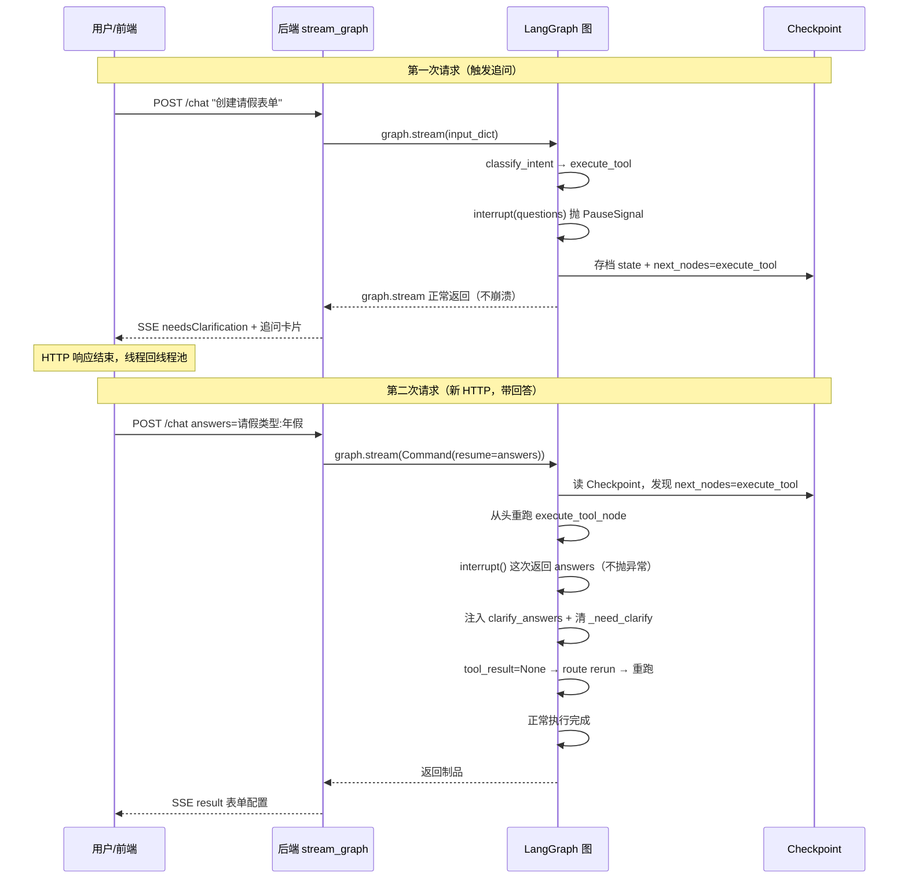

# LLM Form Modeler 简历技术点与面试准备

> 本文档从 LLM Form Modeler 项目中提取可在简历中使用的技术亮点，并提供配套的面试题 + 知识点 + 回答巧思。
> 每个技术点末尾标注了 📖 深入阅读指引，方便跳到学习指南对应章节。

---

## 一、简历技术亮点（直接可用）

> **用法**：根据投递岗位挑选 3-5 条。每条遵循「动作 + 技术方案 + 效果」结构。

### 亮点 1：三层六边形架构设计（核心亮点）

```
设计了三层六边形架构（API → Engine → SDK → Domain Pack），
Engine 层零领域知识（grep 验证无业务词汇），通过 Tool ABC + AssetClient ABC
端口抽象隔离领域知识。新增业务能力只需加一个 domains/xxx 目录（自动发现），
Engine 层零改动。通过 Tool 钩子方法（validate_input/summarize_artifact/format_result）
让 Engine 不读制品内部数据结构，实现真正的关注点分离。
```

> **术语速解（Java 视角）**：
> - **六边形架构（端口与适配器）**：核心业务逻辑不依赖外部，通过"端口"（抽象接口）交互。类比 Spring 的 Controller 不直接调 DataSource，而是调 Repository 接口。Engine 是核心，SDK 的 ABC 是端口，HttpAssetClient 是适配器。
> - **Tool ABC**：工具抽象基类，类比 Java `abstract class` 或 `interface`。所有工具继承它，Engine 统一调 `execute()`。
> - **钩子方法**：基类定义可选方法（validate_input/summarize_artifact 等），Engine 通过这些钩子避免读制品内部。类比 `HttpServlet.init()`——框架调，子类选实现。
> - **自动发现**：`discover_packs()` 扫描 domains/ 目录，含 `pack.py` 的自动注册。类比 Spring `@ComponentScan`。

**可深挖的技术点**：
- 架构试金石：`grep -rE "form|leave|请假" engine/` 必须返回空
- Tool 钩子隔离：Engine 通过 `format_result` / `summarize_artifact` 不读制品内部
- 路由候选集铁律：画布为空时 modify 类工具不进候选集（数据规则复核，防 LLM 幻觉选错）

> 📖 **深入阅读**：学习指南「第五章 三层六边形架构」+「第七章 SDK 协议层」

---

### 亮点 2：LangGraph 状态机 + interrupt/resume 追问机制

```
基于 LangGraph StateGraph 实现四节点状态机（意图识别 → 置信度门槛 → 工具执行 → 结果处理），
利用原生 interrupt/resume 实现跨 HTTP 请求的追问恢复——
工具执行到一半信息不足时调 interrupt() 挂起（Checkpoint 自动持久化状态），
用户回答后用 Command(resume=answers) 从断点恢复，answers 注入 tool_state 重跑。
Checkpoint 已落地 PostgresSaver（平台 PG-only）+ msgpack 反序列化类型白名单，
重启/多 worker 不丢追问现场；路由自评置信度低于阈值（默认 0.6）时
挂起发"确认意图"追问卡片，LLM 不确定时不硬猜。
```

> **术语速解（Java 视角）**：
> - **LangGraph StateGraph**：LangChain 的状态机框架，和 Spring State Machine 类似，但节点是 Python 函数。
> - **interrupt/resume**：原生中断恢复。`interrupt(value)` 暂停图执行（状态自动存到 Checkpoint，`graph.stream()` 正常返回），HTTP 响应结束；用户回答是新 HTTP 请求，`Command(resume=data)` 让图从头跑被中断的节点函数、`interrupt()` 这次直接返回 data。类比 Activiti 的 `processInstance.signal()` 但跨 HTTP。
> - **Checkpoint**：状态持久化。项目用 PostgresSaver（与四个 Store 同库），msgpack 反序列化带类型白名单（防 pickle 式攻击面）。类比游戏存档。

**可深挖的技术点**：
- interrupt 后 `route_after_result` 返回 "rerun" 触发重跑 execute_tool
- answers 注入 `tool_state["clarify_answers"]` 并清除中断标记
- Checkpoint 自动保存每次节点执行后的状态（PostgresSaver，重启可恢复）

> 📖 **深入阅读**：学习指南「第三章 状态机」+「第八章 追问机制」

---

### 亮点 3：CompositeTool 模板方法 + 多步管线

```
设计了 CompositeTool 组合工具基类（模板方法模式），定义 run_pipeline 步骤骨架，
子类只需实现 _step_xxx。以 CreateFormTool 为例实现 6 步管线
（获取指南→列模板→解析字段→取模板→生成配置→校验），
支持步骤级 SSE 事件推送（前端实时显示管线进度）、
校验失败自动 retry（重跑生成步骤，最多 3 次）、
信息不足触发 ClarificationRaised 中断追问。
```

> **术语速解（Java 视角）**：
> - **模板方法模式**：`run_pipeline` 是模板（定义骨架），子类的 `_step_xxx` 是具体实现。类比 `HttpServlet.service()` 调 `doGet()`/`doPost()`——框架控制流程，子类填逻辑。
> - **ClarificationRaised**：工具内部抛出的"需要追问"异常，run_pipeline 捕获后转为 interrupt。类比 `BusinessException` 带补充信息要求。

**可深挖的技术点**：
- 先发 `pipeline_definition` 事件给前端显示进度条
- `_step_validate` 校验失败内部 retry（重跑 `_step_generate`，MAX_RETRIES=3）
- `_step_parse_fields` 可抛 ClarificationRaised 触发追问

> 📖 **深入阅读**：学习指南「第二章 阶段二」+「第七章 7.2 CompositeTool」

---

### 亮点 4：动态能力上报 + 路由候选集铁律

```
实现 ChatTool 动态能力上报——从 ToolRegistry 读取所有非 chat 工具的 when 描述，
自动生成能力列表，新增工具自动被介绍无需手写。
路由安全不靠 prompt 劝阻靠候选集铁律：画布为空时 modify 类工具直接不进候选集
（LLM 在此场景选 modify 是幻觉，从集合里排除比在规则里"劝阻"可靠——
概率系统永远 <100% 遵循指令）。路由自评置信度低于阈值（默认 0.6）时
挂起发"确认意图"追问卡片，由用户裁决而非 LLM 硬猜。
```

> **术语速解（Java 视角）**：
> - **动态能力上报**：ChatTool 不硬编码能力列表，而是运行时从 registry 读。类比 Spring `@RequestMapping` 扫描后自动生成 Swagger 文档。
> - **候选集铁律**：数据规则在候选集层面执行，不在 prompt 层面"劝阻"。类比网关白名单——不在名单里的请求根本进不了路由，而不是进来后再拒绝。

**可深挖的技术点**：
- ChatTool `_build_capabilities` 从 registry.all() 动态生成
- `candidate_tools(has_artifact)` 覆写点：空画布排除 modify_form（曾因直通 create 把"识别图片生成表单"也吞了）
- check_confidence 节点：confidence=None（旧路由/兜底）直接放行不引入误判，追问只挂起一次

> 📖 **深入阅读**：学习指南「第十二章 关键设计决策」+「第七章 7.1 Tool ABC」

---

### 亮点 5：上下文压缩 + 熔断器 + Unicode 隐写清洗

```
实现上下文压缩机制：历史 token 超模型上限 70% 时触发 LLM 摘要压缩，
压缩在 forked 后台线程跑不阻塞主流程，配合三级保护
（70% 阈值 / 熔断器连续 3 次失败降级截断 / PTL 防御）。
压缩追加 compacted 事件（append-only 不删除旧数据可回溯）。
实现 Unicode 隐写清洗（NFKC 归一化 + 零宽/方向反转/BOM/私用区字符移除），
防上游内容隐写注入。
```

> **术语速解（Java 视角）**：
> - **token**：LLM 计量单位。中文每字 ~1.5 token。超了必须压缩。
> - **熔断器**：和 Resilience4j/Hystrix 一样。压缩连续失败 3 次 → 熔断降级为截断。
> - **append-only**：事件只追加不修改，压缩追加新事件不删旧的。类比 Event Sourcing。
> - **Unicode 隐写**：用零宽字符（不可见）藏指令。类比 SQL 注入但是用 Unicode 字符。

**可深挖的技术点**：
- 压缩在 forked 线程跑（CompressionSidechain）不阻塞主流程
- 熔断器三态：closed → open（熔断 120s）→ half-open（试探）
- sanitize_obj 递归清洗 dict/list/str

> 📖 **深入阅读**：学习指南「第九章 上下文压缩」

---

### 亮点 6：嵌入 SDK + 请求头全链路透传

```
实现前端嵌入 SDK（LLMFormModeler 类），支持 iframe 嵌入宿主系统，
通过 postMessage 双向通信（MODELER_INIT/CONFIG_GENERATED/CONFIG_APPLY/CLOSE）。
实现请求头全链路透传：宿主系统的 X-User-Id/Authorization/Cookie
→ 前端 forwardHeaders → 后端 _extract_forward_headers → 上游 API，
实现单点登录无缝集成。
```

> **术语速解（Java 视角）**：
> - **postMessage**：浏览器跨窗口通信。类比 Java RMI 但前端版。
> - **forwardHeaders**：嵌入模式下宿主的认证头透传到后端再到上游。类比 Spring SecurityContext 传递但跨系统。

> 📖 **深入阅读**：学习指南「第十章 嵌入模式」

---

### 亮点 7：多插件存储下沉 SDK + 命名空间隔离契约

```
把知识图谱插件的 Neo4j/向量/文档解析能力（960 行）下沉为框架 SDK
（GraphStore/VectorStore Protocol + scope_registry），供后续插件复用
（ChatBI 已接入；向量后端现为 pgvector 单后端,Milvus 已全量移除）。
设计两条硬隔离契约：前缀登记（两插件撞前缀装配期
fail-fast）+ scope_id 服务端签发（store 入口按 UUID 形态防御拒收，禁止用户
输入直传）。参数化设计（node_label/rel_type/collection_prefix）默认值与
存量数据兼容，迁移零停机。1400+ 条测试含 Cypher 渲染回归 + 工厂前缀
指纹测试（曾抓出"vector 工厂丢前缀参数导致隔离静默击穿"的真实 Bug）。
```

> **术语速解（Java 视角）**：
> - **Protocol（Python typing）**：结构化鸭子类型接口，类比 Java interface 但零运行时开销。
> - **fail-fast**：冲突在装配期就炸，不等到运行时互相污染数据。类比 Spring 启动时 BeanDefinitionOverrideException。
> - **命名空间隔离**：每个插件的数据带自己的前缀（kg_/bi_），物理上不混。类比 DB schema per tenant。

**可深挖的技术点**：
- 为什么隔离靠机制不靠自觉（文档约定挡不住第二个插件写错前缀）
- 工厂单例指纹缓存：连接参数+模型 kwargs 进指纹，同库不同前缀不共享对象
- unload 生命周期：在用检查（任务运行中跳过连接释放，防"Driver closed"杀任务）

> 📖 **深入阅读**：学习指南「7.4 SDK 存储设施」+「12.14 存储下沉决策」、`backend/src/domains/ARCHITECTURE.md`

---

### 亮点 8：后台任务框架——长任务的工程化三件套

```
设计插件级后台任务框架：queue_key 队列串行（同库导入不并发写图）、
协作式取消（handler 周期检查 cancelled，在块边界安全退出，不强杀线程）、
断点续跑（块级 checkpoint，done 语义 = 数据已落库——曾修过"checkpoint
早标导致续跑静默丢块"的真实 Bug）。可观测对齐请求级：结构化任务日志
（批次/块/prompt 规模/耗时）、SSE 实时事件流、管理端任务中心
（结构化分组视图 + 运行中活点心跳）。知识图谱导入流水线
（解析→切块→批内并行 LLM 抽取→本体约束→图+向量双写）是首个落地。
检索侧同粒度：图/向量库调用入 call_logs（graph/vector 类型），
细节到逐词种子命中、子图召回量+截断水位、向量逐条相似度分数。
```

> **术语速解（Java 视角）**：
> - **queue_key 串行**：类比 JMS 消息分组（JMSXGroupID），同组 FIFO。
> - **协作式取消**：类比 Thread.interrupt() 协作模式——置标志位，任务自己在安全点检查退出，避免强杀留脏状态。
> - **checkpoint 幂等**：done 标记在写库之后，重跑自然跳过已完成块。类比 Kafka 消费位移提交语义（先处理再提交）。

**可深挖的技术点**：
- 为什么不强杀线程（半写状态 + 连接泄漏）；取消点选块边界的理由
- 熔断设计：连续失败 ≥ 阈值中止整个任务（可修复后续跑），单块失败不拖死整批
- 进度感知：LLM 单块分钟级，"批次开始即推进度 + 逐块心跳 + 活点指示"三层防"假死"观感

> 📖 **深入阅读**：学习指南「12.15 长任务三件套」、`backend/src/services/task_manager.py`

---

### 亮点 9：AI 脚本生成工具——locate→generate→check 三步管线

```
为 njmind_form 实现字段权限 JS 脚本与过滤条件 SQL 两个生成工具，
共用 locate→generate→check 三步管线：定位目标（弹框场景包参数显式定位 /
悬浮窗 LLM 推断兜底）→ 按平台契约生成 → 机械校验。
后端无 JS 引擎依赖（node/esprima 不可假设存在），改做结构化校验：
括号配平（剥字符串字面量）、箭头函数存在、截断启发、formData/row
引用 key 反查字段目录。校验失败带原因重试（≤2 次），达上限诚实丢弃——
"未通过校验就不是已生成"，绝不把残缺脚本当制品交付。
```

**可深挖的技术点**：
- 零 LLM 确定性分流：designer 消息头的 `[script:js]` / `[script:sql]` 标记由代码直选工具（置信度 1.0），弹框场景 100% 命中、零 LLM 调用——概率路由在弹框语境不可接受
- 配置位扩展为 5 slot + 12 Profile（字段值变化事件/字段外链/按钮前置·后置·隐藏·禁用·跳转·自定义/列表链接·格式化·隐藏·自定义渲染），URL 类 Profile 加可执行链接门禁（`generate_js_script.py:50,75`；`table_custom_render` 见 `_script_common.py:105`）——同一套 locate→generate→check 管线承接 17 种配置位，契约校验按 Profile 的 return_required/字段命名空间分场景收口
- SQL 白名单 + 三库方言黑名单：列名白名单（系统列按主/子表场景分流）+ `njmd_*` 宏白名单 + Oracle/MySQL/DM8 专有函数黑名单（to_date/nvl/`||` 等禁用，只允许 ANSI 标准写法）
- 过滤SQL三契约硬化（`generate_filter_sql.py`）：① **相对年份强制 EXTRACT 动态写法**——需求说"当年/去年/近3年"时校验器拦截硬编码年份字面量（`'2026-…`），强制 `EXTRACT(YEAR FROM 列) = EXTRACT(YEAR FROM CURRENT_TIMESTAMP)`（去年 -1/明年 +1/近N年 -N+1），只有用户明确给了"2024年"才允许字面量——防跨年后过滤条件静默失效；② **禁表别名前缀**——片段必须裸列名（外层 `WHERE t.is_deleted=0` 统一持有别名，MP 单表注入路径甚至无别名，`t.列` 直接 SQL 报错）；③ **MyBatis 动态标签拒绝 + XML 转义**——运行时 SQL 被包进 `<select>` 交 DOM 解析器（平台不做转义），`<if>` 标签会被当 XML 元素执行必须拒绝，比较符 `& < >` 落库前转实体（幂等，支持迭代生成）
- 重试上限与表单生成管线（3 次）有意区分：脚本产物直接回写设计器，残缺脚本危害更大，2 次即弃

> 📖 **深入阅读**：`backend/src/domains/njmind_form/tools/generate_js_script.py`、`_script_common.py`

---

### 亮点 10：插件生命周期事务化 + PG-only 收敛

```
插件启停（热切换）按事务语义审计重构：两阶段装配（runtime 替换与磁盘
持久化分离，返回事务 handle）、persist 失败按快照确定性回滚（纯引用
替换，不重跑装配）、外部不可逆副作用（lifecycle start/unload）后置到
finalize 段、回滚也失败时诚实置 degraded 不谎称已回滚。toggle 状态
持久化后置到装配成功之后（失败路径零落盘）。chatbi 后台调度任务用
PG 租约 + fencing token（单调递增序列）防多实例双执行。存储收敛为
PG-only（DATABASE_URL 必填、缺省 fail-closed 启动即报错），
Checkpoint 用 PostgresSaver + msgpack 反序列化类型白名单
（LangGraph 正在收紧"从序列化数据实例化任意类"，白名单先行防御）。
```

**可深挖的技术点**：
- 为什么回滚用快照引用替换而不反向重跑装配（反向装配本身可能失败，失败后 runtime 与状态分裂）
- fencing token 的价值：租约过期后旧实例仍可能"复活"写库，token 单调递增使旧持有者的写入被拒
- msgpack 白名单：tool_state 里的领域模型对象会被 checkpoint 序列化，resume 时重建——未注册类型未来版本直接拒绝

> 📖 **深入阅读**：`backend/src/services/pack_manager.py`、`pack_state.py`、`backend/src/domains/chatbi/tasks.py`

---

### 亮点 11：njmind_bpm 流程配置 AI 引擎包——单一重造回显 + 结构化确认门

```
落地 njmind_bpm 流程配置 AI 引擎包（对话式生成 Flowable 审批流拓扑+规则）。
产品语义上只留一条路：generate_process 单一工具承担全部生成/修改/重做，
画布已有流程时按新描述整体重造并回显覆盖——无 create/update 分流，
也就无路由歧义（对照 njmind_form 的 create/modify 双工具+候选集铁律，
BPM 用"减法"消灭了误路由问题）。七步管线（获取指南→读当前流程→加载
表单字段→解析意图→匹配模板→生成草稿→渲染校验），上游 Flowable 侧做
权威校验：机械修复（类型归一/key 悬空回填/操作符降级）≤4 轮、带错误
重生成 ≤3 轮，fail-closed 不让半成品过门。整体重造不丢用户已配明细：
宿主规则（审批人勾选等）经"名称桥接"（BPMN id→语义 key，名称不唯一
即不继承宁缺勿错）+ 属性级合并回填。分支条件引用了表单外字段时挂
结构化确认门：每个缺失字段一张点选卡（question 为 JSON 字符串透传
question/options/header），resume 时确定性回填用户点选（不过 LLM，
秒级）。APPLY 只回显画布不入库——落库仍走设计器原有保存按钮。
```

**可深挖的技术点**：
- 单一重造回显 vs 双工具分流：`router.py` 里 generate_process 是唯一业务工具，"改成…/重新生成…"全走同一条路——没有 update 工具就不存在"该路由到谁"的歧义；代价是重造 token 成本更高，换来语义永远干净（无半新半旧状态）
- 七步管线（`generate_process.py` steps）：fetch_guide→fetch_existing→fetch_form_catalog→parse_intents→fetch_templates→generate→render；参考拓扑脱 id 后才进 prompt（BPMN 风格 key 会被 LLM 照抄导致规则 key 全废）
- I2 规则明细合并（`_pipeline_common.py: merge_rule_details`）：宿主规则键是 BPMN id（taskId/sequenceFlowId），新草稿键是 LLM 语义 key，两域唯一稳定公共轴是节点/连线名称——`bridge_host_keys` 按名称双侧唯一性桥接，桥接不上的行不继承（宁缺勿错）；LLM 未提及的 key 整条继承，提及的按属性级回填
- 结构化确认门（`_pipeline_common.py`）：`collect_unknown_branch_fields` 收集分支条件里表单外的 formFieldKey（名称与字段标题精确相同的直接静默修正不问）；候选选项给全量不截断——之前 [:6] 截断曾把排在末尾的数值字段截掉，用户想选也选不到（实测）；`apply_branch_field_answers` 确定性回填点选映射，不过 LLM
- 机械修复的"逐条对应"纪律（`mechanical_repair`）：只剔除真正被修掉的错误的 field 路径，过宽清除会让未修复错误一并消失、管线在 pass=False 时误判成功
- 上游 Flowable 权威校验 + fail-closed：校验结果缺失（网关截断/契约演进）视同失败；宿主 processKey/processName/formKey 由宿主注入，LLM 自造值一律剥离（真实事故：LLM 从模板示例学到 generic_form 直接输出，校验 FORM_NOT_FOUND 反复拦截耗尽重试）
- 引擎配合：ClarificationRaised 的 question 为 JSON 字符串时被 engine 透传为点选卡（pack 不依赖前端定制，复用通用追问 UI）

> 📖 **深入阅读**：`backend/src/domains/njmind_bpm/`（`generate_process.py`、`tools/_pipeline_common.py`、`router.py`）、设计文档 `docs/superpowers/specs/2026-09-24-bpm-ai-config-design.md`

---

### 亮点 12：njmind_list 列表页配置 AI 引擎包——六步管线 + 跨 pack SQL 契约复用

```
落地 njmind_list 列表页配置 AI 引擎包（对话式生成列表的列/筛选/按钮/过滤）。
对齐 BPM 裁决：generate_list 单一重造回显工具，无 create/update 分流零路由
歧义。六步管线（获取指南→读当前列表→解析意图→匹配模板→生成草稿→校验
修复），三个 SQL 配置位（默认过滤/组合筛选/数据权限）在 validate 前走
SQL 子管线：复用 njmind_form 的 _sql_contract 单一事实源跨 pack 校验
（列名白名单/宏白名单/三库方言黑名单/相对年份禁字面量），失败重试 ≤2
仍失败回退中性不过滤形态 + warnings，不阻断整单。数据源确认门：宿主未绑
表时结构化点选卡让用户选数据表（resume 确定性回填）。宿主上下文双通道：
pack_params 显式通道 + source_artifact 制品通道回退（UI 聊天路径走后者）。
```

**可深挖的技术点**：
- SQL 契约跨 pack 复用（`generate_list.py:36` import `_sql_contract`）：契约规则不在第二个 pack 复制一份——njmind_form 的过滤 SQL 校验（含三契约硬化：相对年份 EXTRACT 强制/禁表别名前缀/MyBatis 标签拒绝+XML 转义）直接服务列表域，规则演进单点生效
- SQL 位降级语义不对称：LQC 位（默认过滤/组合筛选）置空会 STRUCTURE_INVALID，回退 `{conditionMode:10}` 中性不过滤形态；数据权限位是可选纯文本直接置空串——"降级不阻断"分位收口
- 数据源确认门（`_step_fetch_guide`）：`__select_table` 前缀键不进 apply_field_answers 答案空间（与字段回填隔离）；点选 label 反查表清单得 code+serverKey 原地写入宿主 config
- 宿主 artifact 通道回退（`host_context_from`，final review C-1）：designer UI 路径只组 context.artifact 从不构造 pack_params——单通道取值曾让 UI 路径 100% fail-closed
- 首验前无条件 BOOL 归一（`normalize_switch_ints`）：真实端点 FastJSON 对 true 宽松强转 1 首验即过，等错误驱动修复会让 boolean 穿透进 artifact，Jackson 保存流整包拒绝
- validate 全过后才 `merge_buttons`：validate 检 LLM 产物纯度，继承的宿主脚本本就合法不再二次 validate（校验快照 deepcopy 防 merge 事后篡改"校验时纯度"）

> 📖 **深入阅读**：`backend/src/domains/njmind_list/`（`tools/generate_list.py`、`tools/_pipeline_common.py`、`config.yaml`）

---

### 亮点 13：packs 声明路由——"谁发起请求谁声明插件"

```
实现一级路由（领域无关）的 packs 声明机制：宿主嵌入 INIT 下发 packs
（插件链路声明），前端原样沿用到每条 chat 请求（ChatRequest.packs），
引擎三档处理（nodes.py _route_pack）——声明集过滤未装配项后只剩 1 个
→ 直通零 LLM（单域设计器窗口与弹窗强契约场景 100% 命中）；多个 →
LLM 仅在子集内路由（候选收窄+越界选择被拒回子集 fallback）；未声明
→ 全量语义路由。引擎零领域知识：不写死 pack 名、不嗅探消息内容，
domain 声明来自各 pack config.yaml 由启动装配注入。
```

**可深挖的技术点**：
- 三次重构收敛到一个概念：v1 脚本标记硬编码短路（`[script:js]` 在引擎写死 njmind_form）→ v2 target_pack（pack_params 声明目标 pack，与参数默认值语义混同）→ v3 并入 packs（与嵌入 INIT packs 同名同义单一概念）——"弹框直通"从引擎特例变成声明的自然推论
- 声明集与已装配 pack 取交集：拼错/未启用的声明过滤掉并 warning 留痕；重复项去重（`['a','a']` 去重后是单成员应直通而非误走 LLM 多候选）
- LLM 越界防御（测试钉死 `test_route_pack.py:100`）：子集内路由时 LLM 选了子集外的 pack 被拒 → 子集内 fallback 声明优先 → 都无则取子集第一个——声明是硬边界不是建议
- packs vs pack_params 职责切分：packs 是链路声明（路由候选集），pack_params 是参数默认值（给插件传什么），互不替代

> 📖 **深入阅读**：`backend/src/engine/nodes.py`（`_route_pack`）、`backend/src/api/config.py`（ChatRequest.packs）、`backend/tests/engine/test_route_pack.py`

---

## 二、面试题 + 知识点 + 回答巧思

### 话题 1：架构设计

> **术语速解**：六边形架构 = 端口与适配器（核心逻辑不依赖外部，通过抽象接口交互）；Domain Pack = 业务知识的载体包；自动发现 = 扫描目录自动注册。

#### Q1: 为什么用三层六边形架构？Engine 层零领域知识有什么好处？

**回答巧思**：
> "核心好处是**复用性和可测试性**。Engine 层不知道'表单''请假'是什么，只负责编排（意图识别→工具执行→结果处理）。新增业务只加一个 `domains/xxx/` 目录，Engine 零改动。我们的架构试金石是 `grep -rE 'form|leave|请假' engine/` 必须返回空。具体做法是 SDK 层定义 Tool ABC 和 AssetClient ABC——Engine 通过 ABC 的钩子方法（format_result/summarize_artifact）操作制品，不读制品内部数据结构。这样换一套业务（比如从表单配置换成报表生成），Engine 完全不用改。类比 Spring MVC——DispatcherServlet 不知道你的 Controller 具体做什么，只负责路由。"

**思维模板**：面试官考察"架构设计的动机，而不是背分层图"。回答结构 = 先说**收益**（复用/可测）→ 再说**手段**（ABC 端口 + 钩子）→ 最后给**验证**（grep 试金石）。**避坑**：只画分层图不说"为什么"等于零分；一定要落到"新增业务只动一处"。

#### Q2: 新增一个业务能力需要改哪些代码？

**回答巧思**：
> "只改 domains/。四步：① 创建 `domains/my_domain/` 目录；② 写 `pack.py` 注册工具；③ 继承 Tool ABC 实现 execute；④ 写 Jinja2 prompt 模板。启动时 `discover_packs()` 自动扫描注册，意图识别 prompt 动态拼入新工具描述，LLM 自动会选。ChatTool 的动态能力上报会自动把新工具加入能力列表。Engine 层、SDK 层、前端**零改动**。"

**思维模板**：考察"架构的可扩展性是不是真的落地"。这是 Q1 的**follow-up**——面试官用具体场景检验你是不是纸上谈兵。回答要**给出可操作的步骤清单**（几件事 + 在哪改），并强调"哪些层不用动"。**避坑**：不能只说"加个目录"——要把 pack.py、Tool ABC、prompt 模板、自动发现这四件事讲清楚。

---

### 话题 2：LangGraph 与追问机制

> **术语速解**：StateGraph = LangChain 状态机；interrupt/resume = 跨 HTTP 请求的中断恢复；Checkpoint = 状态持久化（游戏存档）。

#### Q3: 为什么选 LangGraph 而不是自建状态机？

**回答巧思**：
> "三个原因：① **原生 interrupt/resume**——我们的追问场景需要工具执行到一半暂停等用户回答，LangGraph 的 `interrupt()` + `Command(resume=...)` 原生支持，自建要自己实现状态持久化和恢复，复杂度高；② **Checkpoint 自动持久化**——每次节点执行后自动保存状态，支持从中断点恢复；③ **节点是纯函数易测试**——每个节点 `(state) → state`，无副作用，测试只需构造输入 state 验证输出 state。代价是引入了 LangGraph 依赖，但它的抽象和我们的场景高度匹配，值得。"

**思维模板**：考察"技术选型能不能说出 trade-off（代价）"。结构 = 三个收益（各带场景）→ 一个代价（引入依赖）→ 结论（收益 > 代价）。**避坑**：只说"它支持 interrupt"太单薄——要把"自建状态机要自己实现持久化/恢复"这个**对比成本**说出来，才显得你是权衡过而不是跟风。

#### Q4: 追问的 interrupt/resume 是怎么实现的？

**回答巧思**：
> "工具返回 `ToolResult(ask=AskSpec(...))` 时，`execute_tool_node` 检测到 ask 非空，调 LangGraph 的 `interrupt(interrupt_value)` —— **注意：这不是线程暂停，是执行栈被展开、本轮运行结束**。`interrupt()` 内部抛出 `PauseSignal` 异常，异常一路传播到 LangGraph 框架层被捕获——框架把当前状态（含 `next_nodes=['execute_tool']`）自动存到 Checkpoint，然后 `graph.stream()` **正常收尾返回**（不是崩溃），HTTP 响应结束。前端收到 `needsClarification` SSE 事件，渲染追问卡片。
>
> 用户回答后发**新的 HTTP 请求**带 `answers`，`stream_graph` 用 `Command(resume=answers)` 启动——LangGraph 读 Checkpoint，发现 `next_nodes=['execute_tool']`，**重新调用整个 `execute_tool_node` 函数**。这次 `interrupt()` 不抛异常了——它检测到有 resume 值，直接返回 `answers`。代码从 `answer = interrupt(...)` 这一行继续往下走：把 answers 注入 `tool_state['clarify_answers']`，清除 `_need_clarify` 标记，返回 `tool_result=None` 触发 rerun 路由，重跑 execute_tool。
>
> **关键区别**：类比 Java 的 `wait()/notify()` 是线程暂停在原地，LangGraph 的 interrupt 是执行栈展开、状态存档、下次从头跑节点函数但 `interrupt()` 返回值不同。`thread_id`（= `conversation_id`）就是恢复的钥匙——和 Activiti 的 `processInstanceId` 一个道理。"
>
> > **追问纠偏（早期设计 vs 现在）**：早版本追问走 `ClarificationRaised` 异常（`dispatcher.py` 捕获后转 `ToolResult.ask`）；现在统一走 `ToolResult.ask`——工具 `run_pipeline` 设 `_need_clarify` 中断步骤，`execute()` 返回带 `ask` 的结果，`execute_tool_node` 检测 `ask` 非空才调 `interrupt()`。面试时若被问"异常还是返回值触发追问"，答"v4 起统一用 `ToolResult.ask`，`ClarificationRaised` 仅作向后兼容"最稳。
> >
> > **结构化追问透传（引擎侧，`nodes.py`）**：`ClarificationRaised` 的 question 若是 **JSON 字符串**（含 `question`/`options`/`header`），引擎会解析后透传为**点选卡**（前端渲染选项按钮，点击即答）；纯文本 question 维持开放问题+自由输入框。pack（如 njmind_bpm 的分支字段确认门）无需前端做任何定制，复用通用追问 UI 就能发结构化点选——resume 时前端 `answerClarification` 回传 `{[q.header]: opt.label}`，工具端确定性消费。这是"引擎零领域知识"的又一次兑现：引擎只认 question/options/header 的通用结构，不关心问题内容是什么领域语义。

#### Q4.1: interrupt 后代码是怎么"从断点继续"的？不是线程暂停吗？

**回答巧思**：
> "不是线程暂停。Python 里 `interrupt()` 的实现是 `throw PauseSignal()`——抛异常。异常一路往上传播到 LangGraph 框架层，框架捕获后把当前 state 存到 Checkpoint（含 `next_nodes` 列表，记录下一步该跑哪个节点），然后 `graph.stream()` 正常返回，SSE 连接关闭，**这轮执行结束，执行线程回到线程池**。
>
> Resume 时是**全新的 HTTP 请求**。`graph.stream(input_data=Command(resume=answers), config={'configurable': {'thread_id': xxx}})` —— LangGraph 读 Checkpoint，看到 `next_nodes=['execute_tool']`，于是**从头调用 `execute_tool_node(state)`**。节点函数从头执行，再次走到 `answer = interrupt(interrupt_value)` 这一行——但这次 `interrupt()` 内部检查到 Checkpoint 里有 resume 值，**不抛异常了，直接返回 answers**。代码继续往下走：`tool_state['clarify_answers'] = answer`，清除标记，返回结果。
>
> 所以'从断点继续'是**逻辑上的**——不是真的回到上次执行的代码行号，而是 LangGraph 知道上次停在 `execute_tool` 节点，重新跑这个节点，`interrupt()` 的行为变了（从抛异常变成返回值），效果等价于从断点继续。"

**interrupt/resume 时序图**（面试白板可画）：



**思维模板**：面试官在考察"你到底是背概念还是真的理解机制"。回答结构 = 抛异常（interrupt）→ 框架接管（存档 + 正常收尾）→ 新请求重跑（返回值不同）。**避坑**：不要说"线程暂停在 interrupt 那行"——这是面试官最爱的陷阱，一踩就露馅。

#### Q4.2: 项目单机 QPS 大概多少？支撑不了高并发怎么办？

**回答巧思**：
> "**先说结论**：这是内部低代码平台的辅助引擎，不是高并发 To C 系统。单实例部署、PostgresSaver、PostgreSQL，QPS 天花板在个位数到两位数——**瓶颈不在基础设施，在 LLM**：每次对话至少 2 次 LLM 调用（意图识别 + 工具内生成），单次几百毫秒到几秒，这就是天然的并发限速器。
>
> **如果要提并发**，四条路，成本从低到高：
> ① **水平扩展**：Checkpoint 已落 PostgreSQL（PostgresSaver），多后端实例共享同一库即可恢复会话——LangGraph 官方多实例方案，剩下的工作是无状态化进程内对象（如 LLM 客户端、缓存）；
> ② **LLM 层降延迟**：prompt section 级缓存（已做）+ 上游 TTL 缓存（300s，已做）减少非 LLM 等待；
> ③ **连接管理**：PostgreSQL 连接池 + PgBouncer（Saver 连接已设 prepare_threshold=0 兼容 transaction 模式池）；
> ④ **缓存 + 异步**：意图识别结果按 (用户消息, 上下文) 缓存，常见问题秒回。
>
> **思维核心**：谈性能一定要先**定位瓶颈**——是 CPU/内存/IO/还是外部依赖？这个项目外部依赖（LLM）就是瓶颈，本地 PG 毫秒级无压力。面试官真正想看的是你有没有"先定位再优化"的系统思维，而不是一上来就堆 Redis/消息队列。"

**思维模板**：考察"系统设计思维 + 诚实度"。结构 = 先给基准（个位数 QPS）→ 说清瓶颈在哪（LLM 是天然限速）→ 给出分级方案（成本从低到高）→ 强调"不盲目上组件"。**避坑**：不要虚报 QPS，也不要一上来就说"上 K8s + Redis"——先解释为什么这个项目不需要。

#### Q4.3: 追问进行到一半，服务重启了怎么办？追问状态怎么持久化？

**回答巧思**：
> "**已落地持久化**：Checkpoint 用 PostgresSaver——平台 PG-only，checkpoint 表与四个 Store 同库，进程重启后同一 `thread_id` 能继续追问，多 worker 部署也能共享现场。配套做了两件防御：
> ① **msgpack 反序列化类型白名单**：tool_state 里的领域模型对象会被 checkpoint 序列化、resume 时重建。LangGraph 正在收紧"从序列化数据实例化任意类"（pickle 式攻击面），未注册类型未来版本直接拒绝——我们用 `JsonPlusSerializer(allowed_msgpack_modules=...)` 白名单先行；
> ② **fail-closed 配置**：`DATABASE_URL` 缺失时 `require_database_url` 校验直接拒绝编图，启动即报错指引配置，不静默降级回内存。
>
> **演进过程可以讲**：早期确实用 InMemorySaver，"重启丢追问现场、用户改到一半刷新就断"是把它从「开发期够用」升级为「生产必需」的直接动因。迁移本身很薄——LangGraph 原生支持换 Checkpointer，但生产化真正的工作量在配套：连接生命周期（进程级长连接由 lifespan 统一释放）、autocommit（setup 的 CREATE INDEX CONCURRENTLY 不能在事务块内跑）、prepare_threshold=0（兼容 PgBouncer transaction 模式）。
>
> **关键认知**：这个问题的本质是**"内存状态 vs 持久化状态"**。面试时主动讲"我们踩过 InMemorySaver 的坑并已迁移到 PostgresSaver + 白名单"——比空谈方案强得多，体现你真的做过生产化。"

**思维模板**：考察"状态持久化的生产意识"。结构 = 现状（已持久化 + 配套防御）→ 演进过程（为什么从内存迁走）→ 点出本质（内存态 vs 持久态）。**避坑**：别只说"换了个 Saver"——配套工作（白名单/连接管理/fail-closed）才是生产化的真实工作量。

#### Q4.4: LLM 不稳定/超时/返回垃圾怎么办？（高可用类）

**回答巧思**：
> "三层防线：
> ① **超时兜底**：LLM 调用有超时，超时进兜底——意图识别失败走 `_get_fallback_tool_name()`（优先级：chat → 安全只读 → 第一个非 artifact 工具），工具内生成失败返回 `ToolResult(error_for_llm)` 让 LLM 下一轮重选；
> ② **输出降级**：`chat_json` 两级降级——优先 `response_format=json_object`（模型原生 JSON 模式），失败降级纯文本 + `_parse_json_from_text` 手动提取；多模态消息自动跳过 json_object（该模式不支持图片）；
> ③ **清洗 + 熔断**：上游内容过 Unicode 清洗防注入；上下文压缩有熔断器（连续 3 次失败 → 降级截断 120s）防 LLM 垃圾拖垮主流程。
>
> **思维核心**：LLM 是**概率系统**，不能像调数据库一样假设它 100% 正确。所有关键路径都要有**降级 + 兜底 + 失败不阻塞**。这跟 Java 里调第三方 API 的容错思路完全一致——只是 LLM 的错误模式更不可预测（可能返回格式错、内容错、超时、幻觉）。"

**思维模板**：考察"面对不可靠外部依赖的容错设计"。结构 = 超时兜底 → 输出降级 → 清洗熔断，每层对应一个具体实现。**避坑**：不要只说"加了超时"——要展开到具体降级路径（fallback 工具、JSON 提取、熔断器）。

---

### 话题 3：设计模式应用

> **术语速解**：模板方法 = 基类定义骨架，子类填具体步骤；钩子方法 = 基类可选方法，框架调用子类选实现。

#### Q5: CompositeTool 的模板方法模式具体怎么用的？

**回答巧思**：
> "`CompositeTool` 基类的 `run_pipeline` 定义骨架：先发 `pipeline_definition` 事件给前端显示进度条，然后顺序执行 `steps` 列表里的每个步骤（`_step_xxx` 方法）。子类只定义 `steps = ['fetch_guide', 'generate', 'validate']` 和实现每个 `_step_xxx`。以 CreateFormTool 为例是 6 步：获取指南→列模板→LLM 解析字段→取模板→LLM 生成→上游校验。每步通过 `ctx.emit('stage', ...)` 推 SSE 让前端显示进度。如果 `_step_parse_fields` 发现信息不足，有两种处理：**早期设计**是抛 `ClarificationRaised` 异常（`nodes.py` 的 try/except 捕获后包装成 error 回流给 LLM）；**v4 统一改为 `ToolResult.ask`**——`run_pipeline` 检测到 `state['_need_clarify']` 标记就中断后续步骤，`execute()` 返回带 `ask` 的 `ToolResult`，由 `execute_tool_node` 调 `interrupt()` 挂起追问。如果 `_step_validate` 校验失败会内部 retry（重跑 `_step_generate`，最多 3 次）。Engine 完全不知道这些步骤的存在——它只调 `execute()`。"

**思维模板**：考察"设计模式是不是为了解决真实问题"。结构 = 骨架（run_pipeline）→ 子类只填 `_step_xxx` → 三个增值点（SSE 进度 / 失败 retry / 中断追问）。**避坑**：别只说"用了模板方法模式"——要讲它解决了什么**具体痛点**（多步流程的进度推送、重试、中断要统一处理，否则每个工具重复写）。模式服务于需求，不是为用而用。

#### Q6: Tool 的钩子方法是怎么实现隔离的？

**回答巧思**：
> "Tool ABC 定义了几个可选钩子：`validate_input`（输入校验）、`summarize_artifact`（制品摘要）、`title_for`（制品标题）、`format_result`（结果格式化）。Engine 通过这些钩子操作制品，**不直接读制品内部数据结构**。比如 handle_result 节点要显示制品标题，它调 `tool.title_for(artifact)` 而非 `artifact['formName']`——后者会让 Engine 依赖表单的数据结构，破坏零领域知识原则。这是架构试金石：如果 Engine 里出现了 `artifact.xxx`，说明隔离被破坏了。"

**思维模板**：考察"开闭原则 / 依赖倒置是不是真的懂"。结构 = 问题（Engine 不能依赖具体业务结构）→ 方案（钩子抽象）→ 试金石（`grep artifact.xxx engine/` 必须为空）。**避坑**：只背"开闭原则"四个字没有说服力——要落到具体的钩子方法名和验证手段。

#### Q6.1: 为什么用 SSE 而不用 WebSocket？（实时通信选型类）

**回答巧思**：
> "**场景匹配**：我们要的是**服务端单向推送**（LangGraph 执行进度 → 前端实时显示），用户到服务端是普通 POST。SSE 天然契合——HTTP 长连接，服务端持续推事件，前端 `EventSource` 原生消费。
>
> **对比**：
> - **SSE**：基于 HTTP，一条连接，**单向**（服务端→客户端），支持**自动重连 + 断点续传**（Last-Event-ID），文本友好；缺点是不能从客户端发消息（要另发 POST）。
> - **WebSocket**：全双工双向，适合聊天/协同编辑这类**双向高频**场景；缺点是要处理握手、心跳、断线重连、消息协议（都是自己写），且不经过标准 HTTP 代理时容易断。
>
> **为什么选 SSE**：① 我们只需要单向推送，WebSocket 的双向能力用不上；② SSE 是 HTTP 协议，**天然过 Nginx/网关/代理**（配置 `X-Accel-Buffering: no` 关缓冲即可），WebSocket 要网关专门支持；③ `EventSource` 自动重连，省了前端心跳逻辑；④ 文本流式天然适配 LLM 逐 token 输出的场景。
>
> **思维核心**：选型先看**通信方向**（单向还是双向）——单向优先 SSE，双向才考虑 WebSocket。Java 类比：SSE ≈ Spring `SseEmitter`，WebSocket ≈ `WebSocketHandler`。这个项目还专门处理了「同步 graph.stream → 异步 SSE」的桥接（`call_soon_threadsafe` + `asyncio.Queue`）。"
>
> **思维模板**：考察"实时通信选型有没有 trade-off 意识"。结构 = 场景（单向推送）→ 对比（SSE vs WS 各三点）→ 落地（过代理/自动重连/关缓冲）→ 升华（按通信方向选型）。**避坑**：别只说"SSE 简单"——要能说出为什么 WebSocket 在这里是过度设计（双向用不上 + 代理穿透成本高）。

---

### 话题 4：安全设计

> **术语速解**：候选集铁律 = 不符合数据事实的工具不进候选集（机制而非约定）；Unicode 隐写 = 用不可见字符藏指令。

#### Q7: LLM 选错工具的安全防线是怎么设计的？

**回答巧思**：
> "核心思路是**不靠 prompt 劝阻，靠候选集铁律**。LLM 是概率系统，永远 <100% 遵循指令——在 prompt 里写"画布为空时别选修改"挡不住幻觉。所以数据规则在候选集层面执行：画布为空时 modify 类工具**根本不进候选集**（`candidate_tools` 覆写点），LLM 想选也选不到。这条铁律是真实事故换来的：画布上有旧表单时用户说"生成请假申请单的表单"，LLM 曾判给 modify→字段 key 全换，产出"半新半旧"配置导致已存数据错位。
>
> 第二道防线是**置信度门槛**：路由让 LLM 对自己的选择自评置信度（0-1），低于阈值（全局默认 0.6，pack 可覆盖）时引擎挂起、发'确认意图'追问卡片，由用户裁决而非 LLM 硬猜。设计上有三个克制点：confidence=None（旧路由/兜底路径）直接放行不引入误判；追问只挂起一次（resume 后有 confirmed 标记）；阈值是配置不是硬编码——'多低算不确信'是领域语义，引擎只做数值比较。
>
> 类比 Java：候选集铁律 ≈ 网关白名单（不在名单里的请求进不了路由），置信度追问 ≈ 风控系统的人工审核兜底。"

**思维模板**：考察"对概率系统的安全设计哲学"。结构 = 为什么 prompt 劝阻不可靠（概率系统）→ 候选集铁律（机制而非约定）→ 置信度门槛（用户裁决兜底）。**避坑**：不要只说"加了校验"——要讲清**为什么在候选集层面排除比在规则里劝阻可靠**，这是机制与约定的区别。

#### Q8: Unicode 隐写清洗防什么？

**回答巧思**：
> "防上游内容里的 Unicode 隐写注入。攻击者可以在返回的模板/指南里藏零宽字符（U+200B）、方向反转字符（U+202E）、私用区字符——这些字符不可见但会影响 LLM 解析。比如用方向反转字符让 LLM 误解指令顺序。我们的 `sanitize_text` 做 NFKC 归一化 + 删零宽/方向反转/BOM/私用区字符，`sanitize_obj` 递归清洗 dict/list/str。所有从上游拿到的数据都过这层清洗。"

**思维模板**：考察"安全敏感度——能不能想到非传统攻击面"。这个点本身就是**亮点**，说明你想到了"LLM 应用的注入面"（提示注入的 Unicode 变体）。结构 = 威胁（隐写字符如何影响 LLM）→ 手段（NFKC + 字符移除）→ 覆盖面（递归清洗所有上游数据）。**避坑**：别说"防 XSS"——要精准定位到**针对 LLM 的 Unicode 隐写注入**，这是这个项目的独特价值。

---

### 话题 5：上下文压缩

> **术语速解**：token = LLM 计量单位；熔断器 = 连续失败后停止调用降级处理；append-only = 只追加不修改。

#### Q9: 压缩为什么用后台线程？熔断器怎么工作？

**回答巧思**：
> "压缩本身要调 LLM（让 LLM 摘要旧消息），如果同步做会阻塞用户请求。所以用 `CompressionSidechain` 在 forked 线程跑，主流程直接用上次的结果或截断版。熔断器三态：`closed`（正常）→ 连续 3 次压缩失败 → `open`（熔断 120 秒，期间降级为简单截断）→ 120 秒后 `half-open`（允许一次试探，成功回 closed，失败回 open）。压缩成功后追加 `compacted` 事件（append-only 不删旧数据，可回溯）。"

**思维模板**：考察"降级设计 + 后台任务隔离"。结构 = 为什么后台（不阻塞主流程）→ 熔断三态（防 LLM 垃圾反复拖累）→ append-only（可回溯审计）。**避坑**：别只说"压缩省 token"——要说清**失败时怎么办**（降级截断），这体现"宁可降级不可阻塞"的工程思维。

---

### 话题 6：嵌入模式

> **术语速解**：postMessage = 浏览器跨窗口通信；forwardHeaders = 认证头跨系统透传。

#### Q10: 嵌入模式怎么实现单点登录？

**回答巧思**：
> "通过请求头全链路透传。宿主系统通过 postMessage 发 `MODELER_INIT` 把认证头（X-User-Id/Authorization/Cookie）传给 iframe 嵌入 SDK。SDK 存到 `forwardHeaders`，每次 API 请求带上。后端 `_extract_forward_headers` 提取这些头，透传到上游 njmind-modeler API。这样用户在宿主系统登录后，嵌入的对话窗口自动带上认证，不用重新登录。"

**思维模板**：考察"跨系统集成 + SSO 方案理解"。结构 = 链路（宿主 → iframe → 后端 → 上游）→ 关键点（postMessage 传头 + forwardHeaders 透传）→ 收益（免二次登录）。**避坑**：别说"用 JWT"——要说出**这个项目特有的**"请求头透传"方案（因为上游要的是 X-User-Id/Cookie 而非标准 JWT）。

---

### 话题 7：测试与工程实践

> **术语速解**：pytest = Python 测试框架（类比 JUnit 5）；分层测试 = 测试目录对应源码目录结构。

#### Q11: 你们怎么测试状态机和工具的？

**回答巧思**：
> "分层对应 src 结构——tests/sdk 测 Tool ABC 和 sanitize；tests/engine 测压缩/对话/节点；tests/domains/tools 测每个工具。核心是 **CompositeTool 的步骤是纯方法**，可以单独测 `_step_xxx`。LangGraph 节点是 `(state) → dict` 纯函数，测试只需构造输入 state 验证输出 state。integration 测完整流程（classify→execute→handle）。有 1318 条分层测试。"

**思维模板**：考察"可测试性是不是设计出来的"。核心卖点 = **纯函数 + 依赖注入**（节点无副作用、工具依赖走 ctx），所以能分层单测。结构 = 测试分层 → 为什么能这么测（纯函数/纯方法）→ 量化（1318 条）。**避坑**：别只说"我们写了测试"——要点出"架构设计让测试容易写"（可测试性），这才是加分点。

#### Q12: 存储为什么收敛为 PG-only？事件流为什么用 append-only？

**回答巧思**：
> "**演进过程**：早期确实是 SQLite（零依赖默认）+ PG 双后端。后来平台整体收敛 PG-only，我们把 SQLite 路径**移除**而不是留着双轨——双后端意味着每条 SQL 都要两套方言验证，测试矩阵翻倍，而 SQLite 的'零运维'优势在平台已有 PG 实例后不复存在。收敛做法：业务 SQL 保持 SQLite 风格（`?` 占位符）单源书写，连接层 `_PgConnProxy` 执行期翻译为 psycopg 的 `%s`，个别方言点（jsonb/ILIKE/RETURNING）留在各 Store 小分支；存量数据用 `scripts/migrate_sqlite_to_pg.py` 迁移。`DATABASE_URL` 必填、缺省 fail-closed 启动即报错——宁可拒绝启动也不静默降级。
>
> **append-only 保留**：事件流只 INSERT 不 UPDATE，完整保留历史轨迹（含压缩点/追问现场/调用审计），类似 Event Sourcing——这个设计跟存储引擎无关，收敛 PG 后依然成立，而且 PG 的 jsonb 让事件负载的查询更从容。"

**思维模板**：考察"选型演进 + 敢于删代码"。结构 = 演进史（双轨→收敛）→ 收敛的工程手法（占位符翻译单源书写）→ 保留的设计（append-only 与引擎无关）。**避坑**：别把"曾经用 SQLite"当负面——讲清"为什么双轨不可持续、收敛怎么做到低摩擦"才是亮点。

#### Q13: 同步 graph.stream 塞线程池、异步 SSE——这套桥接设计怎么理解？（异步与并发类）

**回答巧思**：
> "本质是**同步阻塞 API 和异步非阻塞 I/O 的桥接**。LangGraph 的 `graph.stream()` 是同步生成器（在调用线程里阻塞执行），而 FastAPI 的 SSE 是 async 生成器。两者不能直接对接——如果在事件循环里跑 `graph.stream`，一个慢请求会**阻塞整个事件循环**，所有请求都卡住。
>
> 方案：`await loop.run_in_executor(None, _run_graph)` 把同步的 `graph.stream` 丢进**线程池**跑，不阻塞事件循环；每个 SSE 事件通过 `loop.call_soon_threadsafe(...)` 从工作线程**安全地投递回事件循环线程**，再由 StreamManager 的 `asyncio.Queue` 逐个 yield 给 HTTP 响应。
>
> 类比 Java：`graph.stream` ≈ 一个阻塞的 `Callable`，用 `CompletableFuture.supplyAsync(callable, executor)` 丢线程池；`call_soon_threadsafe` ≈ `executor.submit(() -> emitter.send(...))`——**跨线程发消息必须走线程安全通道**，不能直接操作不是自己线程的队列。
>
> **核心认知**：这是**混合同步/异步**的经典模式。Python 里 CPU/阻塞密集型工作不碰 async，丢线程池；I/O 密集用 async。面试官其实想看你会不会区分"什么时候该用 async、什么时候该用线程池"。"
>
> **思维模板**：考察"并发模型理解（async vs 线程）"。结构 = 问题（同步阻塞会卡事件循环）→ 方案（线程池 + call_soon_threadsafe）→ 类比 Java（supplyAsync + SseEmitter）→ 升华（何时 async 何时线程池）。**避坑**：不要说"Python 是单线程所以用线程池没意义"——线程池跑的是阻塞代码，不碰 GIL 的 I/O 等待照样并行。

#### Q14: 既然能塞线程池，为什么不全改成 async/await？为什么要区分 async 和线程池？（深入并发）

**回答巧思**：
> "**关键是区分阻塞的类型**：
> - **I/O 等待**（等 LLM 响应、等上游 HTTP、等数据库）：用 `async/await`——协程在等 I/O 时把 CPU 让给别人，单线程就能扛成千上万并发；
> - **CPU 计算**（JSON 序列化、模板渲染、正则清洗）：用线程池——Python 有 GIL，纯计算线程不并行，但这种阻塞会卡住事件循环，必须挪出；
> - **无法改造成 async 的第三方同步库**：也用线程池——LangGraph 的 `graph.stream` 就是这种，它内部没有 await 点，只能同步跑。
>
> **为什么不全 async**：async 是有传染性的——一个函数 async 了，调用链上所有函数都得 async。LangGraph 的节点 API 是同步的 `(state) → dict`，强行异步要改框架。而且工具内部大量调 `httpx` 同步客户端，改造成本高、收益低。**用线程池隔离最经济的方案**。
>
> **升华**：这是 Java 里 `WebFlux` vs `MVC + 线程池` 的经典选择。WebFlux 全异步吞吐高但心智负担大、调试难；MVC 线程池模型简单、一个请求一个线程、和现有同步代码无缝。我们项目是 LLM 编排（每个请求本来就慢、并发低），**线程池模型更务实**——清晰、好调试、好测试。"
>
> **思维模板**：考察"async/await 和线程池的适用边界，能不能说出 trade-off"。结构 = 按阻塞类型分类（I/O/CPU/第三方同步）→ 为什么不全 async（传染性 + 第三方框架限制）→ 类比 Java WebFlux vs MVC 线程池 → 落到"务实选型"。**避坑**：别一刀切说"async 更好"——要说出每个并发方案的成本和适用场景。

---

## 三、LangGraph 核心原理与常见面试题

> 面试官看到简历上写了 LangGraph，大概率会追问原理。这部分覆盖高频问题。

### 3.1 LangGraph 是什么？和 LangChain 什么关系？

**回答巧思**：
> "LangGraph 是 LangChain 团队出的**状态机编排框架**，建立在 LangChain 之上。LangChain 解决的是'怎么调 LLM、怎么串 Prompt'，LangGraph 解决的是'怎么编排多步流程、怎么持久化状态、怎么中断恢复'。类比 Java 生态：LangChain ≈ Spring JDBC（基础工具），LangGraph ≈ Spring Batch / Spring State Machine（流程编排）。我们的项目用 LangGraph 编排四节点状态机（意图识别→置信度门槛→工具执行→结果处理），用 LangChain 的 ChatModel 调 LLM。"

### 3.2 StateGraph 的核心概念？

**回答巧思**：
> "四个核心概念：
> ① **State（状态）**：一个 TypedDict / Pydantic Model，所有节点共享。节点读 state、返回 state 的更新（reducer 模式合并）。类比 Java 的 `HttpServletRequest`——贯穿整个请求生命周期，每个 Servlet 都能读写。
> ② **Node（节点）**：Python 函数，签名 `(state) → dict`。dict 里的 key 会合并回 state。我们的四个节点 `classify_intent_node / check_confidence_node / execute_tool_node / handle_result_node` 都是纯函数。
> ③ **Edge（边）**：节点之间的路由。可以是无条件边（A→B），也可以是条件边（`add_conditional_edges` 根据 state 决定下一步）。类比 Spring State Machine 的 Transition。
> ④ **Checkpointer（检查点器）**：每次节点执行完自动保存 state 快照。用于 interrupt/resume 和历史回溯。项目用 `PostgresSaver`（与业务 Store 同库）+ msgpack 反序列化类型白名单。"

### 3.3 interrupt/resume 的底层原理？（核心高频题）

**回答巧思**：
> "**一句话总结：interrupt 不是线程暂停，是这轮执行栈被展开、结束；resume 不是线程唤醒，是新请求从头跑节点函数、interrupt() 返回值不同。**
>
> 详细流程：
> ① **interrupt 阶段**：节点函数执行到 `answer = interrupt(value)` 时，LangGraph 内部抛出 `PauseSignal` 异常（类似 Python 的 `GeneratorExit`）。异常传播到框架层，框架做三件事：
>    - 把当前 state 存到 Checkpoint（含 `thread_id`、`channel_values` 完整状态、`next_nodes=['execute_tool']`）
>    - 把 `interrupt` 值（追问问题）存到 Checkpoint
>    - 让 `graph.stream()` 正常返回（不是崩溃），HTTP 响应结束，执行线程回到线程池
>
> ② **resume 阶段**：用户回答后，**新的 HTTP 请求**进来，`stream_graph` 函数被调用：
>    ```python
>    input_data = Command(resume=answers)  # 不是普通 dict，是特殊标记
>    graph.stream(input_data, config={'configurable': {'thread_id': thread_id}})
>    ```
>    LangGraph 读 Checkpoint，发现 `next_nodes=['execute_tool']`，于是**从头调用** `execute_tool_node(state)`。节点函数从头执行，再次走到 `answer = interrupt(value)`——但这次 `interrupt()` 内部检测到 Checkpoint 里有 resume 值，**不抛异常了，直接返回 answers**。代码继续往下走。
>
> **类比 Java**：不是 `Thread.suspend()/resume()`（已废弃），更像 Activiti 的 `processInstance.signal()`——流程实例停在 UserTask，用户填完表单后 signal 继续。区别是 Activiti 停在持久化的 UserTask，LangGraph 的节点函数每次从头跑、靠 Checkpoint（我们用 PostgresSaver 落库）区分 interrupt 是抛异常还是返回值。"

### 3.4 Checkpoint 里存了什么？怎么找到上次的执行？

**回答巧思**：
> "Checkpoint 存四样东西：
> - **thread_id**：对话 ID（项目里 = `conversation_id`），是恢复的钥匙
> - **channel_values**：完整的 state 快照（含 user_input、tool_state、tool_name、pending_questions 等——GraphState 定义的字段，注意**不含** `messages`，本项目历史消息存在 conversation_store）
> - **next_nodes**：下一步该跑哪个节点（是节点函数名，不是代码行号）
> - **interrupt**：interrupt 的值（追问问题），resume 时返回给 `interrupt()` 调用
>
> 找到上次执行靠 `thread_id`——和 `conversation_id` 一一对应。前端每次请求带 `thread_id`，后端用它读 Checkpoint。类比 Activiti 的 `processInstanceId`——同一个流程实例的所有任务都通过它关联。"

### 3.5 为什么不用 Redis 存 Checkpoint？

**回答巧思**：
> "三个原因：① **LangGraph 原生支持 PostgresSaver**——我们已落地，checkpoint 与四个业务 Store 同库（平台 PG-only），不需要自己写适配器；② **Checkpoint 是结构化数据**（state dict，含 tool_state 里的领域模型对象），关系型数据库 + msgpack 序列化白名单更合适，还能按 thread_id 做审计回溯；③ **不需要毫秒级响应**——Checkpoint 只在 interrupt/resume 和每节点执行后读写，PG 毫秒级绰绰有余。Redis 的优势是速度快，但这里用不上；而且引入 Redis 意味着多一个要运维的有状态组件，PG-only 收敛（`DATABASE_URL` 必填、缺省 fail-closed）反而降低了部署面。"

### 3.6 LangGraph 的 Reducer 模式是什么？

**回答巧思**：
> "节点返回的 dict 不是直接覆盖 state，而是通过 **Reducer** 合并。默认 reducer 是覆盖（新值替换旧值），但可以自定义——比如 `messages` 字段声明 `Annotated[list, add_messages]` 后，节点返回新消息列表会**追加**而非覆盖。类比 Java 的 `Map.merge()`——不是 put 覆盖，是按策略合并。
>
> **我们项目的实际取舍**：GraphState 全用 `TypedDict + total=False`，所有字段走默认覆盖语义——因为节点是按字段整体写入（如 execute_tool_node 整个返回 `tool_state` 新 dict），不需要累加式 reducer。对话历史（需要追加的地方）不放在 GraphState 里，而是由 `stream_graph` 每次从 conversation_store 读出来注入 `conversation_history` 字段——绕开 reducer 的复杂度，这也是"GraphState 没有 messages 字段"的原因。"

### 3.7 LangGraph 的 conditional_edges 怎么工作？

**回答巧思**：
> "`add_conditional_edges(from_node, routing_fn, {return_value: to_node})`——从 `from_node` 出发时，调 `routing_fn(state)`，根据返回值决定下一步走哪个节点。我们图里三条条件边：
> ```python
> # 条件边 1：classify_intent 之后路由
> workflow.add_conditional_edges("classify_intent", nodes.route_by_tool,
>     {"tool": "check_confidence", "end": END})
> # 条件边 2：置信度门槛之后（可能清空 tool_name，需重新判断）
> workflow.add_conditional_edges("check_confidence", nodes.route_by_tool,
>     {"tool": "execute_tool", "end": END})
> # 条件边 3：handle_result 之后（决定是否重跑）
> workflow.add_conditional_edges("handle_result", nodes.route_after_result,
>     {"rerun": "execute_tool", "done": END})
>
> def route_by_tool(state):          # 有工具 → 继续；没工具（纯闲聊/用户重述）→ 结束
>     return "tool" if state.get("tool_name") else "end"
>
> def route_after_result(state):     # tool_result 为 None 且选了工具 → 追问恢复重跑
>     if state.get("tool_result") is None and state.get("tool_name"):
>         return "rerun"
>     return "done"
> ```
> 类比 Spring State Machine 的 `@OnTransition` 条件守卫——满足条件才走这个 Transition。`route_after_result` 返回 `rerun` 就是图的回环点，让单次 stream 能跑多轮工具；`check_confidence` 是置信度门槛节点——路由自评低于阈值时挂起发"确认意图"追问，用户选"换个说法"则清空 tool_name 走 END。"

### 3.8 LangGraph 和 Temporal / Cadence 有什么区别？

**回答巧思**：
> "核心区别：**LangGraph 是轻量状态机编排 + Checkpoint，Temporal 是持久化工作流引擎**。
> - LangGraph：节点函数在内存跑，Checkpoint 是'存档'（我们落 PostgreSQL），resume 时从头跑节点函数（interrupt 返回值不同）。适合 AI 编排场景——节点少、流程短、中断频率低。
> - Temporal：Worker 进程真正暂停在 await 点，Workflow 代码可以跑几天甚至几个月。适合长时间运行的业务流程——订单审批、物流跟踪。
> - 类比：LangGraph ≈ 游戏存档读档，Temporal ≈ 进程真正挂起等待。
> 我们选 LangGraph 因为场景匹配——追问场景只需要跨一个 HTTP 请求恢复，不需要 Temporal 的重量级能力。"

**思维模板**：考察"同类技术对比 + 选型边界"。结构 = 核心区别一句话（内存状态机 vs 持久化引擎）→ 各自适用场景 → 我们的决策理由。**避坑**：别把 Temporal 说成"LangGraph 的升级版"——两者定位完全不同，Long-running workflow vs 短流程编排，不是谁取代谁。

### 3.9 AI/LLM 工程岗位的高频"认知题"（结合 Java 背景投 AI 岗）

#### Q-AI1: LLM 应用最容易踩的坑是什么？（LLM 应用认知类）

**回答巧思**：
> "**LLM 是概率系统，不能当确定性 API 用**。三个常见坑：
> ① **格式不稳定**：让它返回 JSON 它可能加 markdown 包裹、加解释。我们的对策是 `response_format=json_object` 优先 + 失败降级纯文本提取，再加 system prompt 强约束（'只输出 JSON'）；
> ② **幻觉**：让它生成字段配置，它可能编不存在的字段类型。对策是 Fail-Closed + 上游校验（生成的配置必须过 njmind-modeler 的 validate 接口），不通过就 retry 或拒绝；
> ③ **提示注入**：上游返回的数据可能藏恶意指令。对策是 Unicode 清洗 + 上游数据当'数据'不当'指令'喂给 LLM。
>
> **核心认知**：调 LLM 和调数据库的**本质区别**——数据库给确定答案，LLM 给最可能的答案。所以所有关键路径都要有**校验 + 降级 + 兜底**，不能假设它 100% 正确。这跟 Java 里调第三方不可靠 API 的容错思路一致，只是 LLM 的错误模式更不可预测。"

**思维模板**：考察"对 LLM 应用本质的理解"。结构 = 一句话本质（概率系统）→ 三个坑（格式/幻觉/注入）→ 各自对策 → 升华（和传统 API 容错的异同）。**避坑**：别只说"LLM 会出错"——要说出**具体哪三类错 + 每类怎么治**，体现你真的做过。

#### Q-AI2: 你做的是不是就是套个 API？（"LLM 不菜"防御题，极高频）

**回答巧思**：
> "**不是套 API，是套 API 之上的工程体系**。直接调 `chat/completions` 确实简单，但生产级 LLM 应用要解决五类问题：
> ① **编排**：一次对话要多次调 LLM（意图识别 + 工具内生成），还要中断恢复追问——这就是我们用 LangGraph 状态机的原因；
> ② **稳定性**：LLM 输出不可靠，要 JSON 降级 + 校验 + retry + 熔断——这是确定性工程；
> ③ **成本**：token 是钱，要压缩 + 缓存 + Prompt 复用——这是性能工程；
> ④ **安全**：提示注入 + 隐写 + Fail-Closed 默认——这是安全工程；
> ⑤ **可扩展性**：新增业务不能改引擎，靠六边形架构 + 自动发现——这是架构工程。
>
> 套 API 是 10 行代码，生产级是这五层工程。面试官问这个其实是在确认你**分得清 demo 和生产的差距**。"

**思维模板**：这是"防御题"——面试官怀疑你只是会调 SDK。回答要**主动分层**（编排/稳定/成本/安全/扩展），每层一个具体技术点，证明你做的是系统工程而非玩具。**避坑**：千万别心虚辩解"我做得很复杂"——用五层工程体系直接碾压，自信但不傲。

#### Q-AI3: 怎么看 AI 对后端开发的影响？你担心被替代吗？（认知 + 态度题）

**回答巧思**：
> "**AI 会替代'搬砖'，不替代'架构和工程判断'**。LLM 让'写 CRUD、写样板代码'变廉价，但生产系统的难点从来不在写代码——在**架构权衡、容错设计、性能调优、系统演进**这些需要判断力的地方。我这个项目恰恰证明：把 LLM 做成稳定的生产系统，需要的工程能力（状态机/熔断/缓存/安全隔离/可测试架构）和传统后端**完全相通**，甚至要求更高，因为依赖（LLM）更不可靠。
>
> 所以我的态度是**拥抱 + 深耕工程**：不抵触 AI（我自己用 Claude Code 提效），但把重心放在 AI 也替代不了的'系统工程 + 架构判断'上。会用 AI 工具 + 懂底层工程的人，反而是 AI 时代的稀缺资源。"

**思维模板**：这是态度/认知题，没有标准答案，但**有标准答法**——要体现"清醒 + 积极 + 有差异化"。结构 = AI 替代什么（搬砖）→ 不替代什么（架构/工程判断）→ 你的定位（深耕 AI 也需要工程）→ 积极态度。**避坑**：两个极端都减分——①过度悲观"我也焦虑"显得没主见；②狂妄"AI 都是玩具"显得不开放。要务实且有方向。

#### Q-AI4: 你们的 Prompt 是怎么设计和管理的？（Prompt 工程类，AI 岗必问）

**回答巧思**：
> "**不是硬编码字符串，是用 PromptLoader 做 section 级装配 + 缓存**。四个设计点：
> ① **模板化**：Prompt 是 Jinja2 模板文件（`_sections/` 目录），带 YAML frontmatter 声明 `cacheable`，不是拼字符串；
> ② **section 级缓存**：缓存粒度是单个片段不是整份 prompt——静态片段（字段类型说明等无变量 + cacheable=true）渲染一次永久缓存，动态片段（含用户输入）每次渲染。省 token 又省延迟；
> ③ **override/append 机制**：嵌入模式下宿主可注入 override（整体替换，如换品牌身份）或 append（挂末尾，如追加企业合规规则），优先级清晰；
> ④ **动态拼装**：意图识别 prompt 不硬编码工具列表，而是运行时从 `registry.all()` 读每个工具的 `when` 描述动态拼入——新增工具自动出现在 prompt 里。
>
> **核心认知**：Prompt 在生产环境是**代码资产**，要版本管理、要缓存、要可组合、要可测试——和写 SQL 一样要工程化，不能散落在 Python 字符串里。"

**思维模板**：考察"Prompt 是不是工程化管理"。结构 = 四个设计点（模板化/section缓存/override-append/动态拼装）→ 升华（Prompt 是代码资产）。**避坑**：别说"prompt 就是写在代码里的字符串"——那是 demo 做法。生产级要讲缓存、模板、可组合、版本管理。

#### Q-AI5: 多轮对话的上下文怎么管理？历史越来越长怎么办？（上下文管理类）

**回答巧思**：
> "**三层管理：注入 → 压缩 → 状态补偿**。
> ① **历史注入**：每次对话从 conversation_store 读历史消息，拼进 prompt 的'对话历史'段。但不是全量注入——超过 token 阈值就触发压缩；
> ② **压缩**：历史 token 超模型上限 70% 时，用 `CompressionSidechain` 在后台线程调 LLM 摘要旧消息，替换成 `compressed_history` 文本段。压缩是 append-only（追加 compacted 事件不删旧数据，可回溯）。熔断器防 LLM 摘要失败拖垮主流程；
> ③ **状态补偿**：压缩后 LLM 会忘掉细节，用 `summarize_artifact` 钩子把当前制品关键信息（表单名/字段列表）复灌回 prompt——类比 Redux 的 state hydration。
>
> **核心认知**：LLM 有 token 上限（如 200K），多轮对话历史会无限增长。**压缩不是可选项是必选项**——区别只是压缩策略（摘要 vs 截断 vs 检索）。我们选摘要 + keep-recent（保留最近 3 轮原文）+ 状态补偿，平衡信息保留和成本。"

**思维模板**：考察"长对话的 token 管理"。结构 = 三层（注入/压缩/补偿）→ 为什么必须压缩（token 上限）→ 策略选择（摘要 vs 截断）。**避坑**：别只说"我们会压缩"——要讲清压缩的触发点（70%）、失败兜底（熔断截断）、信息找回（状态补偿）。

#### Q-AI6: 怎么验证意图识别的准确率？怎么提升？（评估与优化类）

**回答巧思**：
> "**现状（诚实）**：靠人工测试 + 线上观察，没有自动化评估集——这是我列的改进项之一。
> **提升思路**（按优先级）：
> ① **建评估集**：收集真实case + 边界case，标注'正确工具'，CI 跑准确率回归——这是基础，没它一切优化都是盲调；
> ② **prompt 优化**：每个工具的 `when` 描述要精确（'创建新表单'而非'表单相关'），加 few-shot 示例；
> ③ **双路召回**：关键词规则预筛（快、准但召回低）+ LLM 精选（准但慢），两者结合提升整体准确率；
> ④ **安全兜底**：候选集铁律（画布为空时修改类工具不进候选集）+ 置信度门槛（低于 0.6 挂起追问让用户裁决），防止 LLM 选了不该选的；意图识别失败走 fallback tool（chat）不崩。
>
> **核心认知**：LLM 应用的准确率优化是**数据驱动**的——建评估集、看 badcase、针对性调 prompt/加规则。和传统 ML 的'调参'不同，LLM 的'调'主要是 prompt 工程 + 兜底逻辑。"

**思维模板**：考察"有没有评估意识"。诚实承认"现在没自动化评估"反而加分（自省）。结构 = 现状（诚实）→ 提升四步（评估集/prompt/双路/兜底）→ 升华（数据驱动）。**避坑**：别虚报"准确率 95%"——没有评估集就别说数字，说"计划建评估集"更可信。

---

## 四、技术栈速查

| 技术 | 用在哪 | 面试怎么说 |
|------|--------|-----------|
| **LangGraph** | 状态机编排 | "类似 Spring State Machine，但节点是 Python 函数，原生支持 interrupt/resume" |
| **FastAPI** | Web 框架 | "类似 Spring Boot，路由用装饰器，原生 async" |
| **Pydantic** | 数据校验 | "类似 Jackson + Hibernate Validator" |
| **Jinja2** | Prompt 模板 | "类似 Thymeleaf，渲染带变量的文本" |
| **httpx** | HTTP 客户端 | "类似 OkHttp / Apache HttpClient" |
| **PostgreSQL** | 存储 + LangGraph Checkpoint（PostgresSaver） | "平台 PG-only 收敛，业务 Store 与 checkpoint 同库，缺配置 fail-closed 拒绝启动" |
| **Vue 3 + Pinia** | 前端 | "Composition API 类似 React Hooks，Pinia 类似 Redux" |

---

## 五、高频追问应对

> **术语速解**：checkpoint = 状态持久化（游戏存档）；PostgresSaver = PG 检查点（重启/多 worker 不丢）。

### 追问 1：服务重启后追问状态会丢吗？

> "不会。Checkpoint 已落地 PostgresSaver——平台 PG-only，checkpoint 表与四个业务 Store 同库，重启后同一 thread_id 能继续追问，多 worker 部署也能共享现场。配套做了 msgpack 反序列化类型白名单（LangGraph 正在收紧'从序列化数据实例化任意类'的攻击面）和 fail-closed 配置校验（DATABASE_URL 缺失拒绝编图）。早期用 InMemorySaver 时确实重启即丢，这正是迁移的直接动因。"

### 追问 2：LLM 意图识别选错工具怎么办？

> "三层防御：① prompt 里每个工具有 `when` 字段描述使用场景，LLM 根据描述选；② **候选集铁律**——画布为空时 modify 类工具不进候选集（数据事实与 LLM 判定矛盾时，从集合里排除比在规则里'劝阻'可靠，概率系统永远 <100% 遵循指令）；③ **置信度门槛**——路由让 LLM 自评置信度，低于阈值（默认 0.6）时引擎挂起、发'确认意图'追问卡片，由用户裁决而非硬猜；confidence=None（旧路由/兜底路径）直接放行不引入误判，追问只挂起一次。此外工具执行有 validate_input 校验，参数不对会返回 error。如果真选错了，用户确认时会纠正，或换个说法重试，LLM 会重新分类。我们没有做自动重试意图识别——因为选错工具通常说明 prompt 不够清晰，重试大概率还是错，让用户裁决更可靠。"

### 追问 3：如果让你重做，会改什么？

> "三件事：① **加自动化评估**——现在靠人工测试意图识别准确率，应该建测试集跟踪（置信度门槛已落地，badcase 有了自评分数可用作标注信号）；② **多路召回**——意图识别现在主要靠 LLM 单路（脚本标记场景已有零 LLM 确定性分流），可以再加关键词规则预筛 + LLM 精选的双路；③ **评估集与置信度阈值联动**——用评估集校准各 pack 的阈值覆盖，而不是全局一刀切。"

### 追问 4：性能怎么样？

> "瓶颈在 LLM 调用——每次对话至少 2 次 LLM（意图识别 + 工具内生成），每次几百毫秒到几秒。优化手段：① Jinja2 prompt 模板 section 级缓存；② 上游 API（模板/schema/guide）有 300 秒 TTL 缓存；③ 上下文压缩在后台线程跑不阻塞主流程；④ SSE 流式推送让用户看到实时进度（不是干等）。PG 是本地的毫秒级无瓶颈。"

### 追问 5：存储选型上有什么演进？

> "早期是 SQLite（零依赖默认）+ PG 双后端，后来平台收敛 PG-only，我们把 SQLite 路径**删掉**而不是留双轨——双后端每条 SQL 都要两套方言验证，测试矩阵翻倍。收敛手法：业务 SQL 保持 SQLite 风格（`?` 占位符）单源书写，连接层 `_PgConnProxy` 执行期翻译为 psycopg 的 `%s`，存量数据走 `scripts/migrate_sqlite_to_pg.py`。`DATABASE_URL` 必填、缺省 fail-closed 启动即报错。事件流保持 append-only（只 INSERT 不 UPDATE，完整历史轨迹类似 Event Sourcing）——这个设计与存储引擎无关，收敛后依然成立。"

### 追问 6：简历上写"AI-Native 研发"，你们团队具体怎么用 AI 编码的？（2026 高频题）

> "我们的实践分四层：
> ① **规范驱动（OpenSpec）**：功能开发前先写 proposal → specs → tasks，AI 按规格实现而不是凭感觉生成代码。规格先行让需求和验收标准明确，AI 产出可对照检查——这本质上就是传统软件工程'需求文档驱动'在 AI 时代的翻版；
> ② **项目上下文注入（CLAUDE.md / AGENTS.md）**：项目根目录维护架构约定、启动命令、代码规范，AI 代理开工前先读，产出的代码风格与项目一致。长会话后 AI 会忘掉早期约定，所以约定必须落文件、不靠对话记忆；
> ③ **代理分工**：Claude Code 做深度重构和架构改造，ZCode 做日常迭代，Codex 做交叉代码审查——不同模型互相校验减少单一模型盲区；
> ④ **质量护栏**：本项目 1318 条测试（分层对应 src 结构：sdk/engine/domains/adapters），大部分 AI 生成人审。AI 产码快但会'自信地写错'（引用不存在的 API、边界条件缺失），测试门禁是铁律；安全相关代码（Unicode 隐写清洗、候选集铁律、租约 fencing）必须人工逐行审。
>
> 一个有意思的联动：**我们把 AI 工具的设计理念反向用到了产品里**——Claude Code 的 SKILL.md 格式（教 AI 做某类事的说明文件）启发了我们把 Prompt 做成 Jinja2 模板 + section 缓存 + override/append 的工程化管理，Prompt 当代码资产维护。"

**思维模板**：核心叙事 = "我不是被 AI 替代的程序员，而是指挥 AI 的架构师"——定规格、定边界、定质量门禁。**避坑**：别说"代码全是 AI 写的我不管"（面试官会怀疑技术真实性），也别伪装全部手写（开源仓库可查）。正确姿态是"AI 执行 + 人决策 + 测试护栏"。

### 追问 7：简历上两个 AI 项目，为什么这个用 LangGraph，ChatBI 却自建状态机？（跨项目对比题）

> "**先更新一个事实**：ChatBI 已不再是独立项目——它已作为 domain pack 迁入本仓库（`backend/src/domains/chatbi/`），问数主链路（数据源→检索→SQL→执行→图表）复用本仓库 Engine 的 LangGraph 编排与插件装配体系。所以现在的对比不是'两个项目选型不同'，而是**同一仓库里两种状态管理策略的分工**：
> - **会话内追问用 LangGraph interrupt/resume**：核心诉求是**执行中途的挂起恢复**——工具执行到一半发现信息不足，要 interrupt 挂起、跨 HTTP 请求等用户回答、再 Command(resume) 从断点恢复重跑。LangGraph 的 interrupt/checkpoint 机制原生解决这个问题，自己做要处理状态序列化、超时、幂等一堆坑；
> - **后台定时任务用 DB 租约 + fencing token**（chatbi 的调度任务）：无人工交互、跨进程抢任务，靠 PG 租约互斥 + 单调递增 token 拒绝过期持有者的写入——这是 Temporal 式'持久化执行'问题的轻量解法，比把没有人工断点的任务塞进 LangGraph 图更合适。
>
> **历史演进可以讲**：ChatBI 独立时期 v1 就是用 LangGraph 搭的（意图分类→SQL 生成→执行 + RAG 节点），v2 重构时切自研——因为它的流程是**确定性管线**（7 个阶段严格前向，唯一回环是 SQL 自愈），人机交互都发生在轮与轮之间，靠自研 StateStore 恢复'业务上下文'而非'执行断点'，checkpoint 机制对它是用不到的能力。迁入本仓库后，会话侧统一回归 LangGraph，自建状态机的经验沉淀为后台任务的租约设计。
>
> **判断框架**：需要'轮内中断-恢复 + 动态路由'选 LangGraph（用人家的 checkpoint 别自己造）；无人工断点的后台任务用 DB 租约/fencing 更轻。类比 Java：需要工作流引擎上 Flowable，简单互斥用数据库锁甚至 SELECT FOR UPDATE 就够——**框架复杂度要匹配业务复杂度**。"

**思维模板**：这是简历上有两个 AI 项目后**几乎必问的对比题**。结构 = 先亮最新事实（ChatBI 已迁入本仓库成为 domain pack，会话侧已统一 LangGraph）→ 历史演进（v1 用过 LangGraph、v2 切自研、迁入后分工）→ 升华到判断框架（有人工断点选 interrupt/resume，无人断点用租约）。**避坑**：别说"ChatBI 是另一个项目"——仓库里 `domains/chatbi/` 可查，说错了反而露怯；也别贬低任何一方（自建 ≠ LangGraph 不好）。

---

## 六、简历模板（完整版）

```
LLM Form Modeler — LLM 驱动的多插件智能助手引擎
技术栈：Python 3.12 / FastAPI / LangGraph / Pydantic / Jinja2 / PostgreSQL
       / Vue 3 / TypeScript / Pinia / Ant Design Vue

·  设计三层六边形架构（API → Engine → SDK → Domain Pack），
  Engine 层零领域知识（grep 验证无业务词汇），通过 Tool ABC + AssetClient ABC
  端口抽象隔离领域知识，新增业务只加 domains/xxx 目录自动发现，Engine 零改动

·  基于 LangGraph StateGraph 实现四节点状态机（意图识别→置信度门槛→工具执行→结果处理），
  利用原生 interrupt/resume 实现跨 HTTP 请求的追问恢复，
  Checkpoint 落地 PostgresSaver + msgpack 反序列化白名单（重启/多 worker 不丢现场），
  路由自评置信度低于阈值时挂起发"确认意图"追问卡片，LLM 不确定时不硬猜

·  设计 CompositeTool 模板方法基类（多步管线），CreateFormTool 实现 6 步管线
  （获取指南→列模板→解析字段→取模板→生成→校验），支持步骤级 SSE 推送、
  校验失败自动 retry（最多 3 次）、信息不足触发 interrupt 追问

·  实现路由候选集铁律（画布为空时修改类工具不进候选集，机制而非 prompt 劝阻）+
  动态能力上报（ChatTool 从 registry 自动生成能力列表）+
  Unicode 隐写清洗（NFKC + 零宽/方向反转/私用区字符移除）

·  实现 AI 脚本生成工具（locate→generate→check 三步管线）：字段权限 JS 脚本 +
  过滤条件 SQL，[script:js]/[script:sql] 标记零 LLM 确定性分流，
  无 JS 引擎下结构化校验（括号配平/引用 key 反查），重试≤2 次后诚实丢弃

·  落地 njmind_bpm 流程配置 AI 引擎包：generate_process 单一重造回显工具
  （生成/修改/重做全走一条路，零路由歧义），七步管线，
  I2 规则明细名称桥接合并（整体重造不丢用户已配审批人），
  分支字段缺口结构化确认门（点选卡 + resume 确定性回填零 LLM），
  上游 Flowable 权威校验（机械修复≤4/重生成≤3），APPLY 只回显不入库

·  实现上下文压缩（70% 阈值触发 LLM 摘要，后台线程不阻塞主流程，熔断器连续
  3 次失败降级截断 120s，append-only 可回溯）+ 嵌入 SDK（iframe + postMessage +
  请求头全链路透传实现单点登录）

·  插件启停事务化（两阶段装配/快照确定性回滚/degraded 诚实降级）+
  chatbi 后台任务 PG 租约 fencing token；存储收敛 PG-only（fail-closed 校验）

·  1318 条测试，分层对应 src 结构（sdk/engine/domains/adapters）
```

---

## 七、面试思维方式与开放式问题

> 前六章是"技术问答"，本章是"思维方式 + 行为面试 + 开放题"。
> 很多面试官最后会问几个没有标准答案的问题，考的是**思维方式和表达**。
> 每题给"回答套路"而非标准答案——背套路不如理解套路。

### 7.1 通用答题思维框架（贯穿全场）

**框架 1：先结论后展开（金字塔原理）**
> 任何技术问题，**第一句话给结论**，再展开理由。反面教材：从背景讲起绕三分钟才到结论，面试官早走神了。
> - ❌ "这个嘛，我们项目背景是……所以最后用了 LangGraph"
> - ✅ "选 LangGraph，因为原生支持 interrupt/resume。展开说三个原因……"

**框架 2：说 trade-off，别只说好处**
> 任何技术选型都有代价。主动说"代价是 X，但收益 > 代价"比被追问强。
> - ✅ "早期用 InMemorySaver 的代价是重启丢追问状态，开发期够用；生产化时迁移到 PostgresSaver + msgpack 白名单，配套做了连接管理和 fail-closed 校验。"

**框架 3：给可验证的证据**
> 说"架构好"不如说"grep 验证无业务词汇"。说"测试充分"不如说"1318 条分层测试"。**量化 + 可验证 > 形容词**。

**框架 4：主动暴露短板（防守转进攻）**
> 面试官一定会找弱点。**主动说"这块现在是短板，计划这么改"**——比被指出后支支吾吾强十倍。体现你有生产意识和自省能力。

**框架 5：落到具体，拒绝空泛**
> 面试官最怕听到"我们做了优化""提升了性能"。一定要落到**具体技术点 + 具体数字**：`response_format=json_object` 降级、300s TTL 缓存、MAX_RETRIES=3。

### 7.2 STAR 行为面试题（讲故事的套路）

> STAR = **S**ituation（情境）→ **T**ask（任务）→ **A**ction（行动）→ **R**esult（结果）。
> 行为题不要罗列技术，要讲一个**有起伏的故事**。

#### STAR 例 1：这个项目里你遇到的最大技术挑战是什么？

**回答套路**（套 STAR，内容自己填）：
> **S（情境）**：需求是做"工具执行到一半能暂停、等用户回答后接着跑"的追问机制。难点是这要**跨 HTTP 请求**恢复——HTTP 是无状态的，请求结束线程就没了。
>
> **T（任务）**：我要在不大改架构的前提下，实现可靠的跨请求状态恢复，还要支持多轮追问、重试、断点续跑。
>
> **A（行动）**：① 调研了三种方案——自建状态机（要自己管持久化，复杂）、上 Activiti/Temporal（太重）、LangGraph（原生 interrupt/resume + Checkpoint）；② 选了 LangGraph，但踩了坑——一开始以为 interrupt 是线程暂停，后来发现是"执行栈展开 + 重跑节点函数"，理解错了导致 `_need_clarify` 标记没清，追问答案永远不消费；③ 定位到问题后补了 `tool_state.pop("_need_clarify")`，并写了深度解析文档防止再踩。
>
> **R（结果）**：追问机制稳定上线，支持多轮追问 + 重跑，1318 条测试覆盖。我自己写了篇 interrupt/resume 原理深度解析，团队其他人再没踩过这个坑。

**思维模板**：STAR 的关键是有**真实的困难和真实的转折**（踩坑→定位→解决），而不是"我用了 X 技术做完了 Y"。**避坑**：别挑一个其实不难的"挑战"——面试官一听就知道水分。挑一个你**真的卡过**的点，讲转折才有说服力。

#### STAR 例 2：和技术方案有分歧时你怎么处理？

**回答套路**：
> **S**：追问机制早期用 `ClarificationRaised` 异常驱动（工具抛异常 → dispatcher 捕获转 ask），后来要接 LangGraph，异常机制和 interrupt 不搭。
>
> **T**：要决定是"异常派"还是"返回值派"统一追问触发方式。
>
> **A**：我没有直接拍板，而是① 列了两派的 trade-off（异常派：调用栈自动传播但难控制流程；返回值派：显式可控但要每层判断）；② 写了个最小 PoC 对比可读性和可测试性；③ 拉上团队 review，结论是返回值（`ToolResult.ask`）更显式、和 LangGraph 的 `interrupt()` 职责边界更清晰。④ 把 `ClarificationRaised` 保留为向后兼容、标 deprecated，渐进迁移不搞大爆炸式重构。
>
> **R**：v4 起统一 `ToolResult.ask`，代码可读性提升，新老代码共存平滑过渡。

**思维模板**：考察"协作 + 决策能力"。关键是体现**用证据和数据决策**（列 trade-off + 写 PoC）而非"我觉得"，以及**渐进迁移**的工程素养（不搞破坏性大改）。**避坑**：别说"我说服了所有人"——要说"用 PoC 和 trade-off 让结论自然浮现"。

### 7.3 开放式设计题

#### Q-OPEN1: 如果让你给一个新业务（比如报表生成）做类似的 LLM 助手，你会怎么设计？

**回答套路**（考的是能不能把架构抽象复用）：
> "**复用引擎，只加 Domain Pack**。因为六边形架构的设计目标就是这个——
> ① 建 `domains/report/` 目录 + `pack.py`；
> ② 继承 `CompositeTool` 实现 `ReportTool`，定义 steps（如：理解需求→选数据源→生成 SQL→执行→格式化）；
> ③ 实现 `AssetClient` 的报表适配器（接报表系统的 API）；
> ④ 写 Prompt 模板（Jinja2，section 级缓存）。
> Engine 层（意图识别/工具执行/结果处理/SSE 桥接）**一行不改**，启动时自动发现新 pack。
>
> 唯一要评估的是**新业务的追问场景**——报表可能要追问'时间范围/维度/指标'，用同样的 `ToolResult.ask` + interrupt 机制就行。**这就是零领域知识架构的价值：复用成本趋近于零。**"

**思维模板**：这是"架构复用"的终极检验。回答要体现你**真的理解了可扩展性**——不是"加个 if/else"，而是"加个目录，引擎不动"。**避坑**：别开始讲"我要重新设计状态机"——那就说明架构白做了。正确答案是"几乎不用改引擎"。

#### Q-OPEN2: 这个项目你觉得还有什么可以改进的？（自我批判题）

**回答套路**（真诚 + 有方案，别装完美）：
> "三个已知短板，我都想过改造方案：
> ① **缺少自动化评估**——意图识别准确率靠人工测，应该建测试集 + CI 跟踪回归（路由已有置信度自评分数，可作 badcase 的标注信号）；
> ② **意图识别通用场景靠 LLM 单路**——脚本弹框场景已做 `[script:js]`/`[script:sql]` 标记零 LLM 确定性分流，通用场景可以再加关键词规则预筛 + LLM 精选的双路；
> ③ **无 JS 引擎下的脚本校验是结构化折衷**——括号配平/截断启发拦不住语义级语法错误，目前靠用户编辑器高亮兜底，可评估引入轻量 JS 解析器做前置校验。
>
> 曾经的'重启丢追问状态'短板已解决——Checkpoint 落地 PostgresSaver + msgpack 白名单。从架构角度，当前部署契约是单实例（热切换装配锁是进程内的），并发上来要规划多实例——Checkpoint 已落 PG 可共享，但进程内对象（缓存/连接）要无状态化。不过这取决于实际流量，现在属于 YAGNI（不过度设计）。"

**思维模板**：考察"自省 + 工程成熟度"。结构 = 诚实列短板 → 每个配改造方案 → 用 YAGNI 收尾（说明你有判断力，不会为不存在的问题过度设计）。**避坑**：两个极端都减分——①"我觉得没什么可改的"显得没思考；②列一堆致命问题显得项目很烂。挑 3 个"有方案的、非致命的"短板最合适。

### 7.4 反向提问（面试官让你问问题）

> 面试尾声必问"你有什么想问的？"。**不问 = 不上心**，乱问 = 没深度。三个推荐方向：

1. **问团队/技术栈**："团队现在 LLM 应用落地的最大挑战是什么？"（展示你对真实问题的兴趣）
2. **问工程文化**："代码 review 流程怎么做？线上事故怎么复盘？"（展示你重视工程素养）
3. **问成长**："这个岗位前三个月最看重交付什么？"（展示结果导向）

**避坑**：别问"加班多吗/薪资多少/年假几天"——这些留到 HR 轮。技术面要问**能体现你思考深度**的问题。

---

## 附录：技术点 → 学习指南对应章节

| 简历亮点 | 面试话题 | 学习指南对应章节 |
|---------|---------|----------------|
| 亮点 1：三层六边形架构 | 话题 1：架构设计 | 第一章（架构总览）、第五章（六边形详解）、第七章（SDK 协议层） |
| 亮点 2：LangGraph + 追问 | 话题 2：LangGraph、第三章（原理） | 第二章（核心数据流）、第三章（状态机）、第八章（追问机制）、第十五章（深度解析） |
| 亮点 3：CompositeTool | 话题 3：设计模式 | 第二章阶段二、第七章 7.2 |
| 亮点 4：候选集铁律 + 动态能力 | 话题 4：安全设计 | 第十一章（安全架构）、第七章 7.1、第十二章（关键设计决策） |
| 亮点 5：压缩 + Unicode 清洗 | 话题 5：上下文压缩 | 第九章（上下文压缩） |
| 亮点 6：嵌入 SDK | 话题 6：嵌入模式 | 第十章（嵌入模式） |
| 亮点 7：存储下沉 + 隔离契约 | 话题 7：多租户/数据隔离、SDK 设计 | 第七章 7.4（SDK 存储设施）、第十二章 12.14 |
| 亮点 8：后台任务框架 | 话题 8：异步任务、幂等、断点续跑 | 第十二章 12.15 |
| 亮点 9：AI 脚本生成工具 | 话题 4：安全设计（白名单/黑名单防御） | `backend/src/domains/njmind_form/tools/`（generate_js_script.py、_script_common.py） |
| 亮点 10：插件生命周期事务化 + PG-only | 话题 7/8：状态一致性、幂等 | `backend/src/services/pack_manager.py`、`pack_state.py`、`domains/chatbi/tasks.py` |
| 亮点 11：njmind_bpm 流程配置 AI | 话题 2/4：追问机制（结构化确认门）、安全设计（fail-closed） | `backend/src/domains/njmind_bpm/`、`docs/superpowers/specs/2026-09-24-bpm-ai-config-design.md` |
| 亮点 12：njmind_list 列表页配置 AI | 话题 2/4：追问机制（数据源确认门）、安全设计（跨 pack 契约复用） | `backend/src/domains/njmind_list/`（generate_list.py、_pipeline_common.py） |
| 亮点 13：packs 声明路由 | 话题 1/4：架构设计（零领域知识）、路由安全 | `backend/src/engine/nodes.py`（_route_pack）、`tests/engine/test_route_pack.py` |
| SSE 线程桥接 | Q6.1（SSE vs WS）、Q13（异步并发） | 第二章（核心数据流）、第四章（模块调用关系） |
| LLM 应用工程 | Q-AI1~6（AI 认知/Prompt/上下文/评估） | 第十二章（关键设计决策）、第九章（上下文压缩） |
| 面试思维/行为题 | 第七章（思维方式 + STAR） | —— |

---

*本文档基于 LLM Form Modeler 项目源码深度分析生成*
*共覆盖：13 个简历亮点 + 30 道面试题（含 8 道 LangGraph 原理 + 6 道 AI 工程认知 + STAR 行为题 + 开放设计题）+ 5 条通用答题框架*
